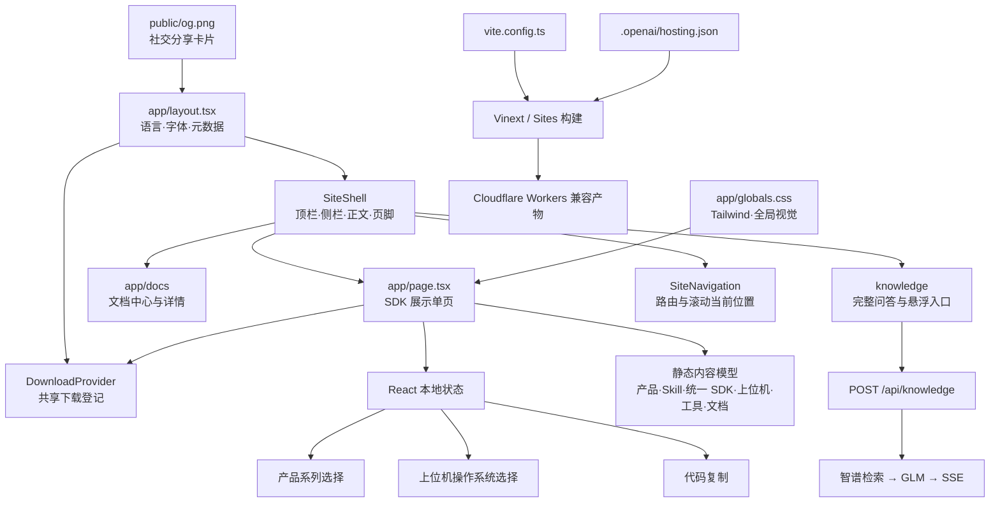

# 架构文档

> 本文档由 Codex 自动生成和维护。最后更新于：2026-10-10

## 1. 项目概述

Shroom Developer 是一个面向传感器与硬件开发者的单页 SDK 展示站。页面按照“选择产品 → 使用 Shroom Skill 快速接入 → 获取统一 SDK → 下载 Shroom 上位机 → 使用工具 → 阅读文档”的路径组织内容。

首页、文档中心、文档详情和 `/knowledge` 问答页通过根布局共用 `SiteShell`：统一 72px 顶栏、240px 左侧导航、正文区域和页脚；窄屏通过同一个“目录”按钮展开导航。文档的本页目录在宽屏右侧展示，窄屏折叠。独立的 `/lab.html` 测试台不套用网站布局。

**当前版本的下载与文档都是真实可用的，不再是骨架**：

- **按语言获取 SDK** —— 首页下载区直接平铺 Python 与 Node.js 两张卡片，各自展示适用场景、下载按钮和使用指南；桌面双列、手机单列。顶栏“获取 SDK”跳至 `/#downloads`，不再弹出语言选择。点击具体语言按钮后复用下载登记。构建从 `sdk/` 生成 `shroom-sdk-python.zip` 和 `shroom-sdk-node.zip`；Node 包含浏览器入口和 Python 说明，但不含 Python 源码。Python 包包含 `python/` 源码、示例、测试、README 和专用 AI 上下文，Python 3.10+ 用 pip 安装。旧的 `shroom-sdk.zip` 完整包继续保留，兼容已有链接。不按操作系统分 SDK 包。
- **Windows 上位机** —— **Shroom Monitor（串口监视器）**，只做四件事：连接串口、看原始字节、
  看帧、看实时热力图，**不做曲线 / 回放 / 报表 / 算法 / 授权**，和 SDK 的能力边界一致。
  免安装 zip，工程在同级独立目录 `../shroom-monitor`。
  版本 / 体积 / SHA-256 来自 `app/desktop-release.json`，
  由 `scripts/sync-desktop-release.mjs` 从包本身算出。macOS / Linux 尚未打包，页面上是灰态「即将发布」。
- **文档中心** —— `/docs` 与 `/docs/:slug` 在构建期由 `scripts/build-docs.mjs` 把 `sdk/*.md` 和 `sdk/python/README.md`
  预渲染成 HTML，运行时不读磁盘。
- **网页测试台** —— `public/lab.html`，浏览器直连串口看数据。
- **后端连接 SDK** —— Node.js / 浏览器新增 `BackendSdkClient`，通过 HTTP/WS 查询和控制已运行的主项目后端，接收原始实时 JSON 帧；不是内置采集服务器，也不要求 Shroom Monitor 提供 HTTP 接口。下载包内包含源码、类型、只读示例与 `BACKEND.md`，文档站入口为 `/docs/backend`；Python 包本次不变。
- **手套体验站** —— 外链到独立部署的 <https://glove.jq-industries.io/>。
- **获取登记** —— 下载前弹窗收集姓名/手机，POST 到密钥系统的 `/sdk-requests`；
  **登记失败不挡下载**，这不是审批流程。
- **智谱知识问答** —— 从 `ld` 分支恢复检索、流式回答、来源引用和章节跳转，适配当前布局与文档。入口为侧栏/文档中心 `/knowledge` 及全站右下角“问文档”。运行需要服务端智谱配置；当前本地尚未配置真实凭据，未配置时明确返回 503。

仍为占位的只有两处：「点位映射生成器」与「工程验证工具（含力学标定）」，页面上明确标注为灰态「规划中」。

页面 **不提供、也不会提供** kPa / 牛顿等物理单位换算 —— SDK 直连串口给到的是 0~1 相对值，后端客户端则保留后端的原始 JSON 与单位语义，
标定曲线逐台设备不同，不在公开 SDK 范围内。`#capabilities` 里有一块「SDK 里没有这些」把边界写死。

## 2. 技术栈

| 分类 | 技术 | 版本/说明 |
| :--- | :--- | :--- |
| **前端框架** | React / Next.js App Router | React 19.2.6、Next.js 16.2.6 |
| **构建与运行** | Vinext / Vite | Vinext 1.0.0-beta.3、Vite 8.0.13 |
| **样式系统** | Tailwind CSS | Tailwind CSS 4.2.1，配合少量全局 CSS |
| **问答后端** | App Router API / Web Streams | `POST /api/knowledge` 服务端请求智谱，向客户端返回 SSE |
| **数据库** | 无 | `.openai/hosting.json` 未启用 D1 / R2 |
| **编程语言** | TypeScript / TSX / CSS | TypeScript 5.9.3，严格模式 |
| **Python SDK** | Python 3.10+ / setuptools | 核心无第三方运行依赖；串口可选 pySerial >=3.5,<4，图形示例可选 Matplotlib >=3.7,<4 |
| **JS 后端客户端** | 原生 fetch / WebSocket | 浏览器无 Node 依赖；Node 18+，缺少全局 WebSocket 时按需使用 SDK 可选依赖 ws ^8.14.2 |
| **包管理器** | npm | 使用 `package-lock.json` 固定依赖 |
| **部署环境** | OpenAI Sites / Cloudflare Workers | 通过 `@openai/sites-vite-plugin` 与 Cloudflare Vite 插件构建，已配置生产站点基址 |
| **其他关键库** | next/font | Geist 与 Geist Mono 字体 |

## 3. 目录结构

```text
shroomSDKWEB/
├─ .openai/
│  └─ hosting.json          # Sites 项目及逻辑资源绑定
├─ app/
│  ├─ globals.css           # Tailwind 入口、全局基础样式与背景纹理
│  ├─ layout.tsx            # 页面语言、字体、元数据与统一布局入口
│  ├─ page.tsx              # 单页内容、数据模型与前端交互
│  ├─ SiteShell.tsx         # 首页与文档共用的顶栏/左侧栏/正文/页脚骨架
│  ├─ SiteNavigation.tsx    # 路由与首页滚动高亮、跨页锚点、移动目录
│  ├─ DownloadProvider.tsx  # 下载登记弹窗与 useDownload（具体语言由卡片决定）
│  ├─ downloads.ts         # Python / Node.js / 上位机下载目标和发布元数据
│  ├─ api/knowledge/       # 智谱问答 POST 接口，只在服务端读取密钥
│  ├─ knowledge/           # 共用 SiteShell 的完整问答页及元数据
│  ├─ components/knowledge-* # 会话、悬浮面板、消息引用与文档定位
│  ├─ docs-data.ts         # 当前文档章节类型、查找与关键词匹配
│  ├─ desktop-release.json  # 上位机版本/体积/SHA-256，由脚本生成，禁止手改
│  └─ docs/                 # 文档中心路由（内容构建期生成）
├─ scripts/
│  ├─ build-sdk-bundle.mjs  # 生成 sdk/web/shroom.bundle.js 单文件版
│  ├─ pack-sdk.mjs          # sdk/ → Python、Node.js 和兼容完整包（保留 start.sh 可执行位）
│  ├─ build-docs.mjs        # SDK Markdown（含 Python README）→ 预渲染 HTML，供 /docs 使用
│  └─ sync-desktop-release.mjs  # 上位机包 → public/downloads/ + desktop-release.json
├─ sdk/                     # SDK 源码与文档的事实源，打包进 zip 并生成文档站
│  ├─ backend/              # 环境无关 HTTP/WS 客户端、TypeScript 契约
│  ├─ node/backend.js       # Node 适配器：原生 WebSocket / 按需加载 ws
│  ├─ node/backend-demo.js  # 只读示例，不自动开串口或采集
│  ├─ tests/               # HTTP/WS 回归、真实本地网络、经典脚本及类型测试
│  ├─ BACKEND.md            # 后端连接指南，生成 /docs/backend
│  └─ python/               # Python 独立包：pyproject.toml、src/shroom_sdk、examples、tests、README
├─ public/
│  ├─ favicon.svg           # 站点图标
│  ├─ og.png                # 1200×630 社交分享卡片
│  ├─ lab.html              # 网页测试台（Web Serial 直连设备）
│  ├─ shroom-sdk.zip        # 兼容旧链接的完整构建产物
│  ├─ shroom-sdk-node.zip   # Node.js / 浏览器源码、示例及文档
│  ├─ shroom-sdk-python.zip # Python 独立包，不依赖 Node.js
│  └─ downloads/            # 上位机压缩包，已 gitignore，生产走 Nginx alias
├─ todo/
│  └─ SDK_SKILL_TODO.md     # SDK、手套接入、Skill 与展示站的分阶段待办
├─ ARCHITECTURE.md          # 本架构说明
├─ server/                  # 智谱检索、SSE 代理与问答/路由回归测试
├─ .env.example             # 智谱服务端变量示例，无真实密钥
├─ DEPLOY.md                # 部署、上位机发版流程与 Nginx 配置
├─ SDK_PAID_STRATEGY.md     # 基础/付费 SDK 的能力边界、定价、支付、授权与实施方案
├─ deploy.sh                # 服务器一键部署：装依赖 → 构建 → 重启 PM2 → 健康检查
├─ ecosystem.config.cjs     # PM2 进程配置（fork 单实例，只监听 127.0.0.1）
├─ eslint.config.mjs        # ESLint 配置
├─ next.config.ts           # Next.js 配置
├─ package.json             # 脚本与依赖
├─ package-lock.json        # npm 锁文件
├─ tsconfig.json            # TypeScript 配置
└─ vite.config.ts           # Vinext、Sites、Tailwind 与 Worker 构建配置
```

上位机是**同级的独立工程**，不在这个仓库里：

```text
C:/project/ShroomConstruction/
├─ shroomSDKWEB/            # 本仓库（站点 + SDK 事实源）
└─ shroom-monitor/          # Shroom Monitor，Electron 串口监视器，独立工程
   ├─ main/                 # 主进程：窗口 + 串口 + IPC（只搬字节，不拆帧）
   ├─ renderer/             # 界面；vendor/shroom.bundle.js 由 scripts/sync-sdk.mjs 从本仓库拷入
   └─ dist/                 # ShroomMonitor-<版本>-win-x64.zip
```

两边靠 `sdk/web/shroom.bundle.js` 连着：上位机的拆帧、解帧、热力图**全部复用站点这份 SDK**，
拷贝而不是重写，保证 SDK 只有一个事实源。

### 关键目录说明

| 目录 | 主要功能 |
| :--- | :--- |
| `/app` | App Router 页面、根布局、站点级样式与上位机发布元数据 |
| `/scripts` | 构建期脚本：打 SDK zip、预渲染文档、同步上位机压缩包 |
| `/sdk` | SDK 源码与 `AI-CONTEXT.md` 等文档的**唯一事实源**，zip 和文档站都从这里生成 |
| `/public` | 静态资源、网页测试台、SDK zip 与上位机压缩包 |
| `/.openai` | OpenAI Sites 部署项目标识与逻辑资源声明 |
| `/todo` | 记录 SDK 事实源、手套接入闭环、Shroom Skill 和展示站真实业务接入的待办与验收标准 |

## 4. 核心模块与数据流

### 4.1 模块关系图



### 4.2 主要数据流

1. **产品资源定位**
   - 用户选择产品系列。
   - `activeProduct` 在本地更新，`useMemo` 得到当前产品信息。
   - 页面展示对应的规格书、SDK、网页测试或 Mapping 资源入口。
2. **Shroom Skill 推荐接入**
   - 页面突出展示 Skill 所包含的设备协议、统一 SDK 接口、Mapping 规则和示例上下文。
   - 用户按“安装 Skill → 描述设备与目标 → 生成并验证接入”的三步路径开始开发。
3. **统一 SDK 与上位机资源**
   - 首页“获取上位机”通过 `#desktop-downloads` 平滑滚动到上位机标题与平台选择区域，预留固定导航栏的滚动偏移；选择下载按钮后才进入下载登记流程。
   - SDK 下载区直接展示 Python / Node.js 两张卡片，对应独立 ZIP、适用场景和语言指南；Node.js 包附浏览器入口。点击卡片上的下载按钮，未登记用户进入表单，已登记用户直接下载。顶栏入口仅定位下载区，无语言选择弹窗。
   - `activePlatform` 驱动上位机卡片：Windows 显示真实版本、体积、更新日志、SHA-256 与下载按钮；
     macOS / Linux 为 `status: 'planned'`，渲染成不可点的「即将发布」，**不挂假文件名**。
4. **手动接入与代码复制**
   - 示例代码以静态内容呈现。
   - 复制按钮通过 Clipboard API 写入剪贴板并显示短暂反馈；SHA-256 复用同一套复制反馈。
5. **下载登记**
   - 根布局的 `DownloadProvider` 管理 SDK 与 Windows 上位机共用登记弹窗，首页语言卡片与上位机按钮通过 `useDownload()` 触发；所有页面顶栏改为下载区锚点。`downloads.ts` 统一维护语言卡片与下载目标（`gateTarget` 记住是谁触发的），
     标题、副标题、登记来源 `source` 随触发方切换。
   - 提交后 POST 到密钥系统的 `/sdk-requests`，来源为 `sdk-python` / `sdk-node` / `desktop-win`。**登记成功失败均放行下载**（8 秒超时），写入 `localStorage` 后下次点击具体版本直接下载。原生 dialog 约束焦点、阻止背景交互，支持 Esc / 关闭；关闭后可在下载区选另一版本，并保留本次表单草稿。
6. **全站导航与响应式布局**
   - `SiteNavigation` 按“了解 SDK / 接入与下载 / 工具与文档”组织入口，所有页面共用同一菜单顺序：首页按概览 → 产品 → 能力 → Skill → SDK 下载 → 上位机 → 快速开始 → 工具 → 文档与示例的正文顺序滚动高亮；文档页根据路由标记当前位置，首页区域链接解析为 `/#区域`，文档入口指向 `/docs`，Python 指南指向 `/docs/python`。
   - >=1024px 显示固定 240px 侧栏，正文使用同宽左外边距；顶栏仅保留品牌、当前区域与主要操作。Hero 双栏在 >=1280px 启用，避免侧栏挤压内容。
   - 原生锚点保留深链接和浏览器前进/后退；通过 requestAnimationFrame 合并滚动更新，按区域位置设置 `aria-current`，不在滚动时改写历史。点击锚点不提前选中目标项，平滑滚动途中的高亮也始终跟随实际位置；页尾不足一屏时仍激活最后的文档区域。
   - 移动端目录支持展开/收起、Esc 关闭并返回按钮焦点、选中后聚焦目标内容、失焦与外部点击关闭；展开期间禁止背景滚动。保留跳过导航入口、键盘焦点样式和 reduced-motion 行为。
   - `layout.tsx` 只向客户端传入文档路径/标题映射，不导入整篇文档到导航客户端模块；文档仍由服务端页面渲染。每页仅有一个顶栏、主内容区和页脚，旧的 `DocHeader` 已由共享组件替代。
   - 文档详情的本页目录在 >=1280px 右侧 sticky 展示，较窄屏幕使用原生 details 折叠；文章、代码块和表格保留独立溢出处理，文章锚点与跨页入口预留顶栏偏移。

### 4.3 Python SDK 数据流与交付

- `sdk/python/src/shroom_sdk/device.py` 使用 pySerial 读取字节，经过 `framer.py` 拆帧和长度锁定，再由 `frame.py` 解析成 `Frame`。模拟设备走同一解码路径。
- 采用同步 `read_frame(timeout)` / `frames()` / 迭代器读取和 `with` 管理生命周期，无后台采集线程。核心导入与 Mock 不要求 pySerial，依赖在真实串口调用时加载。
- `Frame` 使用 bytes 原始快照、array('f') 数值、点数/重心/统计和 Unix 毫秒时间戳，支持 raw/mat32/自定义排列。跨语言测试调用现有 JS 实现验证数值与拆帧一致。
- `python -m shroom_sdk` 提供串口枚举、模拟/实机运行、有限帧数和 JSON 输出；`examples/heatmap.py` 是可选 Matplotlib 图形示例。
- 通过 pip 本地安装或构建 wheel/sdist，尚未发布 PyPI。官网 `/docs/python` 展示专门指南；Python ZIP 和兼容完整 ZIP 携带源码、配置、示例和测试，排除虚拟环境、字节码、egg-info 与构建产物。独立 Python 包不含 JS 事实源，其跨语言对照测试自动跳过；在完整仓库仍执行。

### 4.4 智谱知识问答

- 历史实现来自 `ld` 的 `4faecb8` / `995e963`；只迁回问答模块，不覆盖当前首页、SDK 或布局。完整页和悬浮面板共用 `useKnowledgeChat`，支持 SSE、停止、清空、错误提示和来源引用；悬浮会话仅存于浏览器 sessionStorage，最多保留 20 条，不存数据库。
- `server/zhipu-knowledge.ts` 先请求知识库 retrieve，再把有限的命中文段送给 GLM。无命中时不调用模型。服务端归一化来源并过滤非 HTTP(S) 链接，限制问题 1000 字符、历史 8 条、上下文 12000 字符。
- API 拒绝跨 Origin 请求，限制实际请求体 64 KiB，智谱请求 60 秒超时；API Key 不进入浏览器或 SDK 下载包。缺少 Key / Knowledge ID 返回 `KNOWLEDGE_NOT_CONFIGURED`，不提供模拟答案。
- `build-docs.mjs` 同时生成轻量 `app/docs/catalog.generated.ts`，只把章节元数据交给客户端。模型章节标识使用 `slug--sN` 避免跨文档重名，实际链接为 `/docs/:slug#sN`；服务端和客户端均校验目录，不沿用旧分支的 Backend 链接。
- 本地文档构建不会自动同步到智谱知识库。管理员仍需上传当前 README、AI 上下文和 Python README；系统提示明确基础 SDK 不含旧版本可能提及的录制回放、CSV、数据库和标定，避免版本混淆。
- 增加 `BACKEND.md` 后，目录自动包含 backend 页面和章节；问答提示区分 JS 的后端客户端、后端服务本身与 Python 能力。知识库需另行上传新文档，构建不会自动上传。
- `npm run test:knowledge` 使用模拟上游测试检索、SSE、来源、安全错误及全部章节链接；未配置凭据时无法验证真实云端问答。公网部署前还需配置入口限流与用量保护，当前接口不是付费授权系统。

### 4.5 已有后端连接客户端

- 从 `E:/ShroomSDK/src/backend/BackendSdkClient.js` 的 HTTP/WS 契约适配为 `sdk/backend/client.js` ES 模块。浏览器使用原生 fetch/WebSocket 和轻量事件监听器，不引入 Node EventEmitter；`sdk/node/backend.js` 为旧版 Node 按需选择可选 `ws`。`sdk/web/index.js`、`sdk/node/index.js` 具名导出，包子路径为 `shroom-sdk/backend`，经典脚本入口为 `Shroom.BackendSdkClient`。
- HTTP 默认 `http://127.0.0.1:19245`，WS 默认 `ws://127.0.0.1:19999`，分别由调用方显式配置；不读取网站环境变量或智谱密钥，也不自动启动后端。Monitor 和开发者网站本身不提供这组设备接口。
- `getContract()` 缓存后端契约并加载接口路径；显式 routes 覆盖不会在刷新时丢失。支持状态查询、设备与展示系统元数据、开关串口和启停采集，控制方法仅显式调用时发送。HTTP 支持 JSON 业务错误、AbortSignal 和默认 10 秒超时；写操作不自动重试。
- 实时连接完成后订阅通道，JSON 批量帧逐条分发，数据不截断、不归一化、不重新排列。后端帧不等于串口 `Frame`，图形接入需按实际后端协议显式适配。断开清理监听与握手定时器，丢弃过时连接事件；可复用客户端，但不自动重连或重放控制命令。
- Node 只读示例 `node node/backend-demo.js` 读取契约/串口状态并订阅，结束时释放连接，不触发设备或采集控制。`npm run test:sdk` 构建经典脚本并运行测试；真实网络测试只使用临时回环 HTTP/WS 服务，不操作实际设备。未验证生产后端、跨域代理与真机链路。
- 构建将本模块和指南打入 Node ZIP 与兼容完整 ZIP，Python ZIP 不增加任何 JS 文件或依赖。浏览器需由后端允许 CORS/Origin，HTTPS 页面配置 HTTPS/WSS；公网鉴权、授权和设备权限由后端负责，本客户端不实现付费许可。

## 5. API 端点

首页与交互组件为客户端组件，文档内容在服务端渲染，共享根布局。下载登记由浏览器直接跨域提交；知识问答通过站内 API 在服务端调用智谱：

| 方法 | 地址 | 用途 |
| :--- | :--- | :--- |
| `POST` | `${NEXT_PUBLIC_SDK_REGISTRY_URL}`（默认 `https://shroom.jq-industries.com/sdk-requests`） | 提交下载登记线索，由密钥系统的 CORS 接口接住 |
| `POST` | `/api/knowledge` | 接受 question / history / page，返回 sources / delta / sections / done / error SSE 事件；调用智谱检索与聊天接口 |

下载登记不参与鉴权，也不阻塞下载。问答的上游鉴权密钥仅在服务端使用。

SDK 后端连接是调用方到**外部主项目后端**的请求，不是新增的网站 API。默认读取 `/api/sdk/contract`、`/api/channels`、`/api/ws/status`、`/api/display-systems`、`/api/serial/ports`、`/api/serial/status`、`/api/sensor/current`；显式控制请求使用 `/api/sensor/type`、`/api/serial/open`、`/api/serial/close`、`/api/collection/start`、`/api/collection/stop`。路径可由后端契约或调用方覆盖。

## 6. 外部依赖与集成

| 服务/库 | 用途 | 集成方式 |
| :--- | :--- | :--- |
| OpenAI Sites | 站点版本管理与托管 | `@openai/sites-vite-plugin` + `.openai/hosting.json` |
| Cloudflare Workers | 托管运行时与本地模拟 | `@cloudflare/vite-plugin` |
| Tailwind CSS | 响应式布局与组件样式 | PostCSS 插件 |
| Clipboard API | 复制快速开始示例 | 浏览器端调用 |
| 智谱 BigModel | 知识库检索与 GLM 回答 | 服务端 Bearer Key，使用知识库 retrieve 与 chat/completions，SSE 代理 |

当前没有数据库、用户认证或付费权益鉴权；外部业务调用为下载登记和智谱问答。

下载的 JS SDK 另提供可选的主项目后端连接能力；网站不会代替用户发起设备控制，也没有开放式转发代理。

## 7. 环境变量

展示页与下载可在无额外变量时运行。下面两个是**构建期注入**的（`NEXT_PUBLIC_` 前缀），
改完必须重新 `npm run build` 才生效，详见 [DEPLOY.md](DEPLOY.md)：

| 变量名 | 描述 | 默认行为 |
| :--- | :--- | :--- |
| `NEXT_PUBLIC_DESKTOP_DOWNLOAD_BASE` | 上位机压缩包所在目录 | `/downloads`，指向 Nginx alias 或 CDN |
| `NEXT_PUBLIC_SDK_REGISTRY_URL` | 下载登记提交地址 | `https://shroom.jq-industries.com/sdk-requests` |

问答需要以下**服务端私密配置**，参考 `.env.example`；本地写入被 Git 忽略的 `.env.local`，改完重启开发服务，生产通过进程环境或托管平台 Secrets 注入：

| 变量名 | 描述 | 默认行为 |
| :--- | :--- | :--- |
| `ZAI_API_KEY` | 智谱 API Key，不得使用 NEXT_PUBLIC_ 前缀 | 缺失则问答返回 503 |
| `ZHIPU_KNOWLEDGE_ID` | 已上传并处理文档的知识库 ID | 缺失则问答返回 503 |
| `ZHIPU_MODEL` | 回答模型 | `glm-4.7-flash` |

构建工具会使用以下非业务变量：

| 变量名 | 描述 | 默认行为 |
| :--- | :--- | :--- |
| `CODEX_SANDBOX` | 在 Codex macOS 沙箱中切换轮询式 HMR | 非 `seatbelt` 时使用常规文件监听 |
| `WRANGLER_WRITE_LOGS` | Wrangler 日志开关 | `false` |
| `WRANGLER_LOG_PATH` | Wrangler 日志目录 | `.wrangler/logs` |
| `MINIFLARE_REGISTRY_PATH` | Miniflare 注册表目录 | `.wrangler/registry` |

## 8. 项目进度

> 记录项目从开始到现在已经完成的所有工作，每次新增追加到末尾。

| 完成日期 | 完成的功能/工作 | 说明 |
| :--- | :--- | :--- |
| 2026-08-25 | SDK 展示页信息架构 | 将原始思维导图重排为产品选择、能力、下载、流程、工具、文档和试用路径 |
| 2026-08-25 | 响应式单页界面 | 完成桌面端与移动端布局、导航和视觉系统 |
| 2026-08-25 | 产品与平台选择 | 支持产品系列和 Windows、macOS、Linux、浏览器 SDK 的本地切换 |
| 2026-08-25 | 开发资源展示 | 加入代码示例、网页测试台、Mapping、AI Skill 与工程验证工具入口 |
| 2026-08-25 | 试用申请演示 | 加入姓名、手机号、邮箱、机构字段与前端提交反馈 |
| 2026-08-25 | 站点分享元数据 | 配置中文标题、描述和 1200×630 品牌分享图 |
| 2026-08-25 | 生产站点发布 | 配置规范链接、生产基址与可解析为绝对地址的分享卡片元数据 |
| 2026-08-25 | Skill 优先接入与资源重构 | 将 Shroom Skill 提升为推荐入口，并拆分统一 SDK 与分平台上位机下载 |
| 2026-08-26 | SDK 与 Skill 实施清单 | 基于手套接入样例整理 SDK 契约、设备描述、Mapping、真实数据、Skill、展示站和发布工作的分阶段 TODO |
| 2026-09-09 | 清理假入口 | 未实现的资源入口改为真实去处或标注「规划中」，不再把「规格书」「Mapping JSON」指到空页面 |
| 2026-09-09 | 网页测试台上线 | `public/lab.html`，Web Serial 直连设备看数据 |
| 2026-09-09 | 文档中心上线 | `scripts/build-docs.mjs` 构建期预渲染 `sdk/*.md`，提供 `/docs` 与 `/docs/:slug` |
| 2026-09-09 | 跨平台说明补全 | README / AI-CONTEXT / 怎么用AI开发 三份文档补齐三系统的启动方式与驱动权限差异 |
| 2026-09-09 | Windows 上位机发布 | 打出 1.1.34 安装包并接入站点，展示版本、体积、更新日志与 SHA-256；macOS / Linux 保持「即将发布」 |
| 2026-09-09 | 下载登记通用化 | SDK 与上位机共用一个登记弹窗，来源区分开，登记失败不阻塞下载 |
| 2026-09-09 | 能力边界显式化 | 首页新增「SDK 里没有这些」，与 SDK 文档中的能力边界表一致，明确不提供 kPa 换算 |
| 2026-09-09 | 产品搜索与手套体验站 | 产品系列搜索框接上真实过滤；接入外部手套体验站 <https://glove.jq-industries.io/> |
| 2026-09-09 | 部署文档 | 新增 `DEPLOY.md`，覆盖上位机打包、同步脚本、Nginx alias 与发版流程 |
| 2026-09-09 | 自研上位机 Shroom Monitor | 新建独立工程 `../shroom-monitor`：Electron + serialport，串口连接、原始字节十六进制视图、帧列表与帧长锁定、实时热力图、HEX/文本发送。渲染层复用 `sdk/web/shroom.bundle.js`，零构建步骤 |
| 2026-09-10 | 点位排列（线序）接入 | 新增 `sdk/core/layout.js`，收录 30 种产品的线序（垫子、坐垫、汽车坐垫 / 靠背、volvo、延锋、沙发、恩迪、整椅坐垫 / 靠背 / 头枕、温度全床、小样垫、触觉足底等），把采集板扫描顺序换成垫子上的实际位置；排列自带行列与扫描点数（1024 或 256），`decodeFrame` 以它为准。**只搬位置不改数值**，高斯柔化 / 压力换算 / 坏点插值一律不收；手套类线序不收录。线序来自 `C:/project/shroom1.0` 的 `openWeb.js` 与 `server.js`，用下标探针提取后逐个比对，30 个全部一致 |
| 2026-09-10 | 下拉框改列产品而不是线序 | `sdk/core/layout.js` 在 30 条线序之上加一层**产品**表（`PRODUCTS` / `getProduct` / `listProducts`），网页测试台与 Shroom Monitor 的下拉改从 `listProducts()` 生成。原来直接列线序名，而线序是按**走线**分的：手部检测 / 小床监测 / 小床检测(数据) / 宠物看护 / mini看护 共用 `mat32`，下拉里写「32×32 压力垫」用户对不上自己那台设备。产品名与顺序照抄公司桌面端「请选择传感器」菜单（`Title.jsx` 的 `allSensorArr` + `App.jsx` 的中文），脚本比对过一字不差。手套类 4 项按既定边界不收；桌面端的「整椅展示」是三块板子接三个串口拼一把椅子，这里一次只连一个口拼不出来，整项不收；`matCol`（小床褥监测）桌面端菜单里本来就没有，也不收。另有 8 项暂不支持（三款触觉上衣、64*64高速、OneStep、小床检测(12B)、14*20高速、轮椅），其中轮椅是因为桌面端会把点位清零，属于改数值，与「只搬位置」的边界冲突。下拉里只写产品名，不带行列后缀。`layout: 'raw'` 的产品（几款「高速」和「正常测试」「人体全身」）必须显式传行列，否则 1024 字节会被按帧长猜成 32×32，而 16*16高速 实际是 16×16 |
| 2026-09-09 | 上位机改为免安装 zip | 站点下载从公司桌面端 `Shroom Setup 1.1.34.exe`（335 MB，带 Python 运行时与授权校验）换成 `ShroomMonitor-0.1.0-win-x64.zip`（103 MB），不出安装器，避开 NSIS「无法关闭」与授权问题 |
| 2026-09-21 | SDK 商业化方案 | 新增基础 Core、私有 Pro 与企业/OEM 三层边界，明确项目年费假设、人工首单流程、支付权益链路、Ed25519 离线许可证、私有交付和防泄漏发布门禁 |
| 2026-10-08 | 首页上位机入口调整 | Hero 区次按钮由获取通用 SDK 改为获取上位机，并接入 Windows 上位机下载登记流程；资源区继续保留独立 SDK 下载入口 |
| 2026-10-08 | 上位机入口滚动定位 | 首页“获取上位机”改为页内锚点链接，平滑滚动至上位机区域，支持先选择平台再下载 |
| 2026-10-08 | Python 基础 SDK | 新增独立 pip 包，支持 pySerial 连接、拆帧、统一 Frame、raw/mat32 排列、Mock、CLI 与可选 Matplotlib 示例；提供 JS 对照与串口回环测试，并纳入统一下载和文档中心 |
| 2026-10-08 | SDK 首页左侧导航 | 顶栏栏目迁移为分组侧栏，新增滚动当前位置、独立 SDK/上位机入口、Python 指南及移动端目录；保留原有下载与接入流程 |
| 2026-10-08 | 左侧目录顺序对齐 | 导航按正文从上到下排序，补齐文档区域定位，并让点击跳转与手动滚动共用当前位置高亮 |
| 2026-10-08 | 一级与二级页面统一布局 | 首页、文档中心及全部文档详情共用顶栏、左侧栏、正文和页脚；下载登记统一管理，文档目录改为右侧/窄屏折叠 |
| 2026-10-09 | SDK 下载语言选择 | 所有获取 SDK 入口先选择 Python / Node.js，交付独立 ZIP，保留完整包旧链接、下载登记与上位机流程；验证解压安装与模拟帧 |
| 2026-10-09 | 智谱问答接回当前布局 | 恢复完整问答页、全站问文档面板和服务端检索/SSE，接入当前 Python/JS 文档目录，添加配置示例和 14 项回归测试；真实云端待配置凭据 |
| 2026-10-09 | SDK 双语言入口直接展示 | Python 与 Node.js 卡片在下载区常驻展示，各自下载与查看指南；移除语言选择弹窗，顶栏获取 SDK 改为跨页锚点，保留登记和上位机流程 |
| 2026-10-10 | JS 后端连接 SDK 集成 | 适配 E 盘 BackendSdkClient 的 HTTP/WS 契约，加入 Node/浏览器/经典脚本入口、类型、只读示例与后端指南；提供超时与连接清理，保持 Python 和直连串口能力不变 |

## 9. 更新日志

| 日期 | 变更类型 | 描述 |
| :--- | :--- | :--- |
| 2026-08-25 | 初始化 | 创建项目架构文档 |
| 2026-08-25 | 新增功能 | 完成 Shroom SDK 展示页首版结构与前端交互 |
| 2026-08-25 | 配置变更 | 绑定 OpenAI Sites 项目并补充生产站点元数据基址 |
| 2026-08-25 | 优化重构 | 强化 Shroom Skill 快速接入说明，明确 SDK 不区分平台、上位机按系统提供 |
| 2026-08-26 | 文档更新 | 新增 SDK、手套接入与 Shroom Skill 分阶段 TODO，并补充对应目录说明 |
| 2026-09-09 | 新增功能 | 网页测试台、文档中心、Windows 上位机下载与通用下载登记弹窗上线 |
| 2026-09-09 | 优化重构 | 能力卡片按 SDK 实际能力重写，补「SDK 里没有这些」边界说明，产品资源入口全部指向真实去处 |
| 2026-09-09 | 文档更新 | 新增 DEPLOY.md；更新本文档第 1、3、4、5、7 节，去掉「前端骨架」「试用申请演示」等过期描述 |
| 2026-09-10 | 新增功能 | 新增 30 种产品的点位排列（线序），网页测试台与 Shroom Monitor 可按下拉选产品，画面位置与实物一致；热力图新增底色选项与上位机同款色标 |
| 2026-09-10 | 优化重构 | 下载登记加上字段校验。表单挂 `noValidate`，**不再用浏览器原生校验气泡**（样式改不了、跟着系统走、看着很旧），改成提交时自己校验、错在哪就在哪个框下面显示一行红字并高亮边框，光标自动落到第一个出错的框。姓名、手机号、邮箱、所在机构**四项全部必填**（原先邮箱和机构是选填），手机号收 11 位国内号（边输边剃掉空格 / 横杠 / `+86`），邮箱查有没有 `@` 和域名。密钥系统 `POST /sdk-requests` 同步做手机号归一化与手机 / 邮箱的格式校验，绕过浏览器也进不了库；那个接口本身仍只强制「姓名 + 至少一个联系方式」，四项必填是表单侧的口径。**只校验格式，不代表号码真实存在**——那要发短信验证，暂未做。校验不通过只是不提交，**通过之后照旧「登记失败也不挡下载」** |
| 2026-09-09 | 优化重构 | Windows 上位机换成自研的 Shroom Monitor（免安装 zip），页面文案去掉新应用没有的「3D 模型映射 / 回放 / CSV 导出 / 授权」；`sync-desktop-release.mjs` 改为按输入文件扩展名产出 `ShroomMonitor-<版本>-win-x64.<ext>`，更新日志改从 `../shroom-monitor/release-notes/` 读 |
| 2026-09-21 | 文档更新 | 新增 `SDK_PAID_STRATEGY.md`，记录免费/付费 SDK 的拆包、定价实验、销售支付、权益授权、合规与分阶段实施决策；本次未修改运行代码 |
| 2026-10-08 | 优化重构 | 首页 Hero 区“获取通用 SDK”入口改为“获取上位机”，点击后打开 Windows 上位机下载弹窗，避免入口文案与实际下载目标不一致 |
| 2026-10-08 | 修复缺陷 | 将首页“获取上位机”行为修正为跳转 `#desktop-downloads`，新增上位机锚点和固定导航栏滚动偏移 |
| 2026-10-08 | 新增功能 | 增加 `sdk/python`、`/docs/python` 和首页 Python 指南入口；SDK 打包排除 Python 缓存/虚拟环境/构建目录，更新 README 与 AI 上下文 |
| 2026-10-08 | 优化重构 | 新增 `HomeNavigation.tsx`，首页改为精简顶栏＋240px 侧栏，补充移动导航、键盘可访问性与正文断点适配；ESLint 排除本地 `work/` 测试产物 |
| 2026-10-08 | 修复缺陷 | 修正目录分组顺序与正文不一致导致高亮上下跳动的问题，移除点击时预选目标项，新增文档区域页内导航 |
| 2026-10-08 | 优化重构 | 根布局引入 SiteShell / SiteNavigation / DownloadProvider，替换独立 DocHeader；统一跨页导航、当前页面标记与下载入口，保留首页锚点顺序及 SDK 交付逻辑 |
| 2026-10-09 | 新增功能 | 下载弹窗增加语言选择与独立 Python / Node.js ZIP，支持返回重选、键盘焦点与移动视口；更新打包脚本和 SDK 安装说明 |
| 2026-10-09 | 新增功能 | 从 ld 恢复智谱问答并适配共享布局与当前文档锚点；新增服务端变量示例、实际请求体上限、超时及回归测试，未配置时明确提示 |
| 2026-10-09 | 优化重构 | SDK 语言选项从弹窗移到首页双卡片；删除通用 SDK 弹窗目标，顶栏链接定位下载区，同步 Python 安装指引与生成产物 |
| 2026-10-10 | 新增功能 | Node.js / 浏览器新增已有后端 HTTP/WebSocket 客户端、测试与 /docs/backend；同步下载包、AI 上下文和问答能力边界，未搬入存储、算法或授权模块 |

---

*此文档旨在提供项目架构快照，具体实现细节请参考源代码。*
