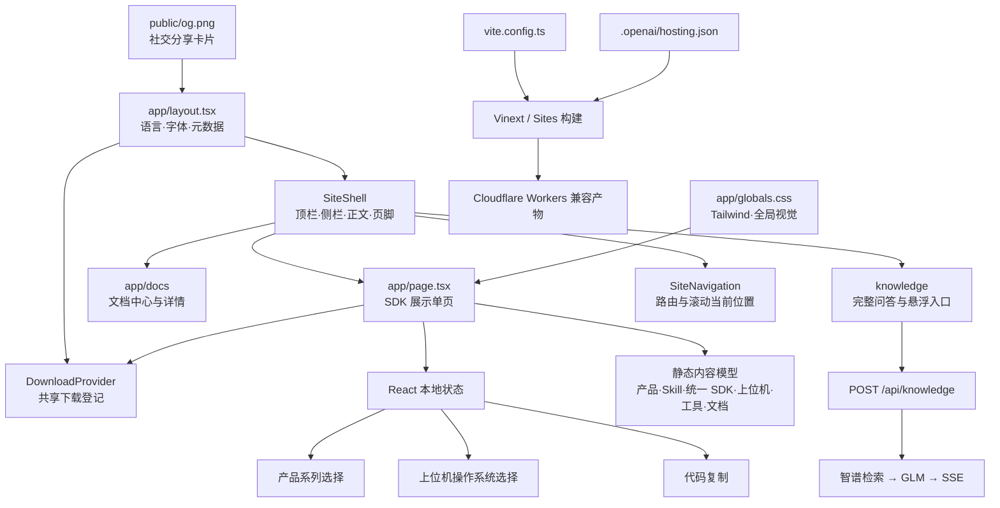

# 架构文档

> 本文档由 Codex 自动生成和维护。最后更新于：2026-10-20

## 1. 项目概述

Shroom Developer 面向已购设备、需要快速集成自有应用的客户。首页突出“开始集成设备”与按语言下载 SDK，标准路径为“确认设备与技术栈 → 安装 SDK → 读取真实产品数据 → 接入自己的程序”；Skill、上位机、网页诊断和展示采集作为按需入口。

首页、文档中心、文档详情和 `/knowledge` 问答页通过根布局共用 `SiteShell`：统一 72px 顶栏、左侧导航、正文区域和页脚；窄屏通过同一个“目录”按钮展开导航。首页与问答侧栏为 240px，文档侧栏为 288px。文档分类和当前文档的章节/API 全部并入左侧层级树，正文不再分出右侧目录；文档顶栏仅显示品牌与当前位置，开发首页、下载和问答入口放在左侧。首页 `.home-shell` / `.home-page` 与文档 `.docs-shell` 使用独立阅读样式，下载登记和既有路由保持兼容。独立的 `/lab.html` 测试台不套用网站布局。

**当前版本的下载与文档都是真实可用的，不再是骨架**：

- **按语言获取 SDK** —— 首页下载区直接平铺 Python 与 Node.js 两张卡片，各自展示适用场景、下载按钮和使用指南；桌面双列、手机单列。顶栏“获取 SDK”跳至 `/#downloads`，不再弹出语言选择。点击具体语言按钮后复用下载登记。构建从 `sdk/` 生成 `shroom-sdk-python.zip` 和 `shroom-sdk-node.zip`；Node 包含浏览器入口和 Python 说明，但不含 Python 源码。Python 包包含 `python/` 源码、示例、测试、README 和专用 AI 上下文，Python 3.10+ 用 pip 安装。旧的 `shroom-sdk.zip` 完整包继续保留，兼容已有链接。不按操作系统分 SDK 包。
- **三平台上位机** —— 首页通过 `app/downloads.ts` 提供用户指定的 Shroom 安装包：Windows 1.1.36 EXE、macOS 1.1.37 ARM64 DMG（仅 Apple Silicon）、Linux 1.1.38 amd64 DEB（仅支持 DEB 的 x86_64 系统）。三个平台均可下载；版本来自文件名，体积来自 2026-10-13 的 HTTPS HEAD 响应。安装包由 `shroom.jq-industries.com/shroom1/` 独立提供，不进入本站 Git 或构建产物。页面不复用旧 Monitor ZIP 的日期、更新日志、签名或授权说明；当前包的功能/授权不由基础 SDK 边界推定。旧 `desktop-release.json` 与同步脚本仅保留用于历史 Monitor 流程，不再驱动首页。
- **文档中心** —— `/docs` 以“集成已购设备”为主面板，按确认产品、运行示例、接入应用三个任务索引，主按钮直达 `/docs/quick-start` 工作台。快速接入页集中提供产品、手侧、Web/Node、采集系统、双平台驱动和完整示例下载，完整示例直接显示，六章接入说明默认展开、支持手动收起，字段、排查、下载独立为参考面板。`/docs/custom` 承接基础自定义，后端参考仍统一在 `/docs/backend`，通过下拉框切换 Node.js / Python；旧链接和语言锚点兼容。`sdk/docs/catalog.json` 统一维护十五篇文档的来源和导航元数据，构建期由 `scripts/build-docs.mjs` 预渲染成 HTML，运行时不读磁盘。
- **完整快速方案** —— Node数据服务广播标准产品帧，浏览器自动分区展示，按标签录制到服务端磁盘并下载CSV/JSONL；页面刷新可找回记录。提供真实与合成产品示例，source明确区分模拟数据；细节见4.9。
- **网页测试台** —— `public/lab.html`，浏览器直连串口看数据。
- **串口接入可靠性** —— SDK 按查询 → 配置/连接 → 自动分帧/解码组织接入，配置在打开端口前校验；Node.js / 浏览器和 Python 提供结构化错误、生命周期与诊断快照。JS 额外提供运行时 `onError()`，Python 保持同步异常，不新增后台线程、自动重连或传感器型号识别。
- **按产品直接取数** —— Node.js / 浏览器新增 `connectGlove()`（整包触觉手套）与 `connectHandPad()`（手部检测垫），内置对应波特率、分帧与点位映射，通过一次调用中的 `onData` 直接收取已解析产品数据。保留通用 `connect()` 作为进阶入口；Python 当前仍为通用矩阵 SDK，不宣称已支持手套专用协议。
- **后端连接 SDK** —— Node.js / 浏览器新增 `BackendSdkClient`，通过 HTTP/WS 查询和控制已运行的主项目后端，接收原始实时 JSON 帧；不是内置采集服务器，也不要求 Shroom Monitor 提供 HTTP 接口。下载包内包含源码、类型、只读示例与 `BACKEND.md`，API 参考入口为 `/docs/backend-api`，后端统一指南为 `/docs/backend`；Python 包本次不变。
- **手套体验站** —— 外链到独立部署的 <https://glove.jq-industries.io/>。
- **获取登记** —— 下载前弹窗收集姓名/手机，POST 到密钥系统的 `/sdk-requests`；
  **登记失败不挡下载**，这不是审批流程。
- **智谱知识问答** —— 从 `ld` 分支恢复检索、流式回答、来源引用和章节跳转，适配当前布局与文档。入口为侧栏/文档中心 `/knowledge` 及全站右下角“问文档”。运行需要服务端智谱配置；当前本地尚未配置真实凭据，未配置时明确返回 503。

仍为占位的只有两处：「点位映射生成器」与「工程验证工具（含力学标定）」，页面上明确标注为灰态「规划中」。

页面 **不提供、也不会提供** kPa / 牛顿等物理单位换算 —— SDK 直连串口给到的是 0~1 相对值，后端客户端则保留后端的原始 JSON 与单位语义，
标定曲线逐台设备不同，不在公开 SDK 范围内。`#capabilities` 里有一块「SDK 里没有这些」把边界写死。

## 2. 技术栈

| 分类 | 技术 | 版本/说明 |
| :--- | :--- | :--- |
| **前端框架** | React / Next.js App Router | React 19.2.6、Next.js 16.2.6 |
| **构建与运行** | Vinext / Vite | Vinext 1.0.0-beta.3、Vite 8.0.13 |
| **样式系统** | Tailwind CSS | Tailwind CSS 4.2.1，配合少量全局 CSS |
| **问答后端** | App Router API / Web Streams | `POST /api/knowledge` 服务端请求智谱，向客户端返回 SSE |
| **数据库** | 无 | `.openai/hosting.json` 未启用 D1 / R2 |
| **编程语言** | TypeScript / TSX / CSS | TypeScript 5.9.3，严格模式 |
| **Python SDK** | Python 3.10+ / setuptools | 核心无第三方运行依赖；串口可选 pySerial >=3.5,<4，图形示例可选 Matplotlib >=3.7,<4 |
| **JS 后端客户端** | 原生 fetch / WebSocket | 浏览器无 Node 依赖；Node 18+，缺少全局 WebSocket 时按需使用 SDK 可选依赖 ws ^8.14.2 |
| **包管理器** | npm | 使用 `package-lock.json` 固定依赖 |
| **部署环境** | OpenAI Sites / Cloudflare Workers | 通过 `@openai/sites-vite-plugin` 与 Cloudflare Vite 插件构建，已配置生产站点基址 |
| **其他关键库** | next/font | Geist 与 Geist Mono 字体 |

## 3. 目录结构

```text
shroomSDKWEB/
├─ .openai/
│  └─ hosting.json          # Sites 项目及逻辑资源绑定
├─ app/
│  ├─ globals.css           # Tailwind 入口、全局基础样式与背景纹理
│  ├─ layout.tsx            # 页面语言、字体、元数据与统一布局入口
│  ├─ page.tsx              # 单页内容、数据模型与前端交互
│  ├─ SiteShell.tsx         # 首页与文档共用的顶栏/左侧栏/正文/页脚骨架
│  ├─ SiteNavigation.tsx    # 路由与首页滚动高亮、跨页锚点、移动目录
│  ├─ DownloadProvider.tsx  # 下载登记弹窗与 useDownload（具体语言由卡片决定）
│  ├─ downloads.ts         # Python / Node.js / 上位机下载目标和发布元数据
│  ├─ api/knowledge/       # 智谱问答 POST 接口，只在服务端读取密钥
│  ├─ knowledge/           # 共用 SiteShell 的完整问答页及元数据
│  ├─ components/knowledge-* # 会话、悬浮面板、消息引用与文档定位
│  ├─ docs-data.ts         # 当前文档章节类型、查找与关键词匹配
│  ├─ desktop-release.json  # 历史 Monitor 元数据；脚本生成，当前首页不使用
│  └─ docs/                 # 文档概览/详情、侧栏、语言切换与元数据
│     ├─ DocOutline.tsx     # 左侧折叠章节/API：中文功能、语言同步与当前位置
│     ├─ use-active-doc-heading.ts # 合并滚动更新、监听语言显隐变化
│     ├─ ProductWorkspace.tsx / .module.css # 产品工作台、折叠指南、参考面板与示例交付
│     ├─ ProductWorkspaceNavigation.tsx / .module.css # 共享侧栏、原生产品下拉与任务导航
│     ├─ product-workspace-model.ts # 配置、URL解析、手侧确认和运行命令的纯状态模型
│     ├─ product-workspace-preview.ts # 未确认实物时的只读核心调用预览
│     ├─ product-workspace-state.tsx # SSR稳定快照与客户端URL订阅，连接侧栏和正文
│     └─ doc-position.ts    # 可单元测试的标题位置选择逻辑
├─ scripts/
│  ├─ build-sdk-bundle.mjs  # 生成 sdk/web/shroom.bundle.js 单文件版
│  ├─ pack-sdk.mjs          # sdk/ → Python、Node.js 和兼容完整包（保留 start.sh 可执行位）
│  ├─ build-docs.mjs        # SDK Markdown（含 Python README）→ 预渲染 HTML，供 /docs 使用
│  └─ sync-desktop-release.mjs  # 历史 Monitor 同步；不修改当前三平台下载配置
├─ sdk/                     # SDK 源码与文档的事实源，打包进 zip 并生成文档站
│  ├─ core/errors.js        # ShroomError、稳定串口错误码、原始异常映射
│  ├─ core/license.js       # SDK产品许可、RSA验签、短时在线复核与运行期失效通知
│  ├─ core/serial-config.js # 连接前参数检查与分配上限
│  ├─ core/serial-diagnostics.js # 查询式诊断快照，与 Mock 共用
│  ├─ core/product.js       # 已核实产品配置、尾分隔流解析、连接前准备
│  ├─ core/glove.js         # 整包手套 256 点压力/195 点展开映射与 IMU 字节拆分
│  ├─ core/glove-regions.js # 用户左右手点位表：五指、独立指腹、非齐行手掌
│  ├─ core/stream-codec.js  # 版本化产品帧JSON编码/TypedArray恢复与校验
│  ├─ node/quick-server.js  # 同端口WS数据、录制控制和HTTP下载
│  ├─ node/recording.js     # 有界文件录制、会话标签、JSONL/CSV与重启恢复
│  ├─ node/quick-demo.js    # 完整真实/合成产品快速服务示例
│  ├─ web/stream.js         # 标准WS客户端、远程录制与附件下载
│  ├─ web/product-view.js   # 自动订阅的二维产品分区展示
│  ├─ web/quick-start.html  # 连接/展示/标签录制/历史下载操作页
│  ├─ node/product-demo.js  # 整包手套、手部检测垫的单函数接入示例
│  ├─ node/license-env.js   # CLI示例授权输入与稳定安装标识，不持久化密钥
│  ├─ examples/product-examples.js # 网页与下载包共用的中文注释示例事实源及类型
│  ├─ examples/generate-product-examples.mjs # 生成根目录六个完整HTML/MJS例程
│  ├─ glove-left-example.html / .mjs # 左手套；右手与手垫同级文件，按实物明确选择
│  ├─ backend/              # 环境无关 HTTP/WS 客户端、TypeScript 契约
│  ├─ node/backend.js       # Node 适配器：原生 WebSocket / 按需加载 ws
│  ├─ node/backend-demo.js  # 只读示例，不自动开串口或采集
│  ├─ tests/               # HTTP/WS 回归、真实本地网络、经典脚本及类型测试
│  ├─ BACKEND.md            # 后端通讯 API 参考，生成 /docs/backend-api
│  ├─ docs/                 # 后端统一指南及 Node、串口、存储、前端通讯、渲染参考
│  │  ├─ BACKEND-GUIDE.md   # 双语言串口/通讯/存储 API 参考，生成 /docs/backend
│  │  ├─ LICENSE.md         # 不限型号的SDK产品许可、电脑名额与期限，生成 /docs/license
│  │  ├─ DRIVERS.md         # Windows/macOS驱动链接、安装前置与串口排查，生成 /docs/drivers
│  │  └─ catalog.json       # 构建与页面侧栏共用的轻量文档元数据
│  └─ python/               # Python 独立包：pyproject.toml、src/shroom_sdk、examples、tests、README
├─ public/
│  ├─ favicon.svg           # 站点图标
│  ├─ og.png                # 1200×630 社交分享卡片
│  ├─ lab.html              # 网页测试台（Web Serial 直连设备）
│  ├─ shroom-sdk.zip        # 兼容旧链接的完整构建产物
│  ├─ shroom-sdk-node.zip   # Node.js / 浏览器源码、示例及文档
│  ├─ shroom-sdk-python.zip # Python 独立包，不依赖 Node.js
│  └─ downloads/            # 历史上位机包，已 gitignore；当前安装包走外部下载站
├─ todo/
│  └─ SDK_SKILL_TODO.md     # SDK、手套接入、Skill 与展示站的分阶段待办
├─ docs/obsidian/
│  └─ Shroom-当前系统结构.md # 快速/基础路线、运行链路、产品数据和能力边界快照
├─ outputs/layout-discussion-2026-10-19/ # 本地产品开发中心原型与评审产物，不参与生产路由
│  ├─ product-workspace.html # 产品/手侧/环境配置、驱动前置、完整示例、验收与问题恢复
│  ├─ product-workspace-examples.js # 按配置生成浏览器/Node完整取数示例或核心片段
│  └─ product-workspace*.test.mjs # 非UI配置回归与生成示例的模拟SDK生命周期验证
├─ ARCHITECTURE.md          # 本架构说明
├─ server/                  # 智谱检索、SSE 代理与问答/路由回归测试
├─ .env.example             # 智谱服务端变量示例，无真实密钥
├─ DEPLOY.md                # 部署、上位机发版流程与 Nginx 配置
├─ SDK_PAID_STRATEGY.md     # 基础/付费 SDK 的能力边界、定价、支付、授权与实施方案
├─ deploy.sh                # 服务器一键部署：装依赖 → 构建 → 重启 PM2 → 健康检查
├─ ecosystem.config.cjs     # PM2 进程配置（fork 单实例，只监听 127.0.0.1）
├─ eslint.config.mjs        # ESLint 配置
├─ next.config.ts           # Next.js 配置
├─ package.json             # 脚本与依赖
├─ package-lock.json        # npm 锁文件
├─ tsconfig.json            # TypeScript 配置
└─ vite.config.ts           # Vinext、Sites、Tailwind 与 Worker 构建配置
```

旧 Shroom Monitor 是**同级的独立工程**，不在这个仓库里；以下为历史工程结构，不代表当前三平台 Shroom 安装包的源码或发布流程：

```text
C:/project/ShroomConstruction/
├─ shroomSDKWEB/            # 本仓库（站点 + SDK 事实源）
└─ shroom-monitor/          # Shroom Monitor，Electron 串口监视器，独立工程
   ├─ main/                 # 主进程：窗口 + 串口 + IPC（只搬字节，不拆帧）
   ├─ renderer/             # 界面；vendor/shroom.bundle.js 由 scripts/sync-sdk.mjs 从本仓库拷入
   └─ dist/                 # ShroomMonitor-<版本>-win-x64.zip
```

历史 Monitor 和本站靠 `sdk/web/shroom.bundle.js` 连着：Monitor 的拆帧、解帧、热力图**全部复用站点这份 SDK**，
拷贝而不是重写，保证 SDK 只有一个事实源。

### 关键目录说明

| 目录 | 主要功能 |
| :--- | :--- |
| `/app` | App Router 页面、根布局、站点级样式与上位机发布元数据 |
| `/scripts` | 构建期脚本：打 SDK zip、预渲染文档、同步上位机压缩包 |
| `/sdk` | SDK 源码与 `AI-CONTEXT.md` 等文档的**唯一事实源**，zip 和文档站都从这里生成 |
| `/public` | 静态资源、网页测试台和 SDK zip；当前三平台上位机安装包不存放于此 |
| `/.openai` | OpenAI Sites 部署项目标识与逻辑资源声明 |
| `/todo` | 记录 SDK 事实源、手套接入闭环、Shroom Skill 和展示站真实业务接入的待办与验收标准 |

## 4. 核心模块与数据流

### 4.1 模块关系图



### 4.2 主要数据流

1. **产品资源定位**
   - 用户选择产品系列。
   - `activeProduct` 在本地更新，`useMemo` 得到当前产品信息。
   - 页面展示对应的规格书、SDK、网页测试或 Mapping 资源入口。
2. **Shroom Skill 推荐接入**
   - 页面突出展示 Skill 所包含的设备协议、统一 SDK 接口、Mapping 规则和示例上下文。
   - 用户按“安装 Skill → 描述设备与目标 → 生成并验证接入”的三步路径开始开发。
3. **统一 SDK 与上位机资源**
   - 首页“获取上位机”通过 `#desktop-downloads` 平滑滚动到上位机标题与平台选择区域，预留固定导航栏的滚动偏移；选择下载按钮后才进入下载登记流程。
   - SDK 下载区直接展示 Python / Node.js 两张卡片，对应独立 ZIP、适用场景和语言指南；Node.js 包附浏览器入口。点击卡片上的下载按钮，未登记用户进入表单，已登记用户直接下载。顶栏入口仅定位下载区，无语言选择弹窗。
   - `activePlatform` 从 `DESKTOP_PLATFORMS` 选取上位机卡片，平台按钮用 `aria-pressed` 标记当前选择。三平台显示各自版本、体积、格式、架构与安装提示；下载按钮传入 `selectedPlatform.target`，避免 macOS / Linux 误下 Windows 包。HTTPS 文件由外部下载站提供，不显示未经确认的发布日期、更新日志或哈希。
4. **手动接入与代码复制**
   - 示例代码以静态内容呈现。
   - 复制按钮通过 Clipboard API 写入剪贴板并显示短暂反馈。
5. **下载登记**
   - 根布局的 `DownloadProvider` 管理 SDK 与三平台上位机共用登记弹窗，首页语言卡片与上位机按钮通过 `useDownload()` 触发；首页与问答顶栏、文档左侧菜单的获取 SDK 入口定位下载区。`downloads.ts` 统一维护语言卡片与下载目标（`gateTarget` 记住是谁触发的），
     标题、副标题、登记来源 `source` 随触发方切换。
   - 提交后 POST 到密钥系统的 `/sdk-requests`，来源为 `sdk-python` / `sdk-node` / `desktop-win` / `desktop-macos` / `desktop-linux`，上位机版本沿用 `sdkVersion` 字段。**登记成功失败均放行下载**（8 秒超时），写入 `localStorage` 后下次点击具体版本直接下载。原生 dialog 约束焦点、阻止背景交互，支持 Esc / 关闭；关闭后可在下载区选另一版本，并保留本次表单草稿。跨域安装包的实际下载行为由下载站响应头决定。
6. **全站导航与响应式布局**
   - 首页与问答页的 `SiteNavigation` 按“了解 SDK / 接入与下载 / 工具与文档”组织入口，首页概览 → 产品 → 能力 → Skill → SDK 下载 → 上位机 → 快速开始 → 工具按正文位置滚动高亮；文档中心是直接进入 `/docs` 的路由链接，不混入页内滚动目录。`/docs` 和所有详情页切换到 `DocsNavigation` 的快速接入/基础与自定义路线树，后端/前端为基础路线的参考分类，保持共用布局与移动端目录交互。
   - >=1024px 显示固定侧栏：首页与问答 240px，文档 288px，正文与页脚使用对应左外边距；顶栏保留品牌、当前区域，文档的页面/下载入口统一放入左侧。首页 Hero 在 >=1180px 使用双栏，左侧为集成主动作，右侧为标明环境的 Node.js 产品接口示例；不再展示虚构连接状态或固定帧率。
   - 原生锚点保留深链接和浏览器前进/后退；通过 requestAnimationFrame 合并滚动更新，按区域位置设置 `aria-current`，不在滚动时改写历史。点击锚点不提前选中目标项，平滑滚动途中的高亮也始终跟随实际位置；页尾不足一屏时仍激活最后的页内导航项。
   - 移动端目录支持展开/收起、Esc 关闭并返回按钮焦点、选中后聚焦目标内容、失焦与外部点击关闭；展开期间禁止背景滚动。保留跳过导航入口、键盘焦点样式和 reduced-motion 行为。
   - `layout.tsx` 只向客户端传入文档路径/标题与轻量 TOC 映射，不导入整篇文档到导航客户端模块；文档仍由服务端页面渲染。每页仅有一个顶栏、主内容区和页脚，旧的 `DocHeader` 已由共享组件替代。
   - 文档概览和详情采用统一 `docs-page` / 单列 `docs-grid`，正文最大阅读宽度 800px、正文基准字号 16px；分类和章节/API 保留左置，并以“本页章节”区分文章目录。手机复用“目录”菜单，表格/代码独立横向滚动。文档概览三步面板在窄屏纵向排列，展示采集通过原生 details 按需展开。
   - `DocOutline` 通过 `useActiveDocHeading` 跟随实际标题位置高亮，以 requestAnimationFrame 合并 scroll / resize / hashchange，隐藏语言不参与选择。h2 章节使用默认全部展开的原生 details，h3 函数以中文功能名和英文接口副标题显示；用户仍可用箭头或键盘手动收起。滚动不重新展开已收起的章节，定位时使用该章节的 summary 而不是隐藏链接，仅调整左侧 scrollTop；不移动正文或键盘焦点，不改写历史。此默认行为共用于后端双语言、前端与辅助参考文档；移动端外层“目录”菜单仍默认关闭。

### 4.3 Python SDK 数据流与交付

- `sdk/python/src/shroom_sdk/device.py` 使用 pySerial 读取字节，经过 `framer.py` 拆帧和长度锁定，再由 `frame.py` 解析成 `Frame`。模拟设备走同一解码路径。
- 采用同步 `read_frame(timeout)` / `frames()` / 迭代器读取和 `with` 管理生命周期，无后台采集线程。核心导入与 Mock 不要求 pySerial，依赖在真实串口调用时加载。
- `errors.py` 提供 `ShroomError` 及兼容 ValueError / OSError / ImportError 等既有捕获方式的子类；包含 code、stage、suggestion、details 与 cause。配置在导入 pySerial / 打开设备前校验，超时仍返回 None。`state` 与 `get_diagnostics()` 提供状态及累计计数，诊断不包含原始异常对象。关闭失败不再被吞掉；`with` 内已有业务异常时保留原异常，并记录关闭故障。
- `Frame` 使用 bytes 原始快照、array('f') 数值、点数/重心/统计和 Unix 毫秒时间戳，支持 raw/mat32/自定义排列。跨语言测试调用现有 JS 实现验证数值与拆帧一致。
- `python -m shroom_sdk` 提供串口枚举、模拟/实机运行、有限帧数和 JSON 输出；`examples/heatmap.py` 是可选 Matplotlib 图形示例。
- 通过 pip 本地安装或构建 wheel/sdist，尚未发布 PyPI。官网主入口 `/docs/backend?language=python` 展示统一后端指南的 Python 示例，`/docs/python` 保留完整 API 参考；Python ZIP 和兼容完整 ZIP 携带源码、配置、示例和测试，排除虚拟环境、字节码、egg-info 与构建产物。独立 Python 包不含 JS 事实源，其跨语言对照测试自动跳过；在完整仓库仍执行。

### 4.4 智谱知识问答

- 历史实现来自 `ld` 的 `4faecb8` / `995e963`；只迁回问答模块，不覆盖当前首页、SDK 或布局。完整页和悬浮面板共用 `useKnowledgeChat`，支持 SSE、停止、清空、错误提示和来源引用；悬浮会话仅存于浏览器 sessionStorage，最多保留 20 条，不存数据库。
- `server/zhipu-knowledge.ts` 先请求知识库 retrieve，再把有限的命中文段送给 GLM。无命中时不调用模型。服务端归一化来源并过滤非 HTTP(S) 链接，限制问题 1000 字符、历史 8 条、上下文 12000 字符。
- API 拒绝跨 Origin 请求，限制实际请求体 64 KiB，智谱请求 60 秒超时；API Key 不进入浏览器或 SDK 下载包。缺少 Key / Knowledge ID 返回 `KNOWLEDGE_NOT_CONFIGURED`，不提供模拟答案。
- `build-docs.mjs` 同时生成轻量 `app/docs/catalog.generated.ts`，只把章节元数据交给客户端。模型章节标识使用 `slug--sN` 避免跨文档重名，实际链接为 `/docs/:slug#sN`；服务端和客户端均校验目录，不沿用旧分支的 Backend 链接。
- 本地文档构建不会自动同步到智谱知识库。管理员仍需上传当前 README、AI 上下文、快速指南和 Python README；系统提示区分Node/浏览器新快速服务及标签录制下载、旧BackendSdkClient与Python基础能力，不再错误否认现有产品协议；数据库、回放、标定和三维手模仍不由SDK提供。
- 增加 `BACKEND.md` 后，目录自动包含 backend 页面和章节；问答提示区分 JS 的后端客户端、后端服务本身与 Python 能力。知识库需另行上传新文档，构建不会自动上传。
- `npm run test:knowledge` 使用模拟上游测试检索、SSE、来源、安全错误及全部章节链接；未配置凭据时无法验证真实云端问答。公网部署前还需配置入口限流与用量保护，当前接口不是付费授权系统。

### 4.5 已有后端连接客户端

- 从 `E:/ShroomSDK/src/backend/BackendSdkClient.js` 的 HTTP/WS 契约适配为 `sdk/backend/client.js` ES 模块。浏览器使用原生 fetch/WebSocket 和轻量事件监听器，不引入 Node EventEmitter；`sdk/node/backend.js` 为旧版 Node 按需选择可选 `ws`。`sdk/web/index.js`、`sdk/node/index.js` 具名导出，包子路径为 `shroom-sdk/backend`，经典脚本入口为 `Shroom.BackendSdkClient`。
- HTTP 默认 `http://127.0.0.1:19245`，WS 默认 `ws://127.0.0.1:19999`，分别由调用方显式配置；不读取网站环境变量或智谱密钥，也不自动启动后端。Monitor 和开发者网站本身不提供这组设备接口。
- `getContract()` 缓存后端契约并加载接口路径；显式 routes 覆盖不会在刷新时丢失。支持状态查询、设备与展示系统元数据、开关串口和启停采集，控制方法仅显式调用时发送。HTTP 支持 JSON 业务错误、AbortSignal 和默认 10 秒超时；写操作不自动重试。
- 实时连接完成后订阅通道，JSON 批量帧逐条分发，数据不截断、不归一化、不重新排列。后端帧不等于串口 `Frame`，图形接入需按实际后端协议显式适配。断开清理监听与握手定时器，丢弃过时连接事件；可复用客户端，但不自动重连或重放控制命令。
- Node 只读示例 `node node/backend-demo.js` 读取契约/串口状态并订阅，结束时释放连接，不触发设备或采集控制。`npm run test:sdk` 构建经典脚本并运行测试；真实网络测试只使用临时回环 HTTP/WS 服务，不操作实际设备。未验证生产后端、跨域代理与真机链路。
- 构建将本模块和指南打入 Node ZIP 与兼容完整 ZIP，Python ZIP 不增加任何 JS 文件或依赖。浏览器需由后端允许 CORS/Origin，HTTPS 页面配置 HTTPS/WSS；公网鉴权、授权和设备权限由后端负责，本客户端不实现付费许可。

### 4.6 文档分类与生成

- `sdk/docs/catalog.json` 是文档 slug、源文件、摘要、分类、导航名称和可见性的事实源；`app/docs/structure.ts` 只读取轻量元数据，供概览、侧栏、面包屑和同类推荐共用。整篇 HTML/Markdown 不进入分类侧栏的客户端依赖。
- 后端主入口只有 `/docs/backend`，来源为 `sdk/docs/BACKEND-GUIDE.md`。左侧后端下的串口、通讯、存储链接直接定位同一篇的稳定锚点；`/docs/python`、`/docs/node`、`/docs/serial`、`/docs/storage` 保留为详细参考，不重复出现在主目录。原 HTTP/WS 原文 `BACKEND.md` 改由 `/docs/backend-api` 提供，站内源文件引用自动改写至此。
- `BackendGuide` 接收服务端渲染的正文和 Markdown，下拉框控制 `data-sdk-language` 代码块、说明和本页目录条目的显隐；公共标题保持共享。`?language=python|node` 支持下载区指南直达所选语言与刷新保留，切换时更新当前 URL 并保留 hash；复制按钮只复制当前语言和共享内容。Python 通讯章节明确未交付 HTTP/WS 客户端，不虚构 Python SDK 接口。
- 前端保持通讯 / 渲染分类，辅助指南保持原入口。详情通过面包屑显示分类，底部最多展示三篇可见同类文档；没有推荐时不显示空区块。本页目录和问答浮窗继续复用。
- 四篇核心文档（后端主指南、BackendSdkClient、前端通讯、渲染）改为逐接口参考，覆盖串口、Mock、拆帧、解码、点位/产品配置、HTTP/WS、Frame 转换及 Canvas/色图接口。存储区明确 JSONL 为应用侧示例，不声称 SDK 自带数据库或录制回放。文档版本标识读取 SDK package.json，不新增或改写 SDK 运行接口。
- 清单的 `tocDescriptions` 按稳定锚点维护中文功能说明，构建校验目标标题和描述并生成 `DocToc.description`。左侧章节/API 目录以中文功能为主、英文 API 名为辅，正文标题、复制原文和跳转锚点保持不变；问答章节关键词包含功能说明，方便用中文查找接口。
- 文档详情保持服务端渲染文章，根布局把轻量 TOC 交给 `DocsNavigation` / `DocOutline`；当前文档的章节嵌入对应分类，隐藏旧参考页仍在左侧提供自己的功能目录。`BackendGuide` 通过局部 Context 将当前语言和原文交给标题下方的工具栏，并在更新 URL 后发出 `shroom:backend-language-change` 事件。左侧目录用 useSyncExternalStore 订阅语言与 popstate，服务端首屏通过 useSearchParams 保持 Python 深链接一致，不把 Markdown 文章变为客户端渲染。布局复用 React / Tailwind，无需引入 Ant Design 组件库。
- 构建从清单读取源文件，校验 slug 与分类，按源文件目录解析 Markdown 相对链接并保留 query/hash。h2 / h3 支持 `{#id}` 稳定锚点并校验唯一性，清单章节必须匹配正文 h2；目录条目记录语言，问答链接自动携带语言参数。回归测试覆盖导航单入口、标题层级、正文/目录语言隔离、有效锚点以及 BackendSdkClient 全部声明方法的文档覆盖。
- 新指南随 Node 与兼容完整 ZIP 交付，Python 独立 ZIP 的内容保持原有范围。首页产品、Skill、模拟体验、下载登记与上位机流程沿用现有实现。
- 快速文档的 `#device` 优先提供独立 `device.mjs` 产品取数例程，覆盖 onData、onError、取消订阅和关闭；原 `server.mjs` 保留为可选网页分发与录制分支，两者不同时占用同一设备。完整七步的原 section、步骤、录制起停分组和按记录 ID 下载语义保持不变，正文中的七步面板默认折叠；所有既有章节锚点保留。
- 首页减少等权重宣传区：Skill 改为辅助说明，测试台内嵌画面默认折叠，主要动作指向设备集成和 SDK 下载；产品系列选择保持原有资源列表，不宣称已实现具体型号/版本筛选。首页代码示例、文档概览和快速文档统一使用产品取数路线，SDK 运行接口未变更。
- 文档概览把集成主按钮放在三步说明之前，手机无需读完步骤再找入口；悬浮文档问答采用低强调白底，窄屏缩为带可访问名称的 AI 按钮，保持原对话和关闭行为。

### 4.7 串口查询、配置、解析与错误诊断

- Node 使用 `listPorts()` 查询系统端口，未传 path 时保持原有选择第一个端口的行为；浏览器由用户手势调用授权选择器，不伪装成全设备枚举。Python 保持仅一个端口时自动选择、多端口要求明确 path；查询结果不是自动识别传感器型号。
- `serial-config.js` 在连接前校验波特率、分隔符、帧长、矩阵、满量程与阈值；分隔符限制 1–64 字节，矩阵/帧长上限 1,048,576，防止错误配置导致巨大分配。保留已有配置名、分帧锁定与 JS 未知线序回退 raw 的约定，不新增底层串口配置项。
- 实机字节流依次进入 `createFramer()` → `decodeFrame()` → `Frame` → 应用订阅；Mock 直接生成 payload 并复用解码，不经过串口分帧。应用 `onFrame` 抛错会生成 CALLBACK_FAILED，但不会阻断其他同步订阅。
- JS Node / 浏览器 / Mock 共用 `ShroomError`、`onError()`、`state` 和 `getDiagnostics()`；连接前故障通过 Promise 拒绝，连接后的读取/解析/断开故障通知订阅并清理资源，关闭幂等且关闭失败可观察。状态为 open / closed / error；故障清理后保留 error，诊断保留最后错误，不自动重连。
- 保留 JS 连接后修改原配置对象进行解码热切换的行为，传输与分帧参数仍在连接时确定。Node 示例输出结构化错误与建议；网页测试台用现有状态区展示错误/恢复建议及诊断，等待连接时阻止重复操作，页面退出时尝试释放连接，不改变页面布局。
- 诊断按累计字节和帧区分 waiting-data / waiting-frame / streaming，并增加 closed / error；streaming 只表示累计成功解析过帧，不是实时活性或采样率监测。快照包含中文排查建议，lastError 不暴露 cause。Python 对应接口使用 snake_case，没有 JS 风格回调。Mock 的字节与帧计数代表生成数据，不是串口吞吐。
- 浏览器模块、Node 模块、TypeScript 声明和经典脚本同步导出错误契约；构建重新生成演示 HTML、测试台和三份 ZIP。回归使用假串口、浏览器流、pySerial loop:// 与跨语言样本，不代表已通过真机硬件验收。现有 HTTP/WS 客户端的错误契约与存储边界不变。
- 2026-10-15 验证：JS SDK 53 项、Python 44 项、文档/问答/导航 32 项测试通过；TypeScript、所改 SDK 文件 ESLint 和生产构建通过。解压后的 Node ZIP 已验证导入、产帧、诊断和关闭；Python ZIP 测试通过（仅跳过独立 Python 包不含 JS 源码的两项对照）。测试台已验证模拟采集、诊断提示与断开归零，无浏览器错误日志；未操作真实硬件、未提交或部署。

### 4.8 面向客户的产品 SDK

- 用户确认本轮先接入 `handGloveFullPacket` 整包手套与 `hand` 手部检测垫。只读复用 `E:/shroom1` 的现行 profile、实际串口链路与纯映射，不修改该工程，也不搬入授权、存储、算法或完整后端。
- 公开入口为 `Shroom.connectGlove({ side, path?, onData?, onError? })`、`connectHandPad({ path?, onData?, onError? })`；浏览器不使用 OS path，而在用户手势中选择授权端口，可传 port/filters。`connectProduct({product,...})` 为统一入口，`listDeviceProducts()` 仅列出已经封装直连协议的两项，与旧 `listProducts()` 的通用线序/展示菜单不同。
- 手部检测垫使用 1,000,000 波特率、1024 字节 uint8 数据、32×32，沿用现有 `mat32`，与主项目实际 `jqbed` 线序同构。整包手套使用 921,600 波特率，274 字节载荷依次为帧号1字节、包类型1字节、压力256字节、IMU16字节。两产品都按主项目的 `AA 55 03 99` 尾分隔符拆包，再校验长度，不把分隔符纳入 payload；支持跨 chunk 和粘包，超长片段丢弃后在下个尾分隔恢复，缓存有界。
- 手套手侧必须明确传 left/right。主项目现行整包处理不依据 packetType 自动判断手侧，USB 串口信息也不足以证明型号；Node 产品入口未指定 path 时仅单一端口自动选，多端口返回 PORT_AMBIGUOUS。旧通用串口选第一个端口的行为保持不变。不新增扫描所有端口、猜产品或自动发送未知命令的行为。
- 产品层固化波特率、分帧和线序，不接受对应参数覆盖；配置错误在串口打开前拒绝。回调在打开/启动读取前注册，避免首帧丢失。产品设备增加 `onData()`（onFrame 别名），复用既有状态、诊断、订阅异常隔离与幂等关闭。底层串口生命周期只有一份，产品层只替换解析器和元数据。
- 产品帧保留 Frame 的归一化 values、行列、统计、时间戳，并提供 product、pressure（原扫描 ADC）、pressureMatrix（映射后 ADC）。手套为 256 原始压力点与 13×15 的195个展开位置（含空位），额外提供 side、sequence、packetType 和 imu.raw；原左手索引38重复按来源保留。IMU 仅提供16个原始字节，不承诺轴序、四元数或单位；没有手势识别、kPa/N换算和产品专用 Mock。
- SDK模块、TypeScript、经典浏览器脚本、Node示例与文档同步；Python与旧HTTP/WS客户端能力不变。产品范围明确，不把这些预设泛化为所有手套/垫子。当前主项目整包链路未要求额外启动命令，也没有checksum校验；合成数据验证不替代真机固件和设备验收。
- 本轮验证：JS SDK 73项、Python44项、文档/问答/导航32项通过，类型检查、所改SDK ESLint和生产构建通过；解压后的Node ZIP新增产品测试20项通过。另与来源工程真实映射函数516组点位探针及2899组分块/分隔/错误恢复探针对照一致。未修改E盘来源、未进行真机测试、未提交/部署。产品 onData 预订阅可能在 await 返回前执行，回调应直接消费传入数据，不假定外层设备常量已初始化。
- 用户随后提供明确的左右手区域点位表：按1-based扫描编号减1读取256点，新增 `fingers.thumb/index/middle/ring/little`，每指4×3共12点，独立 `.pulp` 为1×1指腹点；`palm` 为72点。区域对象提供中文name、rows/cols、rowLengths、0-based sourceIndices、ADC raw、同满量程normalized values和ADC matrix。手掌声明5×15但实际首行12点、其余15点，严格保留 `[12,15,15,15,15]`，不擅自补零或猜补位方向。
- 新分区与旧195点展示线序是不同来源：分区以用户新表为准，旧 pressureMatrix/values/统计保持兼容，不从旧展示矩阵切分或重新命名未核实的5个单点。区域数据与输入及其他区域独立，零ADC保留；不把原始ADC解释成力、弯曲角度或物理单位。点位表中的 btPacketSize=128 仅保留背景语义，不据此改变274字节整包串口协议或增加蓝牙/双包传输。
- 分区验收：JS SDK96项（含21项区域精确点位/快照测试、模块与经典脚本产品回调）、Python44项及文档/问答32项通过；类型检查、所改SDK ESLint、语法检查和生产构建通过。解压后Node ZIP的43项产品/区域测试通过。旧通用串口、Python和HTTP/WS能力未扩大；未真机验收、未提交或部署。

### 4.9 产品快速接入、标签录制与下载

- 面向现有整包手套和手部检测垫提供完整 Node.js/浏览器链路：`connectGlove/connectHandPad → serveDevice → connectStream → createProductView → startRecording/stopRecording → downloadRecording`。Python 仍为基础串口与矩阵接口，不宣称支持这组快捷接口；既有通用串口与 BackendSdkClient 保持独立兼容。
- `sdk/core/stream-codec.js` 定义 `shroom.frame.v1`，按白名单将 TypedArray 转为普通 JSON 数组、接收时恢复类型，保留五指、指腹、72点非齐行手掌、原扫描数据、旧195点展示矩阵和原始IMU。传输只做快照与校验，不重新线序映射、标定或猜左右手；单帧上限16384点，损坏形状/非有限值在绘图和分配前拒绝。
- `sdk/node/quick-server.js` 的 `serveDevice(device, options)` 订阅调用者已有设备，同一端口提供 WS 数据、录制控制和 HTTP 附件下载。服务关闭等待录制写完并解除订阅，不关闭调用者拥有的设备。默认仅绑定127.0.0.1，校验Origin与Host，拒绝默认file:null和远程网页；跨机须显式host/allowedOrigins，Origin不是公网身份鉴权，公网仍需外部认证及HTTPS/WSS代理。
- `sdk/node/recording.js` 参考 `E:/shroom1` 的会话标签、起停刷新及导出反馈语义，不复制其Electron/SQLite依赖。一次录制一个不可变label与UUID；Node逐帧写入JSONL并原子维护meta，stop完成写入、sync、关闭后返回最终状态。浏览器断开不停止后端录制，重连可查询状态/历史。写入队列默认1000帧并限制16MiB，超限或磁盘/设备错误结束录制、保留已接收数据并明确标记error；异常退出会话在重启时标记中断。
- CSV按帧流式输出，含sessionId、label、帧序、时间戳、产品/手侧及原始数据和分区JSON，使用UTF-8 BOM、CSV引号和公式注入防护；JSONL保存原始标签和完整帧。下载显式传入服务端生成的采集记录UUID（start/stop返回值或历史记录的id），不能用产品ID、标签或端口代替，也不默认选择最新一场。客户端拒绝缺少/无效ID，服务端仅允许已知UUID文件，记录不存在返回404、尚在录制或未写完返回409；不接受任意路径。HTTP附件下载由浏览器接收，不将整场数据堆入浏览器Blob或内存数组。
- `sdk/web/stream.js` 封装ready握手、版本校验、typed-array恢复、带关联ID和超时的录制控制、状态订阅和下载。断线会拒绝在途请求，不自动重连、不重放开始/停止命令，不把浏览器断线当成后端停止成功。
- `sdk/web/product-view.js` 提供自动订阅数据源的产品视图。手套绘制左右手命名分区及独立指腹、手掌真实行长；手垫复用32×32热力图。为二维分区展示而非三维手模。destroy只释放本视图的订阅、画布和刷新/resize任务，不影响连接或采集。
- `sdk/node/quick-demo.js --mock` 生成经过实际产品解码器的合成手套/手垫帧，真实串口通过明确path切换；`sdk/web/quick-start.html` 提供端口连接、标签、起停、记录列表及下载闭环。`sdk/start.mjs` 提供本机静态网页，默认5178与WS默认19999为不同用途的端口。构建同步 `/quick-start.html` 和经典脚本，保留旧 `/lab.html` 直连试用。
- 文档新增 `/docs/quick-start` 与 `/docs/custom` 两条入口，基础路线保留后端语言选择与旧API深链接；README、AI上下文、存储章节、站点介绍和问答能力提示同步。智谱云端知识库仍须管理员另行更新，构建不会上传。`.shroom-recordings/`、SDK内recordings目录加入Git忽略和打包排除，用户采集文件不得进入源码或ZIP。
- 文档阅读层级进一步收拢为“快速接入文档”与“基础文档”：快速页正文完整展开，侧栏DocOutline使用collapsible=false展示全部流程，基础文档仅作为独立跨页入口并在正文底部提供跳转；后端/前端/辅助目录只在基础与参考页展示。基础页继续使用 `/docs/custom`，保留所有旧参考路径和语言切换。参考E盘SDK的常展开分组与独立页面方式，未改来源工程。
- 快速示例页与文档将“开始采集 / 停止采集”归在同一“数据采集”分类，下载作为独立分类；下载仍按用户选中的采集记录ID取文件，不与停止操作绑定。快速文档用同一二级采集章节下的两个三级标题展示起停，保留record/download锚点，侧栏完整展开两者。
- 快速文档与独立示例在顶部以 `sdk-quick-flow` 有序流程区突出完整7步，按后端准备（产品/取数/WS）、前端展示（连接/渲染）、采集与下载分三段；桌面分栏、窄屏按序纵向阅读，不裁切步骤。文档步骤跳至既有章节，示例仅前端步骤跳至实际操作区，后端准备不伪装为网页操作；纯HTML/CSS呈现，不新增SDK接口或动态状态。
- 本轮验收：JS SDK131项、Python44项、文档/问答37项及TypeScript/ESLint通过；生产构建和解压Node ZIP安装依赖后的131项测试通过。浏览器实际完成合成手套264帧带标签录制与CSV附件下载，刷新重连后记录仍可访问；375/812/1440宽布局无横向溢出。修复注入Node ws时握手超时关闭触发未处理error的问题，并新增真实挂起握手回归。所有数据为合成测试，尚未真机验收、未提交或部署，未修改E盘原项目。

### 4.10 共用后台与 SDK 产品许可

- 统一使用 `E:/key` 的签发、到期、停用与电脑名额管理，产品字段为 `shroom-desktop` / `shroom-sdk`。旧记录默认 desktop；SDK 拒绝缺少或不匹配产品字段。后台新增 `0023_license_product_types.sql`，只生成迁移，不自动连接生产数据库。SDK 在线载荷使用 `sdkFile`、离线使用 version 5 `boundSensorTypes`，旧桌面端无法把 SDK 码按原 `file` / `sensorTypes` 识别；在线校验也在激活、异常标记及占用电脑名额前拒绝跨产品请求。
- JS `core/license.js` 对外提供 `activateLicense(key, options)`、`getLicenseStatus()`、`clearLicense()`，Node/Web/经典 bundle 与类型声明一致。在线请求 `/licenseCheck`，限定数量 RSA 码请求 `/api/license/devices/check`，均传 `productType` 和可选稳定 `deviceId`。权威响应必须含 SDK 产品、明确 features 与期限，型号范围不再作为许可判断依据；约 30 秒续验，单次最长 60 秒，按服务端时间加保守网络往返耗时和单调时钟判断，不作无限离线回退。清除或更换授权需重新连接设备。
- RSA-SHA256 验签覆盖 Base64 payload 文本，仅内置或应用配置的可信公钥参与验证；公钥与共用后台默认发行者一致，不复制 AES 私密常量。无限数量离线码可本地使用，限定数量码持续联网核对名额，不实现七天设备租约缓存；签名中的有效期、电脑数量要求及独立功能仍约束结果，旧型号范围忽略，通用串口与产品入口统一受serial授权控制。新SDK签发的boundSensorTypes为all。纯本地吊销和重启后的时钟高水位不由本版保证。
- SDK 授权不限制传感器型号；后台新签发统一使用 all 并授予通用串口，旧 SDK 密钥中的型号范围也不再拦截。Node/Web/Python 核心将有效 SDK 产品许可表示为 allProducts=true / products=[]，产品与通用串口均检查 serial，通用入口的 serial.raw 不再按型号另行限制；stream/recording 的独立功能校验保留。产品密钥类型、有效期、电脑名额及停用仍校验。打开前、异步等待后、每帧交付及空闲失效通知均检查；失效关闭串口。真实设备授权需求存 WeakMap；许可错误采用 `ShroomError` 的 `license` 阶段。放开型号许可不增加协议适配、自动识别或Python手套入口。
- `serveDevice` 检查设备原授权及 `stream`，自定义外部 source 要求 `serial.raw`，录制起点另需 `recording`。授权失效中断录制并保留数据，历史查询和下载继续开放，重新授权后重新创建服务。仅工厂创建且方法冻结的模拟源可无许可运行，不能通过伪造 `info.source` 或替换订阅方法转入免费路径。解析、渲染和独立 BackendSdkClient 原服务鉴权边界保持独立。
- Python `license.py` 提供同构 snake_case API、urllib 在线校验、可选 cryptography RSA 验签及运行期到期通知。应用负责稳定安装标识；Node CLI 从环境/密钥文件读取，默认只将安装 ID 保存至用户目录，浏览器示例仅保存同来源安装 ID，不保存密钥。源码交付的入口控制不构成防修改源码的强保护，电脑名额由客户端提供的稳定标识计数。
- 客户指南为 `sdk/docs/LICENSE.md`；后台先迁移并发布，随后发布 SDK 包。硬件、客户真实发行密钥及生产数据库仍需部署后联调验收，本地使用签名测试发行者与模拟后台验证合同。

### 4.11 串口驱动前置

- 首页首屏在标题与设备集成操作之前固定展示“连接设备前，先安装串口驱动”提示及 Windows / macOS 直接下载按钮；顶部与侧栏可进入该位置 `#serial-drivers`。原 SDK 下载区保留安装细节卡 `#serial-driver-details`，不再与首屏共用ID。浏览器直连/快速示例也提供驱动入口。Windows 指向 `https://shroom.jq-industries.com/drive/CH341SER.EXE`，macOS 指向 `https://shroom.jq-industries.com/drive/CH34xVCPDriver.zip`。文件类型按用户提供的平台区分，本站仅提供链接，不将驱动二进制打入 SDK 或自动运行安装程序。
- 使用 CH34x USB 串口的设备没有可用驱动时，系统不能提供串口，SDK 无法查询或读取。接入顺序为安装对应驱动、重插设备并重启采集应用、系统确认端口、SDK查询、激活与连接。WS 远程查看时驱动安装在连接USB设备的采集电脑上。串口出现不代表协议、权限或授权一定正确，继续分别排查。
- `sdk/docs/DRIVERS.md` 为统一安装与排查文档，注册 `/docs/drivers` 并进入构建文档和下载包；README、快速/基础接入、API、Python及AI上下文均链接该前置步骤。浏览器仍需安全上下文与用户手势，Node/Python端口查询无需激活 SDK。

### 4.12 本地产品开发中心原型

- `outputs/layout-discussion-2026-10-19/product-workspace.html` 是本地布局讨论原型，与正式页面同步恢复紧凑工作台：顶部驱动和配置，正文左侧下载、三步运行与完整代码，右侧成功标志和排错。完整示例、调用定位及六章完整说明默认可见；产品字段按需展开，核心片段可手动切换。产品入口使用“切换产品”独立标签和明显边框的原生下拉。字段映射、排查、下载仍为独立参考区，章节深链可展开定位；旧默认URL不自动滚动，普通重绘保留用户手动收起，章节跳转可重新展开。真实网站由 `app/` 提供。历次修改前原型保存在 `product-workspace.before-onboarding.html`、`product-workspace.before-docs-2026-10-20.html`、`product-workspace.before-workbench-2026-10-20.html`、`product-workspace.before-focus-2026-10-20.html` 和 `product-workspace.before-full-example-2026-10-20.html`。
- 接入页直接展示 Windows EXE / macOS ZIP 驱动、安装后重插与系统串口检查，以及 SDK 产品密钥获取方式。手套首次生成或切回手套时必须按实物确认左右手，URL 中的预选值不视为确认；检测垫无需手侧。手动勾选的端口与数据验收明确标注为操作者确认，不伪装为实际驱动、授权或硬件探测。
- 浏览器与 Node.js 共用 `public/shroom-sdk-node.zip`，完整示例与页面配置/下载文件名一致。浏览器明确在 SDK 根目录运行 `node start.mjs --no-open`，再按终端实际端口访问具体 HTML；Node 按 Windows PowerShell / macOS / Linux 提供安装、密钥环境变量和串口路径命令。Python 入口展示真实支持范围并链接独立包与 README，手套专用解析仍限 JavaScript 产品层。
- `product-workspace-examples.js` 通过经典脚本暴露 `WorkspaceExamples.create({ product, side, env, platform, kind })`。浏览器完整示例自动持久保存同源安装标识，不保存密钥；单独激活与点击串口选择，管理等待首帧、取数、关闭与运行期错误。Node 复用 SDK 的 `node/license-env.js`，使用用户目录中的稳定安装标识，从环境/文件读取密钥并要求实际串口参数。核心片段单独切换，下载始终提供完整示例。
- 实际复制/下载的浏览器 HTML/JS、Node 完整示例和两种核心片段均包含中文用途、前提与分区注释，解释参数、稳定安装标识、异步授权、产品映射、数据单位、运行错误与清理竞态；不是仅给生成器源码加注释。教程中的显示键 / SDK 字段 / 触点验证对照表明确 `fingersADC`、`palmADC`、`pressureMatrixADC` 是示例整理后的输出，业务程序仍读取 `data.fingers`、`data.palm`、`data.pressureMatrix`。
- 详细说明第05章保留第一帧、触点映射及 ADC 含义的手动验收；产品结构图位于数据参考页折叠说明，并注明非实时、非完整点位图。浏览器/Node 完整示例展示五指、指腹、完整72点手掌或1024点矩阵；浏览器缓存返回后恢复激活操作并隔离旧连接。配置问题清单与运行示例的诊断复制均避免密钥。配置、旧链接、默认阅读预览、生成配置语法及模拟生命周期有 Node VM 测试覆盖；实际硬件、有效客户密钥和新版视觉布局仍需本机验收。

### 4.13 正式产品接入文档与示例交付

- `/docs/quick-start` 正式使用 `ProductWorkspace`，共享现有 `SiteShell` 顶栏与移动侧栏；侧栏按产品接入、数据字段、问题排查、资源下载四项任务导航。正文以具体产品为标题，驱动与配置前置，完整可运行示例为主动作，三步运行和完整源码集中呈现，详细六章默认展开且可手动收起。SSR 使用固定快照，挂载后从 URL 读取产品、环境、系统、示例类型及章节 hash；共享链接只预选手侧，不能代替本机操作者确认。切产品清空实物确认；不在文档页执行激活或连接硬件。
- 侧栏“切换产品”标签、原生 `select` 和规格说明分行；样式由 `ProductWorkspaceNavigation.module.css` 随组件导入，完整边框、48px点击高度、自绘箭头和键盘焦点明确切换能力，高对比模式保留系统箭头。正文删除下载区、步骤和代码间的同义提示；字段按需展开，完整源码前直接提供授权/连接/数据/错误/关闭定位。Node.js / Web Serial 前置、命令和授权连接顺序仍可直接阅读，不以缩小字号减少内容。
- `sdk/docs/QUICK-START.md` 与目录元数据保留六章名称和稳定 `guide-*` 锚点，网页复制原文、AI 检索、离线文档与网站构建共用。正式 UI 读取构建期生成的可选扩展 HTML；章节深链和旧 `device/demo/view/record/download/troubleshooting` 链接自动打开对应折叠。旧原型参数 hash 的非默认章也可定位，自动序列化的默认准备章保持工作台首屏。录制ID精准下载、404/409、采集起停与退出清理约定保留。首页和文档概览主入口直达工作台，三个任务锚点为 `workspace-config/run/code`。
- 默认代码为含授权、连接、取数、错误与资源释放的完整例程，直接展示在代码区并明确内部滚动；核心片段只由用户手动切换。`product-workspace-preview.ts` 在未确认手侧时同样展示完整演示源码，使用明确说明的示例参数，不改变实物确认或解锁复制下载；HTML预览提示使用HTML注释。复制与显示一致，下载始终生成完整例程。手套标准字段说明聚焦 `pressure/raw`、`fingers`、`palm` 与 `imu.raw`，不再混入旧195点展示映射；检测垫的32×32矩阵接口保留，运行时兼容层未删除。
- `sdk/examples/product-examples.js` 为纯 ESM 字符串生成器，配 `.d.ts`；网页代码展示、复制、完整示例下载与 SDK 根目录六个 HTML/MJS 文件同源。长源码使用 `String.raw` 保留中文职责/参数/原因注释，不依赖生产压缩后的函数 `toString()`。生成例程保留自动稳定安装标识、授权与连接分开、完整触点输出、首帧/错误/关闭、BFCache及异步竞态处理；硬件核心接口和授权规则不变。
- `pack:sdk` 在打包前运行 `sdk/examples/generate-product-examples.mjs`，交付左/右手套与手垫的 Web/Node 完整示例。浏览器与 Node 共用 JS SDK 下载目标和既有登记；驱动继续直接下载。Python 页面说明当前基础矩阵能力，未增加手套专用解析。生成器测试覆盖生产压缩前后48配置逐字一致及6个文件导入路径，配置/URL、站内目录、示例模拟生命周期与生产构建分别验证；未以模拟结果替代真机和视觉验收。
- 首次实现通过190项JS SDK测试及47项文档/URL/问答测试，Node ZIP内6个例程及生成器/类型与源码逐字一致。工作台及本次完整示例修正通过50项文档/URL/问答测试、37项本地预览与生成器VM测试、TypeScript、本轮文件ESLint与生产构建。`scripts/check-product-workspace.mjs` 验证首屏默认直接展示完整授权/连接源码、手套标准字段不含旧展示矩阵、未确认手侧仍可阅读但禁止复制下载，确认产品下拉标签及其实际引用的生产样式可加载，并检查4个页面与3个ZIP均返回200；脚本结束自有生产服务。未部署、未做浏览器视觉或真实硬件验收。

## 5. API 端点

首页与交互组件为客户端组件，文档内容在服务端渲染，共享根布局。下载登记由浏览器直接跨域提交；知识问答通过站内 API 在服务端调用智谱：

| 方法 | 地址 | 用途 |
| :--- | :--- | :--- |
| `POST` | `${NEXT_PUBLIC_SDK_REGISTRY_URL}`（默认 `https://shroom.jq-industries.com/sdk-requests`） | 提交下载登记线索，由密钥系统的 CORS 接口接住 |
| `POST` | `/api/knowledge` | 接受 question / history / page，返回 sources / delta / sections / done / error SSE 事件；调用智谱检索与聊天接口 |

下载登记不参与鉴权，也不阻塞下载。问答的上游鉴权密钥仅在服务端使用。

SDK 后端连接是调用方到**外部主项目后端**的请求，不是新增的网站 API。默认读取 `/api/sdk/contract`、`/api/channels`、`/api/ws/status`、`/api/display-systems`、`/api/serial/ports`、`/api/serial/status`、`/api/sensor/current`；显式控制请求使用 `/api/sensor/type`、`/api/serial/open`、`/api/serial/close`、`/api/collection/start`、`/api/collection/stop`。路径可由后端契约或调用方覆盖。

独立运行的下载版 SDK 快速服务（默认 `127.0.0.1:19999`，不是本站云端API）另提供：

| 协议 | 地址 / 消息 | 用途 |
| :--- | :--- | :--- |
| HTTP GET | `/health` | 数据协议、设备与当前录制状态 |
| HTTP GET | `/recordings/:uuid.csv`、`/recordings/:uuid.jsonl` | 已停止或错误结束会话的附件下载 |
| WebSocket | `/` 或 `/ws` | ready、标准产品帧、录制状态与错误 |
| WebSocket请求 | `recording.start/stop/status/list` | 带requestId的标签录制控制与结果 |

## 6. 外部依赖与集成

| 服务/库 | 用途 | 集成方式 |
| :--- | :--- | :--- |
| OpenAI Sites | 站点版本管理与托管 | `@openai/sites-vite-plugin` + `.openai/hosting.json` |
| Cloudflare Workers | 托管运行时与本地模拟 | `@cloudflare/vite-plugin` |
| Tailwind CSS | 响应式布局与组件样式 | PostCSS 插件 |
| Clipboard API | 复制快速开始示例 | 浏览器端调用 |
| 智谱 BigModel | 知识库检索与 GLM 回答 | 服务端 Bearer Key，使用知识库 retrieve 与 chat/completions，SSE 代理 |

当前没有数据库、用户认证或付费权益鉴权；外部业务调用为下载登记和智谱问答。

下载的 JS SDK 另提供可选的主项目后端连接能力；网站不会代替用户发起设备控制，也没有开放式转发代理。

## 7. 环境变量

展示页与下载可在无额外变量时运行。下面变量是**构建期注入**的（`NEXT_PUBLIC_` 前缀），
改完必须重新 `npm run build` 才生效，详见 [DEPLOY.md](DEPLOY.md)：

| 变量名 | 描述 | 默认行为 |
| :--- | :--- | :--- |
| `NEXT_PUBLIC_SDK_REGISTRY_URL` | 下载登记提交地址 | `https://shroom.jq-industries.com/sdk-requests` |

当前上位机 URL 固定配置于 `app/downloads.ts`，原 `NEXT_PUBLIC_DESKTOP_DOWNLOAD_BASE` 不再被首页读取。更换版本需更新对应平台 URL、版本与已核实的体积，再重新构建。

问答需要以下**服务端私密配置**，参考 `.env.example`；本地写入被 Git 忽略的 `.env.local`，改完重启开发服务，生产通过进程环境或托管平台 Secrets 注入：

| 变量名 | 描述 | 默认行为 |
| :--- | :--- | :--- |
| `ZAI_API_KEY` | 智谱 API Key，不得使用 NEXT_PUBLIC_ 前缀 | 缺失则问答返回 503 |
| `ZHIPU_KNOWLEDGE_ID` | 已上传并处理文档的知识库 ID | 缺失则问答返回 503 |
| `ZHIPU_MODEL` | 回答模型 | `glm-4.7-flash` |

Node CLI示例可读取 `SHROOM_LICENSE_KEY` / `SHROOM_LICENSE_FILE`、`SHROOM_LICENSE_MODE`、`SHROOM_LICENSE_SERVER`、`SHROOM_DEVICE_ID`、`SHROOM_LICENSE_PUBLIC_KEY_FILE`；只影响CLI运行，不是站点构建变量。默认仅安装标识保存至用户目录 `.shroom-sdk/device-id`，密钥不落盘。

构建工具会使用以下非业务变量：

| 变量名 | 描述 | 默认行为 |
| :--- | :--- | :--- |
| `CODEX_SANDBOX` | 在 Codex macOS 沙箱中切换轮询式 HMR | 非 `seatbelt` 时使用常规文件监听 |
| `WRANGLER_WRITE_LOGS` | Wrangler 日志开关 | `false` |
| `WRANGLER_LOG_PATH` | Wrangler 日志目录 | `.wrangler/logs` |
| `MINIFLARE_REGISTRY_PATH` | Miniflare 注册表目录 | `.wrangler/registry` |

## 8. 项目进度

> 记录项目从开始到现在已经完成的所有工作，每次新增追加到末尾。

| 完成日期 | 完成的功能/工作 | 说明 |
| :--- | :--- | :--- |
| 2026-08-25 | SDK 展示页信息架构 | 将原始思维导图重排为产品选择、能力、下载、流程、工具、文档和试用路径 |
| 2026-08-25 | 响应式单页界面 | 完成桌面端与移动端布局、导航和视觉系统 |
| 2026-08-25 | 产品与平台选择 | 支持产品系列和 Windows、macOS、Linux、浏览器 SDK 的本地切换 |
| 2026-08-25 | 开发资源展示 | 加入代码示例、网页测试台、Mapping、AI Skill 与工程验证工具入口 |
| 2026-08-25 | 试用申请演示 | 加入姓名、手机号、邮箱、机构字段与前端提交反馈 |
| 2026-08-25 | 站点分享元数据 | 配置中文标题、描述和 1200×630 品牌分享图 |
| 2026-08-25 | 生产站点发布 | 配置规范链接、生产基址与可解析为绝对地址的分享卡片元数据 |
| 2026-08-25 | Skill 优先接入与资源重构 | 将 Shroom Skill 提升为推荐入口，并拆分统一 SDK 与分平台上位机下载 |
| 2026-08-26 | SDK 与 Skill 实施清单 | 基于手套接入样例整理 SDK 契约、设备描述、Mapping、真实数据、Skill、展示站和发布工作的分阶段 TODO |
| 2026-09-09 | 清理假入口 | 未实现的资源入口改为真实去处或标注「规划中」，不再把「规格书」「Mapping JSON」指到空页面 |
| 2026-09-09 | 网页测试台上线 | `public/lab.html`，Web Serial 直连设备看数据 |
| 2026-09-09 | 文档中心上线 | `scripts/build-docs.mjs` 构建期预渲染 `sdk/*.md`，提供 `/docs` 与 `/docs/:slug` |
| 2026-09-09 | 跨平台说明补全 | README / AI-CONTEXT / 怎么用AI开发 三份文档补齐三系统的启动方式与驱动权限差异 |
| 2026-09-09 | Windows 上位机发布 | 打出 1.1.34 安装包并接入站点，展示版本、体积、更新日志与 SHA-256；macOS / Linux 保持「即将发布」 |
| 2026-09-09 | 下载登记通用化 | SDK 与上位机共用一个登记弹窗，来源区分开，登记失败不阻塞下载 |
| 2026-09-09 | 能力边界显式化 | 首页新增「SDK 里没有这些」，与 SDK 文档中的能力边界表一致，明确不提供 kPa 换算 |
| 2026-09-09 | 产品搜索与手套体验站 | 产品系列搜索框接上真实过滤；接入外部手套体验站 <https://glove.jq-industries.io/> |
| 2026-09-09 | 部署文档 | 新增 `DEPLOY.md`，覆盖上位机打包、同步脚本、Nginx alias 与发版流程 |
| 2026-09-09 | 自研上位机 Shroom Monitor | 新建独立工程 `../shroom-monitor`：Electron + serialport，串口连接、原始字节十六进制视图、帧列表与帧长锁定、实时热力图、HEX/文本发送。渲染层复用 `sdk/web/shroom.bundle.js`，零构建步骤 |
| 2026-09-10 | 点位排列（线序）接入 | 新增 `sdk/core/layout.js`，收录 30 种产品的线序（垫子、坐垫、汽车坐垫 / 靠背、volvo、延锋、沙发、恩迪、整椅坐垫 / 靠背 / 头枕、温度全床、小样垫、触觉足底等），把采集板扫描顺序换成垫子上的实际位置；排列自带行列与扫描点数（1024 或 256），`decodeFrame` 以它为准。**只搬位置不改数值**，高斯柔化 / 压力换算 / 坏点插值一律不收；手套类线序不收录。线序来自 `C:/project/shroom1.0` 的 `openWeb.js` 与 `server.js`，用下标探针提取后逐个比对，30 个全部一致 |
| 2026-09-10 | 下拉框改列产品而不是线序 | `sdk/core/layout.js` 在 30 条线序之上加一层**产品**表（`PRODUCTS` / `getProduct` / `listProducts`），网页测试台与 Shroom Monitor 的下拉改从 `listProducts()` 生成。原来直接列线序名，而线序是按**走线**分的：手部检测 / 小床监测 / 小床检测(数据) / 宠物看护 / mini看护 共用 `mat32`，下拉里写「32×32 压力垫」用户对不上自己那台设备。产品名与顺序照抄公司桌面端「请选择传感器」菜单（`Title.jsx` 的 `allSensorArr` + `App.jsx` 的中文），脚本比对过一字不差。手套类 4 项按既定边界不收；桌面端的「整椅展示」是三块板子接三个串口拼一把椅子，这里一次只连一个口拼不出来，整项不收；`matCol`（小床褥监测）桌面端菜单里本来就没有，也不收。另有 8 项暂不支持（三款触觉上衣、64*64高速、OneStep、小床检测(12B)、14*20高速、轮椅），其中轮椅是因为桌面端会把点位清零，属于改数值，与「只搬位置」的边界冲突。下拉里只写产品名，不带行列后缀。`layout: 'raw'` 的产品（几款「高速」和「正常测试」「人体全身」）必须显式传行列，否则 1024 字节会被按帧长猜成 32×32，而 16*16高速 实际是 16×16 |
| 2026-09-09 | 上位机改为免安装 zip | 站点下载从公司桌面端 `Shroom Setup 1.1.34.exe`（335 MB，带 Python 运行时与授权校验）换成 `ShroomMonitor-0.1.0-win-x64.zip`（103 MB），不出安装器，避开 NSIS「无法关闭」与授权问题 |
| 2026-09-21 | SDK 商业化方案 | 新增基础 Core、私有 Pro 与企业/OEM 三层边界，明确项目年费假设、人工首单流程、支付权益链路、Ed25519 离线许可证、私有交付和防泄漏发布门禁 |
| 2026-10-08 | 首页上位机入口调整 | Hero 区次按钮由获取通用 SDK 改为获取上位机，并接入 Windows 上位机下载登记流程；资源区继续保留独立 SDK 下载入口 |
| 2026-10-08 | 上位机入口滚动定位 | 首页“获取上位机”改为页内锚点链接，平滑滚动至上位机区域，支持先选择平台再下载 |
| 2026-10-08 | Python 基础 SDK | 新增独立 pip 包，支持 pySerial 连接、拆帧、统一 Frame、raw/mat32 排列、Mock、CLI 与可选 Matplotlib 示例；提供 JS 对照与串口回环测试，并纳入统一下载和文档中心 |
| 2026-10-08 | SDK 首页左侧导航 | 顶栏栏目迁移为分组侧栏，新增滚动当前位置、独立 SDK/上位机入口、Python 指南及移动端目录；保留原有下载与接入流程 |
| 2026-10-08 | 左侧目录顺序对齐 | 导航按正文从上到下排序，补齐文档区域定位，并让点击跳转与手动滚动共用当前位置高亮 |
| 2026-10-08 | 一级与二级页面统一布局 | 首页、文档中心及全部文档详情共用顶栏、左侧栏、正文和页脚；下载登记统一管理，文档目录改为右侧/窄屏折叠 |
| 2026-10-09 | SDK 下载语言选择 | 所有获取 SDK 入口先选择 Python / Node.js，交付独立 ZIP，保留完整包旧链接、下载登记与上位机流程；验证解压安装与模拟帧 |
| 2026-10-09 | 智谱问答接回当前布局 | 恢复完整问答页、全站问文档面板和服务端检索/SSE，接入当前 Python/JS 文档目录，添加配置示例和 14 项回归测试；真实云端待配置凭据 |
| 2026-10-09 | SDK 双语言入口直接展示 | Python 与 Node.js 卡片在下载区常驻展示，各自下载与查看指南；移除语言选择弹窗，顶栏获取 SDK 改为跨页锚点，保留登记和上位机流程 |
| 2026-10-10 | JS 后端连接 SDK 集成 | 适配 E 盘 BackendSdkClient 的 HTTP/WS 契约，加入 Node/浏览器/经典脚本入口、类型、只读示例与后端指南；提供超时与连接清理，保持 Python 和直连串口能力不变 |
| 2026-10-10 | 文档中心分类整理 | 文档独立为后端语言/功能、前端通讯/渲染目录；补齐五篇分类指南、专用侧栏、面包屑与同类阅读，统一文档元数据，保留快速接入和下载登记流程 |
| 2026-10-10 | 后端文档统一与语言切换 | 后端合并为一篇指南，下拉选择 Node.js / Python；串口、通讯、存储设二级标题与三级小节，支持语言直达、选择性复制与稳定章节定位，保留完整 API 参考 |
| 2026-10-10 | SDK API 参考文档细化 | 按具体接口补齐用途、参数/默认值、返回值、示例与注意事项；覆盖双语言串口、HTTP/WS、前端通讯和渲染，语言目录与问答链接同步，保留 SDK 功能和首页流程 |
| 2026-10-10 | API 目录中文功能说明 | 后端与前端核心文档的本页目录增加中文功能名称、保留英文接口副标题；同步手机目录和中文检索，保留语言切换与稳定锚点 |
| 2026-10-12 | Ant Design 风格文档布局 | 文档概览/详情统一三栏阅读结构，精简标题空白、白底分类侧栏、浅色示例与参数表；新增滚动位置高亮和目录内部跟随，保留双语言、中文说明及首页流程 |
| 2026-10-13 | 文档导航统一左置 | 将顶栏入口、分类和章节/API 统一为左侧层级导航，移除右侧及正文内重复目录；章节可折叠，语言切换与滚动高亮同步，手机复用同一菜单 |
| 2026-10-13 | 三平台 Shroom 上位机下载 | 接入 Windows EXE、macOS ARM64 DMG、Linux amd64 DEB 的独立 HTTPS 下载地址，展示对应版本/体积/安装提示并保留登记；移除旧 Monitor 与即将发布文案，补充平台目标回归和部署说明 |
| 2026-10-14 | 文档导航默认展开 | 所有文档章节/API 分组初始展开，保留鼠标和键盘手动收起；滚动跟随尊重折叠状态，移动端外层菜单行为不变 |
| 2026-10-15 | 串口 SDK 可靠性优化 | 按查询、配置、解析和错误诊断补齐双语言参数校验、结构化异常、生命周期、诊断快照与资源清理；增加 JS onError、假设备/回环/跨语言测试，同步参考文档和下载产物 |
| 2026-10-15 | 整包手套与手部检测垫产品 SDK | 从 E 盘现行协议只读提取产品配置与映射，新增 Node/浏览器按产品单函数取数、首帧预订阅、明确手侧和端口选择、产品类型与示例；通用串口和 Python 能力保持兼容 |
| 2026-10-15 | 手套五指、指腹与手掌分区 | 按用户左右手256点表新增命名区域字段、独立指腹和72点手掌，保留真实行长度与旧195展示矩阵，更新类型、示例及下载文档 |
| 2026-10-15 | 产品快速接入闭环 | 新增独立WS桥接、标准帧编码、二维产品展示、服务端持久化标签录制和CSV/JSONL下载；拆分快速与自定义文档，保留旧入口及Python基础能力 |
| 2026-10-16 | 按采集记录ID下载说明与回归 | 明确必填recordingId的来源、非标签/端口语义、404/409行为及无默认最近记录；验证同标签两次采集按各自ID精确下载 |
| 2026-10-16 | 快速与基础文档阅读层级 | 快速流程常展开，基础接口不再平铺于快速页；独立基础页承接后端/前端/辅助目录，保留旧URL与语言选择 |
| 2026-10-19 | 采集起停与下载分组 | 快速示例和文档把开始/停止合为数据采集，下载独立；保持按记录ID下载与既有接口不变 |
| 2026-10-19 | 快速接入主链路突出 | 文档与示例顶部展示7步编号流程，按后端/前端/采集下载分段，支持章节跳转与窄屏纵向阅读 |
| 2026-10-19 | 当前系统结构文档 | 新增Obsidian分层结构快照，说明完整快速链路、基础接口、文档页面、源码目录及Node/浏览器/Python差异 |
| 2026-10-19 | 首页与文档阅读层级优化 | 统一设备集成主入口，收敛首页辅助区、文档概览三步导读和800px正文宽度；补充独立产品取数例程，保留可选七步、旧锚点与下载交互 |
| 2026-10-19 | SDK独立产品授权 | 对接共用key后台产品隔离、设备范围与电脑名额，补Node/Web/Python执行入口、失效停采及客户激活说明 |
| 2026-10-19 | 驱动前置与SDK全型号许可 | 补Windows/macOS驱动下载、安装和端口验证；SDK取消型号限制，兼容旧SDK码并保留产品隔离、期限及电脑名额 |
| 2026-10-19 | 首页首屏驱动入口 | 将双平台驱动直链和未安装时无法识别串口提示前置到首页首屏，补顶部/侧栏入口并保留下载区详细指引 |
| 2026-10-19 | 本地产品开发中心接入流程优化 | 前置双平台驱动与密钥、明确手侧、默认完整示例、平台运行命令、首帧/触点验收与断线恢复；保留优化前原型 |
| 2026-10-20 | 原型教程结构与中文代码注释 | 将接入页整理为单列六章、独立参考区与字段对照表，加入代码定位和实际导出示例中文注释；保留原有连接与恢复行为 |
| 2026-10-20 | 正式项目产品接入指南 | 六章教程与产品选择接入正式路由/共享侧栏，网页与SDK共用注释示例事实源并在构建时生成六文件，保留旧链接及扩展流程 |
| 2026-10-20 | 恢复产品接入工作台 | 正式项目与本地预览前置产品配置、双平台驱动、完整示例下载和三步运行；短代码供阅读、六章按需展开，补旧链接定位并保留实物确认 |
| 2026-10-20 | 工作台内容减负与产品下拉可识别性 | 去除重复提示，折叠字段与代码定位；产品切换改为独立标签、完整边框和明显箭头的原生下拉，正式项目与本地预览同步 |
| 2026-10-20 | 完整示例默认展示与手套字段纠正 | 默认直接展示完整授权/连接/取数/清理例程并提供调用定位；删除手套接入说明中的旧195点展示映射，保留检测垫矩阵接口 |
| 2026-10-20 | 完整接入说明默认展开 | 正式项目与本地预览六章说明默认可见，支持手动收起，旧URL不自动滚动，保留章节定位 |

## 9. 更新日志

| 日期 | 变更类型 | 描述 |
| :--- | :--- | :--- |
| 2026-08-25 | 初始化 | 创建项目架构文档 |
| 2026-08-25 | 新增功能 | 完成 Shroom SDK 展示页首版结构与前端交互 |
| 2026-08-25 | 配置变更 | 绑定 OpenAI Sites 项目并补充生产站点元数据基址 |
| 2026-08-25 | 优化重构 | 强化 Shroom Skill 快速接入说明，明确 SDK 不区分平台、上位机按系统提供 |
| 2026-08-26 | 文档更新 | 新增 SDK、手套接入与 Shroom Skill 分阶段 TODO，并补充对应目录说明 |
| 2026-09-09 | 新增功能 | 网页测试台、文档中心、Windows 上位机下载与通用下载登记弹窗上线 |
| 2026-09-09 | 优化重构 | 能力卡片按 SDK 实际能力重写，补「SDK 里没有这些」边界说明，产品资源入口全部指向真实去处 |
| 2026-09-09 | 文档更新 | 新增 DEPLOY.md；更新本文档第 1、3、4、5、7 节，去掉「前端骨架」「试用申请演示」等过期描述 |
| 2026-09-10 | 新增功能 | 新增 30 种产品的点位排列（线序），网页测试台与 Shroom Monitor 可按下拉选产品，画面位置与实物一致；热力图新增底色选项与上位机同款色标 |
| 2026-09-10 | 优化重构 | 下载登记加上字段校验。表单挂 `noValidate`，**不再用浏览器原生校验气泡**（样式改不了、跟着系统走、看着很旧），改成提交时自己校验、错在哪就在哪个框下面显示一行红字并高亮边框，光标自动落到第一个出错的框。姓名、手机号、邮箱、所在机构**四项全部必填**（原先邮箱和机构是选填），手机号收 11 位国内号（边输边剃掉空格 / 横杠 / `+86`），邮箱查有没有 `@` 和域名。密钥系统 `POST /sdk-requests` 同步做手机号归一化与手机 / 邮箱的格式校验，绕过浏览器也进不了库；那个接口本身仍只强制「姓名 + 至少一个联系方式」，四项必填是表单侧的口径。**只校验格式，不代表号码真实存在**——那要发短信验证，暂未做。校验不通过只是不提交，**通过之后照旧「登记失败也不挡下载」** |
| 2026-09-09 | 优化重构 | Windows 上位机换成自研的 Shroom Monitor（免安装 zip），页面文案去掉新应用没有的「3D 模型映射 / 回放 / CSV 导出 / 授权」；`sync-desktop-release.mjs` 改为按输入文件扩展名产出 `ShroomMonitor-<版本>-win-x64.<ext>`，更新日志改从 `../shroom-monitor/release-notes/` 读 |
| 2026-09-21 | 文档更新 | 新增 `SDK_PAID_STRATEGY.md`，记录免费/付费 SDK 的拆包、定价实验、销售支付、权益授权、合规与分阶段实施决策；本次未修改运行代码 |
| 2026-10-08 | 优化重构 | 首页 Hero 区“获取通用 SDK”入口改为“获取上位机”，点击后打开 Windows 上位机下载弹窗，避免入口文案与实际下载目标不一致 |
| 2026-10-08 | 修复缺陷 | 将首页“获取上位机”行为修正为跳转 `#desktop-downloads`，新增上位机锚点和固定导航栏滚动偏移 |
| 2026-10-08 | 新增功能 | 增加 `sdk/python`、`/docs/python` 和首页 Python 指南入口；SDK 打包排除 Python 缓存/虚拟环境/构建目录，更新 README 与 AI 上下文 |
| 2026-10-08 | 优化重构 | 新增 `HomeNavigation.tsx`，首页改为精简顶栏＋240px 侧栏，补充移动导航、键盘可访问性与正文断点适配；ESLint 排除本地 `work/` 测试产物 |
| 2026-10-08 | 修复缺陷 | 修正目录分组顺序与正文不一致导致高亮上下跳动的问题，移除点击时预选目标项，新增文档区域页内导航 |
| 2026-10-08 | 优化重构 | 根布局引入 SiteShell / SiteNavigation / DownloadProvider，替换独立 DocHeader；统一跨页导航、当前页面标记与下载入口，保留首页锚点顺序及 SDK 交付逻辑 |
| 2026-10-09 | 新增功能 | 下载弹窗增加语言选择与独立 Python / Node.js ZIP，支持返回重选、键盘焦点与移动视口；更新打包脚本和 SDK 安装说明 |
| 2026-10-09 | 新增功能 | 从 ld 恢复智谱问答并适配共享布局与当前文档锚点；新增服务端变量示例、实际请求体上限、超时及回归测试，未配置时明确提示 |
| 2026-10-09 | 优化重构 | SDK 语言选项从弹窗移到首页双卡片；删除通用 SDK 弹窗目标，顶栏链接定位下载区，同步 Python 安装指引与生成产物 |
| 2026-10-10 | 新增功能 | Node.js / 浏览器新增已有后端 HTTP/WebSocket 客户端、测试与 /docs/backend；同步下载包、AI 上下文和问答能力边界，未搬入存储、算法或授权模块 |
| 2026-10-10 | 优化重构 | 按后端/前端重新组织独立文档中心，新增语言与功能指南；统一分类清单、站内相对链接解析、文档侧栏及面包屑，首页文档区收敛为入口 |
| 2026-10-10 | 优化重构 | 将后端主目录收敛为 /docs/backend，增加双语言下拉框与章节层级；构建校验稳定锚点，语言指南统一指向所选语言，复制内容与当前示例一致 |
| 2026-10-10 | 文档更新 | 逐接口重写四篇 SDK 核心参考，区分 Node/Python 实际能力与应用存储示例；生成语言目录与有效深链接，补齐接口覆盖和锚点回归，同步 API 标识与阅读样式 |
| 2026-10-10 | 优化重构 | 为 API 目录增加按锚点配置的中文功能说明，采用中文主标题/英文函数副标题；生成并校验描述，补齐目录覆盖回归，不改 SDK 接口和正文标题 |
| 2026-10-12 | 优化重构 | 参考 Ant Design 文档调整文档概览/详情三栏布局，新增 DocContents 与位置选择回归；分离后端语言工具栏，限定文档视觉变体，不新增组件库或修改 SDK 功能 |
| 2026-10-13 | 优化重构 | 文档改为左侧统一导航与单列正文，DocOutline 嵌入分类侧栏；补充章节分组、跨语言过滤和 URL 语言回归，保持 SDK 与首页流程不变 |
| 2026-10-13 | 配置变更 | 三平台下载统一到 downloads.ts，各平台按钮提交自己的下载目标与版本；HTTPS HEAD 验证可访问，明确 ARM64/amd64 边界，同步当前发布流程，不改变 SDK 包与授权逻辑 |
| 2026-10-14 | 优化重构 | DocOutline 改为全部章节默认展开；取消滚动强制展开并修正折叠章节的侧栏定位，不改文档分类、语言过滤或正文锚点 |
| 2026-10-15 | 优化重构 | 新增共享串口错误、配置与诊断模块，修复运行时错误难以捕获及关闭故障被吞的问题；Python 保持同步 API 与内置异常捕获兼容，更新类型、经典脚本、文档与 ZIP，不新增重连、存储或型号识别 |
| 2026-10-15 | 新增功能 | 增加 connectGlove/connectHandPad/connectProduct 产品层，将波特率、分帧和映射藏在内部，输出已解析压力数据与原始 IMU 字节；保留原底层接口，不修改来源工程，不实现未核实型号或猜测手侧 |
| 2026-10-15 | 新增功能 | 使用用户提供的1-based点位表输出五指主体、各指独立pulp与手掌，手掌保留非齐行结构，不补造传感点；旧矩阵/统计、串口协议与Python能力不变 |
| 2026-10-15 | 新增功能 | 按完整产品流程封装Node服务、浏览器连接/分区渲染、不可变会话标签录制与持久化下载，参考E盘采集语义但不修改原工程；同步两路线文档、问答提示和交付构建，避免采集文件进入下载包 |
| 2026-10-16 | 文档更新 | 将下载明确为显式采集记录ID接口，补齐客户端错误指引、类型参数说明与缺失/不存在/同标签多记录的精确选择回归，不改变既有下载协议或新增自动选择 |
| 2026-10-16 | 优化重构 | 参考E盘SDK常展开导航，将快速流程目录与基础参考页分离，增加基础页跨页入口并简化文档概览；基础API保留默认可折叠章节与双语言行为 |
| 2026-10-19 | 优化重构 | 快速接入页面与文档按数据采集（开始/停止）、独立下载组织内容，补充分组回归并同步交付产物，不改录制与下载协议 |
| 2026-10-19 | 优化重构 | 将快速接入完整链路提升为独立强调区，使用有序列表、三段层级与锚点导航；保留起停同组、按ID下载和原API，更新文档及SDK下载产物 |
| 2026-10-19 | 文档更新 | 保存当前系统结构Markdown，区分网站、本地Node服务、新快速协议与旧后端客户端，保留旧笔记且不改运行代码 |
| 2026-10-19 | 优化重构 | 首页与文档围绕已购客户快速集成统一入口、排版和示例；降低Skill与测试台视觉权重，完整七步默认折叠，保留左侧导航和兼容锚点；同步文档预渲染与SDK下载包 |
| 2026-10-19 | 新增功能 | 实现SDK产品密钥、RSA验签与短时在线续验，真实串口/服务/录制入口检查授权；更新示例、类型、测试与交付文档，配套后台迁移待部署执行 |
| 2026-10-19 | 优化重构 | 将串口驱动列为真实设备接入前置，新增驱动指南和下载入口；取消SDK按传感器型号授权限制并同步后台、JS/Python、示例和下载包 |
| 2026-10-19 | 优化重构 | 强化首页驱动优先级：首屏标题前展示Windows/macOS下载及识别设备前置提示，顶部和侧栏直接定位，原下载区保留细节卡 |
| 2026-10-19 | 优化重构 | 更新本地product-workspace原型：驱动/授权准备、手套手侧确认、完整示例生成、平台命令与Python能力边界、手动数据验收及错误恢复，补模拟SDK与配置回归；未改生产路由 |
| 2026-10-20 | 优化重构 | 重排本地产品原型文档为六章入门教程与参考资料，拆分运行/授权/验收/集成步骤并建立显示字段对照；为生成的完整示例与核心片段补分区中文注释，新增章节与代码定位回归 |
| 2026-10-20 | 新增功能 | 将产品六章教程落实正式项目 /docs/quick-start，新增共享产品配置/导航与数据、排错、下载参考；统一中文注释示例生成和SDK打包，同步Markdown、AI目录与首页入口，保留既有授权/采集行为 |
| 2026-10-20 | 优化重构 | 将长教程首屏恢复为紧凑产品工作台，突出驱动、配置和可运行示例，默认注释核心预览并折叠详细教程；同步本地原型、任务导航、入口与旧参数章节链接，更新构建和配置回归 |
| 2026-10-20 | 优化重构 | 精简工作台重复文案并折叠次要字段/代码定位，保留三步运行和授权前提；产品切换增加分行标签、全宽边框与箭头，独立CSS模块并验证生产样式实际加载 |
| 2026-10-20 | 修复缺陷 | 完整示例恢复为默认直接展示，未确认实物时保留完整只读演示；清理手套字段表中的旧展示映射及关联说明，同步网页/离线文档并保留手垫矩阵和运行时兼容行为 |
| 2026-10-20 | 修复缺陷 | 将完整接入说明六章改为默认展开，正式项目和本地预览同步；更新默认状态及手动收起、章节跳转回归 |

---

*此文档旨在提供项目架构快照，具体实现细节请参考源代码。*
