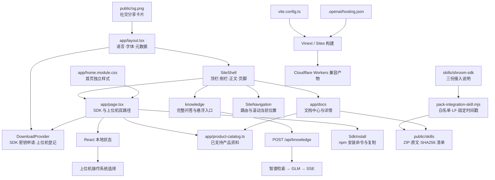

# 架构文档

> 本文档由 Codex 自动生成和维护。最后更新于：2026-11-05

## 1. 项目概述

官网与 SDK 分属两个 Git 仓库：[shroomSDKWEB](https://github.com/liudada118/shroomSDKWEB) 维护页面、在线文档和下载入口，[shroomSDK](https://github.com/liudada118/shroomSDK) 维护 SDK 源码、测试、构建与版本发布。官网的 `sdk/` 是固定提交的 Git 子模块；以下 SDK 路径表示子模块内的文件，不再属于官网直接维护的源码。

当前官网固定 SDK **0.4.0**（`sdk-v0.4.0` / `50d0956c192c892f7bd701cbdde8e22bb0ae0b4b`），页面版本、下载制品、生成文档与 Skill 基线一致。npm `latest` 为 0.4.0，官网 TGZ 与该正式发布包内容一致。人体和鞋垫的“0.3.0 起支持”仍是各自最低版本说明。

Shroom Developer 面向开发自有应用与直接使用上位机的两类客户。首页采用描述与数据示意双栏首屏，按“用途概览 → SDK / 上位机双流程 → SDK 能力中心 → 产品概览与资料入口 → 获取 JavaScript SDK / 按平台下载上位机 → 文档中心”组织，每区以短标题说明结果。SDK 路径以 readProduct 一步取数为核心；上位机路径独立，不要求用户另装 SDK。驱动提示集中在接入准备与上位机下载，首屏不再展示代码或驱动横幅。首页使用独立 home.module.css，保留既有下载、工具与文档锚点。

首页、文档中心、文档详情和 `/knowledge` 问答页通过根布局共用 `SiteShell`：统一 72px 顶栏、左侧导航、正文区域和页脚；窄屏通过同一个“目录”按钮展开导航。首页与问答侧栏为 240px，文档侧栏为 288px。文档分类和当前文档的章节/API 全部并入左侧层级树，正文不再分出右侧目录；文档顶栏仅显示品牌与当前位置，开发首页、下载和问答入口放在左侧。`DocsNavigation` 将快速接入、产品资料与 Skill 入口呈现为同级语义列表，普通项使用相同字重与右箭头，仅当前页面高亮。首页使用 `.home-shell` 与 `home.module.css`，文档使用 `.docs-shell` 阅读样式，下载登记和既有路由保持兼容。独立的 `/lab.html` 测试台不套用网站布局。

**当前版本的下载与文档都是真实可用的，不再是骨架**：

- **获取 SDK** —— 官网暂只展示 JavaScript / TypeScript，提供 `npm install shroom-sdk`、TGZ 下载和源码入口，覆盖 Node.js 与浏览器。Python 下载卡、指南入口、语言选择与相关展示说明暂时隐藏；独立 SDK 的 Python 实现和历史下载制品保留。SDK 下载免登记，真实设备另行申请并激活产品密钥；上位机仍使用原下载登记。官网展示版本读取固定 SDK 提交，发布时确认 npm latest 与其一致；备用 TGZ URL 含版本与 SHA256，历史包随官网源码保留。
- **三平台上位机** —— 首页通过 `app/downloads.ts` 提供用户指定的 Shroom 安装包：Windows 1.1.36 EXE、macOS 1.1.37 ARM64 DMG（仅 Apple Silicon）、Linux 1.1.38 amd64 DEB（仅支持 DEB 的 x86_64 系统）。三个平台均可下载；版本来自文件名，体积来自 2026-10-13 的 HTTPS HEAD 响应。安装包由 `shroom.jq-industries.com/shroom1/` 独立提供，不进入本站 Git 或构建产物。页面不复用旧 Monitor ZIP 的日期、更新日志、签名或授权说明；当前包的功能/授权不由基础 SDK 边界推定。旧 `desktop-release.json` 与同步脚本仅保留用于历史 Monitor 流程，不再驱动首页。
- **文档中心** —— `/docs` 主入口直达 `/docs/quick-start`：先直接展示 `listPorts()` 搜索和用户选择串口，再进入取数、创建 WS、开始采集、停止采集、下载五步。搜索使用 `shroom-sdk/node` 基础 API，不新增第六个快速函数。Node 负责设备与服务，网页通过同一个 `stream` 控制采集并按返回的记录 ID 下载；驱动、授权与依赖集中在“接入准备”。产品和手侧在取数示例旁选择，字段、排查、SDK 下载为独立面板，驱动不再全局置顶。`/docs/products` 提供完整产品资料，`/docs/skills` 分发 AI 接入 Skill；`/docs/custom` 承接基础自定义，后端参考统一在 `/docs/backend`。SDK 文档由 `sdk/docs/catalog.json` 维护来源和导航元数据，构建期预渲染成 HTML；官网产品与 Skill 页由独立路由渲染，旧链接保持兼容。
- **完整快速方案** —— Node 数据服务广播标准产品帧，按标签录制到 SQLite 并下载 CSV/JSONL；页面刷新可按记录 ID 找回历史。已有手套/手垫提供分区展示，新的人体/鞋垫由应用消费 onData 自行绘制；没有将合成数据称为真机数据，细节见 4.9。
- **网页测试台** —— `public/lab.html`，浏览器直连串口看数据。
- **串口接入可靠性** —— SDK 按查询 → 配置/连接 → 自动分帧/解码组织接入，配置在打开端口前校验；Node.js / 浏览器和 Python 提供结构化错误、生命周期与诊断快照。JS 额外提供运行时 `onError()`，Python 保持同步异常，不新增后台线程、自动重连或传感器型号识别。
- **按产品直接取数** —— JS 产品入口内置协议与点位映射，通过 `readProduct` / `connectProduct` 的 `onData` 收取已解析帧；人体与鞋垫从 SDK 0.3.0 起支持，页面保留最低版本提示，统一使用 npm 安装流程。`connectGlove()`、`connectHandPad()` 和通用 `connect()` 继续保留；Python 仍为通用矩阵 SDK，不宣称随版本号获得这些专用产品协议。
- **后端连接 SDK** —— Node.js / 浏览器新增 `BackendSdkClient`，通过 HTTP/WS 查询和控制已运行的主项目后端，接收原始实时 JSON 帧；不是内置采集服务器，也不要求 Shroom Monitor 提供 HTTP 接口。下载包内包含源码、类型、只读示例与 `BACKEND.md`，API 参考入口为 `/docs/backend-api`，后端统一指南为 `/docs/backend`；Python 包本次不变。
- **手套体验站** —— 外链到独立部署的 <https://glove.jq-industries.io/>。
- **密钥申请与上位机登记** —— 首页和接入文档单独提供“申请 SDK 密钥”，提交姓名、电话、邮箱、机构到既有 `/sdk-requests`，来源为 `sdk-license`。只有 HTTP 成功且后台返回 `ok: true` 才显示已提交；失败保留输入并支持重试，不自动发钥或下载。
  上位机保留原下载登记，登记失败仍可下载；SDK 安装与下载不调用申请接口。
- **智谱知识问答** —— 从 `ld` 分支恢复检索、流式回答和章节跳转，适配当前布局与文档。入口为侧栏/文档中心 `/knowledge` 及全站右下角“问文档”。运行需要服务端智谱配置；当前本地尚未配置真实凭据，未配置时明确返回 503。

「点位映射生成器」与「工程验证工具（含力学标定）」尚未开放，首页不再展示占位卡。

页面 **不提供、也不会提供** kPa / 牛顿等物理单位换算 —— SDK 直连串口给到的是 0~1 相对值，后端客户端则保留后端的原始 JSON 与单位语义，
标定曲线逐台设备不同，不在公开 SDK 范围内，能力边界在 SDK 文档中说明。

AI 接入资料以 `sdk/docs/AI-CONTEXT.md` 与 `sdk/docs/怎么用AI开发.md` 为事实源，围绕五步函数、调用异常、运行期错误、采集状态与资源释放组织。网站另在 `skills/shroom-sdk/` 维护可安装的 Skill，通过 `/docs/skills` 说明并分发 ZIP；普通 AI 参考文档不再标为可安装 Skill。Skill 指引基线为 SDK 0.4.0，说明 npm 安装、实际版本核对及 Node/网页同版本要求；安装 Skill 本身不升级 SDK。网站未提供 MCP 服务。

## 2. 技术栈

| 分类 | 技术 | 版本/说明 |
| :--- | :--- | :--- |
| **前端框架** | React / Next.js App Router | React 19.2.6、Next.js 16.2.6 |
| **构建与运行** | Vinext / Vite | Vinext 1.0.0-beta.3、Vite 8.0.13 |
| **样式系统** | Tailwind CSS / CSS Modules | Tailwind CSS 4.2.1；首页、产品资料与 Skill 页使用独立 CSS 模块 |
| **问答后端** | App Router API / Web Streams | `POST /api/knowledge` 服务端请求智谱，向客户端返回 SSE |
| **数据库** | SDK 采集使用 SQLite | Node 可选依赖 better-sqlite3 ^11.10.0；网站未启用 D1 / R2 |
| **编程语言** | TypeScript / TSX / CSS | TypeScript 5.9.3，严格模式 |
| **Python SDK** | Python 3.10+ / setuptools | 核心无第三方运行依赖；串口可选 pySerial >=3.5,<4，图形示例可选 Matplotlib >=3.7,<4 |
| **JS 后端客户端** | 原生 fetch / WebSocket | 浏览器无 Node 依赖；Node 18+，缺少全局 WebSocket 时按需使用 SDK 可选依赖 ws ^8.14.2 |
| **包管理器与发布环境** | npm 10.9.4 / Python pip | 官网与独立 SDK 各有 package-lock；官网 CI 使用 Node 22.22.0，SDK CI 另使用 Python 3.12 和锁定测试依赖 |
| **部署环境** | OpenAI Sites / Cloudflare Workers | 通过 `@openai/sites-vite-plugin` 与 Cloudflare Vite 插件构建，已配置生产站点基址 |
| **其他关键库** | next/font | Geist 与 Geist Mono 字体 |
| **Skill 制品打包** | fflate | 固定版本 0.7.5；构建期生成标准 ZIP，校验静态下载内容 |

## 3. 目录结构

```text
shroomSDKWEB/
├─ .github/workflows/site-ci.yml # 拉取固定 SDK 子模块后验证官网集成
├─ .gitmodules             # sdk → liudada118/shroomSDK；提交号由官网 Git 索引锁定
├─ .gitattributes          # 文本 LF 与 ZIP binary，保持跨平台制品一致
├─ .openai/
│  └─ hosting.json          # Sites 项目及逻辑资源绑定
├─ app/
│  ├─ globals.css           # Tailwind 入口、全局基础样式与背景纹理
│  ├─ layout.tsx            # 页面语言、字体、元数据与统一布局入口
│  ├─ page.tsx / home.module.css # 描述首屏、SDK/上位机双流程与独立首页样式
│  ├─ HeroDataVisual.tsx / .module.css # 首屏传感器到应用的数据示意，无真实设备连接
│  ├─ product-specifications.ts # 首页四份产品规格书的原始文件名和 PDF 直链
│  ├─ product-catalog.ts    # SDK 产品接口参考与快速接入共用的协议、字段和配置
│  ├─ SiteShell.tsx         # 首页与文档共用的顶栏/左侧栏/正文/页脚骨架
│  ├─ SiteNavigation.tsx    # 路由与首页滚动高亮、跨页锚点、移动目录
│  ├─ DownloadProvider.tsx  # 下载登记弹窗与 useDownload（具体语言由卡片决定）
│  ├─ downloads.ts         # 官网 JavaScript SDK / 上位机下载目标和发布元数据
│  ├─ api/knowledge/       # 智谱问答 POST 接口，只在服务端读取密钥
│  ├─ knowledge/           # 共用 SiteShell 的完整问答页及元数据
│  ├─ components/knowledge-* # 会话、悬浮面板、消息引用与文档定位
│  ├─ docs-data.ts         # 当前文档章节类型、查找与关键词匹配
│  ├─ desktop-release.json  # 历史 Monitor 元数据；脚本生成，当前首页不使用
│  └─ docs/                 # 文档概览/详情、侧栏、语言切换与元数据
│     ├─ products/page.tsx / products.module.css # 全部产品的协议、字段与能力边界
│     ├─ skills/page.tsx / skills.module.css # Skill 下载、项目安装与接入接口说明
│     ├─ DocOutline.tsx     # 左侧折叠章节/API：中文功能、语言同步与当前位置
│     ├─ use-active-doc-heading.ts # 合并滚动更新、监听语言显隐变化
│     ├─ ProductWorkspace.tsx / .module.css # 五步调用流程、接入准备与参考面板
│     ├─ ProductWorkspaceNavigation.tsx / .module.css # 共享侧栏、任务导航与全部产品资料入口
│     ├─ product-workspace-model.ts # 配置、URL解析、手侧确认和运行命令的纯状态模型
│     ├─ product-workspace-preview.ts # 未确认实物时的只读核心调用预览
│     ├─ product-workspace-state.tsx # SSR稳定快照与客户端URL订阅，连接侧栏和正文
│     └─ doc-position.ts    # 可单元测试的标题位置选择逻辑
├─ scripts/
│  ├─ sdk-source.mjs        # 核对独立仓库、URL 和锁定提交；调用 SDK 工具并镜像资源
│  ├─ check-sdk-source.mjs  # SDK 子模块来源检查命令
│  ├─ build-sdk-bundle.mjs  # 委托 SDK 构建并同步官网网页资源
│  ├─ pack-sdk.mjs          # 委托 SDK 打包并把三份 ZIP 镜像到 public/
│  ├─ pack-integration-skill.mjs # 三文件白名单生成可复现 Skill ZIP、原文与哈希清单
│  ├─ verify-site.mjs       # 官网来源、文档、类型、生产页面和下载集成检查
│  ├─ tests/               # 独立 SDK 来源、缺失子模块及提交错位回归
│  ├─ build-docs.mjs        # 按官网展示范围预渲染 SDK Markdown，供 /docs 使用
│  ├─ site-docs.mjs         # 暂时隐藏 Python 文档与混合说明，保留 JS 示例及原章节锚点
│  └─ sync-desktop-release.mjs  # 历史 Monitor 同步；不修改当前三平台下载配置
├─ skills/shroom-sdk/        # 官网维护的 AI 接入 Skill 源文件，与 npm SDK 分开交付
│  ├─ SKILL.md              # 可发现的 Skill 定义与接入约定
│  ├─ agents/openai.yaml    # Codex 展示名称、说明与调用提示
│  └─ references/integration.md # 五函数、串口、授权、采集及错误参考
├─ sdk/                     # shroomSDK 独立仓库的固定提交子模块
│  ├─ package.json / package-lock.json # 公开入口、SDK 版本与依赖锁
│  ├─ src/                 # SDK 运行实现与类型
│  │  ├─ quick-flow.js / .d.ts # 五个快速函数及其类型
│  │  ├─ flow/             # 五函数编排、录制 ID 与资源释放
│  │  ├─ core/             # 产品适配器、协议、数据结构、错误与授权
│  │  ├─ node/             # 串口、WS/HTTP、SQLite 采集和导出
│  │  ├─ web/              # 浏览器串口、WS 控制与二维展示
│  │  └─ backend/          # 已有主项目后端的 HTTP/WS 客户端
│  ├─ examples/
│  │  ├─ products/         # 左右手套、手垫的 HTML/MJS 示例
│  │  ├─ node/             # 命令行示例与示例授权环境配置
│  │  ├─ web/              # 测试台模板、生成页面与经典脚本 bundle
│  │  └─ product-*.js      # 官网及交付调用示例生成器
│  ├─ docs/                # 接入、API、AI 上下文和发布指南
│  │  └─ catalog.json      # 站点文档与导航事实源
│  ├─ scripts/             # 启动器与 SDK 构建、版本、打包和发布工具
│  ├─ tests/               # JS、协议、网络、采集和类型测试
│  ├─ python/              # Python 独立包、示例、测试和文档
│  ├─ .github/workflows/   # SDK 三平台检查与 Release 草稿
│  ├─ dist/                # ZIP/TGZ 和版本制品，Git 忽略
│  └─ README.md / ARCHITECTURE.md / CHANGELOG.md / MIGRATION.md
├─ public/
│  ├─ favicon.svg           # 站点图标
│  ├─ og.png                # 1200×630 社交分享卡片
│  ├─ lab.html              # 网页测试台（Web Serial 直连设备）
│  ├─ shroom-sdk.zip        # 兼容旧链接的完整构建产物
│  ├─ shroom-sdk-node.zip   # Node.js / 浏览器源码、示例及文档
│  ├─ shroom-sdk-python.zip # Python 独立包，不依赖 Node.js
│  ├─ skills/               # pack:skill 生成的官网静态下载资源
│  │  ├─ shroom-sdk-skill.zip / .json # Skill ZIP 与 SHA256/条目清单
│  │  └─ shroom-sdk/        # 与 ZIP 同源的 SKILL.md、agents 和 references 原文
│  └─ downloads/            # 历史上位机包，已 gitignore；当前安装包走外部下载站
├─ todo/
│  └─ SDK_SKILL_TODO.md     # SDK、手套接入、Skill 与展示站的分阶段待办
├─ docs/obsidian/
│  └─ Shroom-当前系统结构.md # 快速/基础路线、运行链路、产品数据和能力边界快照
├─ outputs/layout-discussion-2026-10-19/ # 本地产品开发中心原型与评审产物，不参与生产路由
│  ├─ product-workspace.html # 产品/手侧/环境配置、驱动前置、完整示例、验收与问题恢复
│  ├─ product-workspace-examples.js # 按配置生成浏览器/Node完整取数示例或核心片段
│  └─ product-workspace*.test.mjs # 非UI配置回归与生成示例的模拟SDK生命周期验证
├─ ARCHITECTURE.md          # 本架构说明
├─ SDK-RELEASING.md         # 官网初始化、升级和回退 SDK 子模块的操作
├─ server/                  # 智谱检索、SSE 代理与问答/路由回归测试
├─ .env.example             # 智谱服务端变量示例，无真实密钥
├─ DEPLOY.md                # 部署、上位机发版流程与 Nginx 配置
├─ SDK_PAID_STRATEGY.md     # 基础/付费 SDK 的能力边界、定价、支付、授权与实施方案
├─ deploy.sh                # 初始化固定 SDK → 装依赖 → 构建 → 重启 PM2 → 健康检查
├─ ecosystem.config.cjs     # PM2 进程配置（fork 单实例，只监听 127.0.0.1）
├─ eslint.config.mjs        # ESLint 配置
├─ next.config.ts           # Next.js 配置
├─ package.json             # 脚本与依赖
├─ package-lock.json        # npm 锁文件
├─ tsconfig.json            # TypeScript 配置
└─ vite.config.ts           # Vinext、Sites、Tailwind 与 Worker 构建配置
```

旧 Shroom Monitor 是**同级的独立工程**，不在这个仓库里；以下为历史工程结构，不代表当前三平台 Shroom 安装包的源码或发布流程：

```text
C:/project/ShroomConstruction/
├─ shroomSDKWEB/            # 本仓库（站点；sdk/ 现为独立仓库子模块）
└─ shroom-monitor/          # Shroom Monitor，Electron 串口监视器，独立工程
   ├─ main/                 # 主进程：窗口 + 串口 + IPC（只搬字节，不拆帧）
   ├─ renderer/             # 界面；vendor/shroom.bundle.js 由 scripts/sync-sdk.mjs 从本仓库拷入
   └─ dist/                 # ShroomMonitor-<版本>-win-x64.zip
```

历史 Monitor 和本站靠 `sdk/examples/web/shroom.bundle.js` 连着：该脚本现由独立 SDK 仓库生成，官网与历史 Monitor 消费同一份 SDK 实现。

### 关键目录说明

| 目录 | 主要功能 |
| :--- | :--- |
| `/app` | App Router 页面、根布局、站点级样式与上位机发布元数据 |
| `/scripts` | 官网构建期脚本：校验 SDK 来源、镜像其产物、预渲染文档与验证站点 |
| `/skills` | 可安装 AI 接入 Skill 的源码；构建只打包白名单内三个说明文件 |
| `/sdk` | 独立 shroomSDK 仓库的固定提交；源码与 AI 文档在该仓库维护，官网从子模块读取 |
| `/public` | 静态资源、网页测试台、SDK ZIP 与独立 Skill ZIP/清单；当前三平台上位机安装包不存放于此 |
| `/.openai` | OpenAI Sites 部署项目标识与逻辑资源声明 |
| `/todo` | 记录 SDK 事实源、手套接入闭环、Shroom Skill 和展示站真实业务接入的待办与验收标准 |

## 4. 核心模块与数据流

### 4.1 模块关系图



### 4.2 主要数据流

1. **产品资料定位**
   - 首页产品资料由 `app/product-specifications.ts` 独立维护鞋垫、触觉手套、高密度手部压力监测垫与全身触觉皮肤四份 PDF，整张卡片直接在新标签打开资料站 `https://shroom.jq-industries.com/book/` 的原始文件；文件名编码一次，保留空格、括号及原始拼写。首页不再提供“全部产品资料”汇总入口。
   - `app/product-catalog.ts` 继续维护 SDK 已封装产品的协议、字段、最低版本与接入配置，供快速接入和 `/docs/products` 使用。该页及各文档入口统一称为“产品接口参考”，保留原路由与取数深链。规格书用 `displayFileName` 单独维护展示文件名：手套显示为 `触觉手套规格书.pdf`，全身触觉皮肤显示文件名去掉 `(1)`；下载 URL 仍由原始 `fileName` 生成。
   - 产品列表完整性检查与 SDK `listDeviceProducts()` 的注册结果比较，新增协议时同步资料。
2. **Shroom Skill 推荐接入**
   - 首页“用 Skill 快速接入”进入 `/docs/skills`，下载独立的接入说明包；包内明确已支持产品、五个快速函数、串口选择和错误处理边界。
   - 用户把整个 `shroom-sdk` 目录安装到项目 `.agents/skills/`，在新 Codex 会话调用 `$shroom-sdk` 并说明产品与目标，再验证生成的接入代码。该指引不自动安装 SDK、激活密钥或获得串口权限。
3. **统一 SDK 与上位机资源**
   - 首屏的 SDK / 上位机两个入口分别定位 `#sdk-flow` 与 `#desktop-flow`；SDK 流程说明安装、选串口/授权、调用 readProduct 与收到数据，上位机流程说明安装、独立授权、选设备/串口与查看/采集/导出。上位机流程链接至 `#desktop-downloads`，选择下载按钮后才进入登记。
   - SDK 下载区按 JavaScript / TypeScript 与 Python 展示安装和指南入口。JavaScript 首选 npm，TGZ 安装包及源码 ZIP 为备用；SDK 下载免登记，密钥单独申请。顶栏入口仅定位下载区。
   - `activePlatform` 从 `DESKTOP_PLATFORMS` 选取上位机卡片，平台按钮用 `aria-pressed` 标记当前选择。三平台显示各自版本、体积、格式、架构与安装提示；下载按钮传入 `selectedPlatform.target`，避免 macOS / Linux 误下 Windows 包。HTTPS 文件由外部下载站提供，不显示未经确认的发布日期、更新日志或哈希。
4. **接入说明与复制**
   - 首页只保留用途描述和操作流程，产品资料直接展示，不再维护产品搜索/筛选或首页示例代码状态。
   - 真实五步代码集中在快速接入文档；首页 `SdkInstall` 仅展示并复制 npm 安装命令，剪贴板失败时选中文本供手动复制。Skill 页单独提供调用提示复制。
5. **下载登记**
   - 根布局的 `DownloadProvider` 管理 SDK 密钥申请与上位机登记；SDK 下载直接放行。上位机弹窗按所选平台展示驱动下载或串口权限提示，首页下载区也提供同一驱动入口。`downloads.ts` 统一维护语言卡片与下载目标（`gateTarget` 记住是谁触发的），
     标题、副标题、登记来源 `source` 随触发方切换。
   - 登记字段使用可收缩的单列网格与全宽输入框；640px 起姓名和手机号并排，窄屏单列。字段顶部对齐，单项报错不会拉伸同排输入框；弹窗按内容纵向滚动，不产生表单横向溢出。
   - 上位机登记 POST 到 `/sdk-requests`，来源为 `desktop-win` / `desktop-macos` / `desktop-linux`，版本沿用 `sdkVersion` 字段；登记失败仍放行下载。SDK 密钥申请使用 `sdk-license`，须收到明确成功响应才提示已提交，不自动发钥。原生 dialog 管理焦点与关闭，保留草稿；跨域安装包的保存行为由下载站响应头决定。
6. **全站导航与响应式布局**
   - 首页导航与正文一致，依次为概览、使用流程、能力、产品资料、SDK 下载、上位机与驱动、文档。文档新增产品资料与 Skill 入口，静态页不会混入整份基础 API 目录。首页顶部不再重复显示驱动入口。
   - >=1024px 显示固定侧栏：首页与问答 240px，文档 288px，正文与页脚使用对应左外边距；顶栏保留品牌与当前位置。首页 Hero 左侧保留描述和两个使用入口，右侧由 `HeroDataVisual` 展示压力矩阵经 SDK 进入应用的静态 SVG 示意，明确标注“数据示意”，不展示虚构实时数值；小于 768px 时图文纵向排列。代码集中到文档中。
   - 原生锚点保留深链接和浏览器前进/后退；通过 requestAnimationFrame 合并滚动更新，按区域位置设置 `aria-current`，不在滚动时改写历史。点击锚点不提前选中目标项，平滑滚动途中的高亮也始终跟随实际位置；页尾不足一屏时仍激活最后的页内导航项。
   - 移动端目录支持展开/收起、Esc 关闭并返回按钮焦点、选中后聚焦目标内容、失焦与外部点击关闭；展开期间禁止背景滚动。保留跳过导航入口、键盘焦点样式和 reduced-motion 行为。
   - `layout.tsx` 只向客户端传入文档路径/标题与轻量 TOC 映射，不导入整篇文档到导航客户端模块；文档仍由服务端页面渲染。每页仅有一个顶栏、主内容区和页脚，旧的 `DocHeader` 已由共享组件替代。
   - 文档概览和详情采用统一 `docs-page` / 单列 `docs-grid`，正文最大阅读宽度 800px、正文基准字号 16px；分类和章节/API 保留左置，并以“本页章节”区分文章目录。手机复用“目录”菜单，表格/代码独立横向滚动。文档概览的五步入口在窄屏纵向排列，快速接入正文按任务切换面板，五步代码默认展开。
   - `DocOutline` 通过 `useActiveDocHeading` 跟随实际标题位置高亮，以 requestAnimationFrame 合并 scroll / resize / hashchange，隐藏语言不参与选择。h2 章节使用默认全部展开的原生 details，h3 函数以中文功能名和英文接口副标题显示；用户仍可用箭头或键盘手动收起。滚动不重新展开已收起的章节，定位时使用该章节的 summary 而不是隐藏链接，仅调整左侧 scrollTop；不移动正文或键盘焦点，不改写历史。此默认行为共用于后端双语言、前端与辅助参考文档；移动端外层“目录”菜单仍默认关闭。

   - 当前参考文档行使用默认展开的原生 `details/summary`，点击整行或按 Enter / Space 可折叠整份章节目录；未选中文档仍通过链接进入。`DocOutline` 在外层目录隐藏时跳过侧栏自动滚动，避免正文滚动改变收起状态或将侧栏移到隐藏链接的位置。

### 4.3 Python SDK 数据流与交付

自 2026-11-05 起，以下为保留的底层能力；官网暂不展示 Python SDK、安装指南或语言选择。旧文档地址导向 JavaScript 快速接入，历史下载制品与 SDK 源码不删除。

- `sdk/python/src/shroom_sdk/device.py` 使用 pySerial 读取字节，经过 `framer.py` 拆帧和长度锁定，再由 `frame.py` 解析成 `Frame`。模拟设备走同一解码路径。
- 采用同步 `read_frame(timeout)` / `frames()` / 迭代器读取和 `with` 管理生命周期，无后台采集线程。核心导入与 Mock 不要求 pySerial，依赖在真实串口调用时加载。
- `errors.py` 提供 `ShroomError` 及兼容 ValueError / OSError / ImportError 等既有捕获方式的子类；包含 code、stage、suggestion、details 与 cause。配置在导入 pySerial / 打开设备前校验，超时仍返回 None。`state` 与 `get_diagnostics()` 提供状态及累计计数，诊断不包含原始异常对象。关闭失败不再被吞掉；`with` 内已有业务异常时保留原异常，并记录关闭故障。
- `Frame` 使用 bytes 原始快照、array('f') 数值、点数/重心/统计和 Unix 毫秒时间戳，支持 raw/mat32/自定义排列。跨语言测试调用现有 JS 实现验证数值与拆帧一致。
- `python -m shroom_sdk` 提供串口枚举、模拟/实机运行、有限帧数和 JSON 输出；`examples/heatmap.py` 是可选 Matplotlib 图形示例。
- 通过 pip 本地安装或构建 wheel/sdist，尚未发布 PyPI。官网暂时隐藏对应指南；`/docs/python` 重定向至快速接入，旧 `/docs/backend?language=python` 使用 Node.js 内容。Python ZIP 和兼容完整 ZIP 继续携带源码、配置、示例和测试，排除虚拟环境、字节码、egg-info 与构建产物。独立 Python 包不含 JS 事实源，其跨语言对照测试自动跳过；在完整仓库仍执行。

### 4.4 智谱知识问答

- 历史实现来自 `ld` 的 `4faecb8` / `995e963`；只迁回问答模块，不覆盖当前首页、SDK 或布局。完整页和悬浮面板共用 `useKnowledgeChat`，支持 SSE、停止、清空和错误提示；回答直接展示正文，不展示检索依据（来源仍随 SSE 下发，只用于章节跳转的兜底匹配）。流式输出时对话框跟随最新内容，用户往上翻看后不再强制拉回底部（`knowledge-scroll.ts`）；悬浮会话仅存于浏览器 sessionStorage，最多保留 20 条，不存数据库。
- `server/zhipu-knowledge.ts` 先请求知识库 retrieve，再把有限的命中文段送给 GLM。无命中时不调用模型。服务端归一化来源并过滤非 HTTP(S) 链接，限制问题 1000 字符、历史 8 条、上下文 12000 字符。
- API 拒绝跨 Origin 请求，限制实际请求体 64 KiB，智谱请求 60 秒超时；API Key 不进入浏览器或 SDK 下载包。缺少 Key / Knowledge ID 返回 `KNOWLEDGE_NOT_CONFIGURED`，不提供模拟答案。
- `build-docs.mjs` 同时生成轻量 `app/docs/catalog.generated.ts`，只把章节元数据交给客户端。模型章节标识使用 `slug--sN` 避免跨文档重名，实际链接为 `/docs/:slug#sN`；服务端和客户端均校验目录，不沿用旧分支的 Backend 链接。
- 问答推荐、输入提示和 Skill 只说明当前官网展示的 JavaScript / TypeScript 接入；检索片段复用 `site-docs.mjs` 保留混合资料的 JS 内容，过滤 Python 专属来源，避免重新推荐已隐藏的文档。
- 本地文档构建不会自动同步到智谱知识库。管理员仍需上传当前 README、AI 上下文、快速指南和 Python README；系统提示区分Node/浏览器新快速服务及标签录制下载、旧BackendSdkClient与Python基础能力，不再错误否认现有产品协议；数据库、回放、标定和三维手模仍不由SDK提供。
- 增加 `BACKEND.md` 后，目录自动包含 backend 页面和章节；问答提示区分 JS 的后端客户端、后端服务本身与 Python 能力。知识库需另行上传新文档，构建不会自动上传。
- `npm run test:knowledge` 使用模拟上游测试检索、SSE、来源、安全错误及全部章节链接；未配置凭据时无法验证真实云端问答。公网部署前还需配置入口限流与用量保护，当前接口不是付费授权系统。

### 4.5 已有后端连接客户端

- 从 `E:/ShroomSDK/src/backend/BackendSdkClient.js` 的 HTTP/WS 契约适配为 `sdk/src/backend/client.js` ES 模块。浏览器使用原生 fetch/WebSocket 和轻量事件监听器，不引入 Node EventEmitter；`sdk/src/node/backend.js` 为旧版 Node 按需选择可选 `ws`。`sdk/src/web/index.js`、`sdk/src/node/index.js` 具名导出，包子路径为 `shroom-sdk/backend`，经典脚本入口为 `Shroom.BackendSdkClient`。
- HTTP 默认 `http://127.0.0.1:19245`，WS 默认 `ws://127.0.0.1:19999`，分别由调用方显式配置；不读取网站环境变量或智谱密钥，也不自动启动后端。Monitor 和开发者网站本身不提供这组设备接口。
- `getContract()` 缓存后端契约并加载接口路径；显式 routes 覆盖不会在刷新时丢失。支持状态查询、设备与展示系统元数据、开关串口和启停采集，控制方法仅显式调用时发送。HTTP 支持 JSON 业务错误、AbortSignal 和默认 10 秒超时；写操作不自动重试。
- 实时连接完成后订阅通道，JSON 批量帧逐条分发，数据不截断、不归一化、不重新排列。后端帧不等于串口 `Frame`，图形接入需按实际后端协议显式适配。断开清理监听与握手定时器，丢弃过时连接事件；可复用客户端，但不自动重连或重放控制命令。
- Node 只读示例 `npm run demo:backend` 读取契约/串口状态并订阅，结束时释放连接，不触发设备或采集控制。`npm run test:sdk` 构建经典脚本并运行测试；真实网络测试只使用临时回环 HTTP/WS 服务，不操作实际设备。未验证生产后端、跨域代理与真机链路。
- 构建将本模块和指南打入 Node ZIP 与兼容完整 ZIP，Python ZIP 不增加任何 JS 文件或依赖。浏览器需由后端允许 CORS/Origin，HTTPS 页面配置 HTTPS/WSS；公网鉴权、授权和设备权限由后端负责，本客户端不实现付费许可。

### 4.6 文档分类与生成

- `sdk/docs/catalog.json` 是文档 slug、源文件、摘要、分类、导航名称和可见性的事实源；网站通过 `scripts/site-docs.mjs` 暂时排除 Python 文档，并将混合资料转换为 JavaScript 展示内容，不改 SDK 原文。`app/docs/structure.ts` 读取轻量展示元数据，供概览、侧栏、面包屑和同类推荐共用。整篇 HTML/Markdown 不进入分类侧栏的客户端依赖。
- 后端主入口只有 `/docs/backend`，来源为 `sdk/docs/BACKEND-GUIDE.md`。左侧后端下的串口、通讯、存储链接直接定位同一篇的稳定锚点；`/docs/node`、`/docs/serial`、`/docs/storage` 保留为详细参考，不重复出现在主目录，旧 `/docs/python` 转至快速接入。原 HTTP/WS 原文 `BACKEND.md` 改由 `/docs/backend-api` 提供，站内源文件引用自动改写至此。
- `BackendGuide` 接收服务端渲染的正文和 Markdown，仅展示 Node.js，不再提供语言下拉框。旧语言查询参数不切换到隐藏资料；正文、复制原文、目录与问答索引均使用同一展示范围。过滤专属章节前固定原有标题编号，避免改变其他章节的书签。
- 前端保持通讯 / 渲染分类，辅助指南保持原入口。详情通过面包屑显示分类，底部最多展示三篇可见同类文档；没有推荐时不显示空区块。本页目录和问答浮窗继续复用。
- 四篇核心文档（后端主指南、BackendSdkClient、前端通讯、渲染）改为逐接口参考，覆盖串口、Mock、拆帧、解码、点位/产品配置、HTTP/WS、Frame 转换及 Canvas/色图接口。存储区区分 Node SQLite 采集、CSV/JSONL 导出与应用侧有限帧保存示例，不宣称提供通用业务数据库或历史回放。文档版本标识读取 SDK package.json，不新增或改写 SDK 运行接口。
- 清单的 `tocDescriptions` 按稳定锚点维护中文功能说明，构建校验目标标题和描述并生成 `DocToc.description`。左侧章节/API 目录以中文功能为主、英文 API 名为辅，正文标题、复制原文和跳转锚点保持不变；问答章节关键词包含功能说明，方便用中文查找接口。
- 文档详情保持服务端渲染文章，根布局把轻量 TOC 交给 `DocsNavigation` / `DocOutline`；当前文档的章节嵌入对应分类。`BackendGuide` 通过局部 Context 将原文交给工具栏，复制按钮输出 Node.js 展示内容，目录固定使用 Node.js 范围。不把 Markdown 文章变为客户端渲染，布局复用 React / Tailwind。
- 构建从清单读取源文件，校验 slug 与分类，按源文件目录解析 Markdown 相对链接并保留 query/hash。h2 / h3 支持 `{#id}` 稳定锚点并校验唯一性，清单章节必须匹配正文 h2；目录条目记录语言，问答链接自动携带语言参数。回归测试覆盖导航单入口、标题层级、正文/目录语言隔离、有效锚点以及 BackendSdkClient 全部声明方法的文档覆盖。
- 新指南随 Node 与兼容完整 ZIP 交付，Python 独立 ZIP 的内容保持原有范围。首页产品、Skill、模拟体验、下载登记与上位机流程沿用现有实现。
- 快速文档的 `#device` 优先提供独立 `device.mjs` 产品取数例程，覆盖 onData、onError、取消订阅和关闭；原 `server.mjs` 保留为可选网页分发与录制分支，两者不同时占用同一设备。完整七步的原 section、步骤、录制起停分组和按记录 ID 下载语义保持不变，正文中的七步面板默认折叠；所有既有章节锚点保留。
- 首页减少等权重宣传区：Skill 改为辅助说明，测试台内嵌画面默认折叠，主要动作指向设备集成和 SDK 下载；产品系列选择保持原有资源列表，不宣称已实现具体型号/版本筛选。首页代码示例、文档概览和快速文档统一使用产品取数路线，SDK 运行接口未变更。
- 文档概览把集成主按钮放在三步说明之前，手机无需读完步骤再找入口；悬浮文档问答采用低强调白底，窄屏缩为带可访问名称的 AI 按钮，保持原对话和关闭行为。

### 4.7 串口查询、配置、解析与错误诊断

- Node 使用 `listPorts()` 查询系统端口，未传 path 时保持原有选择第一个端口的行为；浏览器由用户手势调用授权选择器，不伪装成全设备枚举。Python 保持仅一个端口时自动选择、多端口要求明确 path；查询结果不是自动识别传感器型号。
- `serial-config.js` 在连接前校验波特率、分隔符、帧长、矩阵、满量程与阈值；分隔符限制 1–64 字节，矩阵/帧长上限 1,048,576，防止错误配置导致巨大分配。保留已有配置名、分帧锁定与 JS 未知线序回退 raw 的约定，不新增底层串口配置项。
- 实机字节流依次进入 `createFramer()` → `decodeFrame()` → `Frame` → 应用订阅；Mock 直接生成 payload 并复用解码，不经过串口分帧。应用 `onFrame` 抛错会生成 CALLBACK_FAILED，但不会阻断其他同步订阅。
- JS Node / 浏览器 / Mock 共用 `ShroomError`、`onError()`、`state` 和 `getDiagnostics()`；连接前故障通过 Promise 拒绝，连接后的读取/解析/断开故障通知订阅并清理资源，关闭幂等且关闭失败可观察。状态为 open / closed / error；故障清理后保留 error，诊断保留最后错误，不自动重连。
- 保留 JS 连接后修改原配置对象进行解码热切换的行为，传输与分帧参数仍在连接时确定。Node 示例输出结构化错误与建议；网页测试台用现有状态区展示错误/恢复建议及诊断，等待连接时阻止重复操作，页面退出时尝试释放连接，不改变页面布局。
- 诊断按累计字节和帧区分 waiting-data / waiting-frame / streaming，并增加 closed / error；streaming 只表示累计成功解析过帧，不是实时活性或采样率监测。快照包含中文排查建议，lastError 不暴露 cause。Python 对应接口使用 snake_case，没有 JS 风格回调。Mock 的字节与帧计数代表生成数据，不是串口吞吐。
- 浏览器模块、Node 模块、TypeScript 声明和经典脚本同步导出错误契约；构建重新生成演示 HTML、测试台和三份 ZIP。回归使用假串口、浏览器流、pySerial loop:// 与跨语言样本，不代表已通过真机硬件验收。现有 HTTP/WS 客户端的错误契约与存储边界不变。
- 2026-10-15 验证：JS SDK 53 项、Python 44 项、文档/问答/导航 32 项测试通过；TypeScript、所改 SDK 文件 ESLint 和生产构建通过。解压后的 Node ZIP 已验证导入、产帧、诊断和关闭；Python ZIP 测试通过（仅跳过独立 Python 包不含 JS 源码的两项对照）。测试台已验证模拟采集、诊断提示与断开归零，无浏览器错误日志；未操作真实硬件、未提交或部署。

### 4.8 面向客户的产品 SDK

- 已封装协议包括 0.4.0 新增的 `handGloveSegmented` 分包手套、保留兼容的 `handGloveFullPacket` 整包手套、`hand` 手垫，以及 0.3.0 新增的 `humanBody` 人体全身、`jqInsole` 鞋垫 A 版。官网按四类物理产品展示，手套默认使用分包；旧整包显式指定协议 ID。人体只读参考 `C:/code/shroom1.0` 的原始协议/物理源表，鞋垫参考用户提供的 `JQInsoleStudio_v2.3_dev_3.html`。不修改来源工程，也不搬入其模型展示、插值、滤波或标定算法。
- 快速入口为 `readProduct({ product, path, side, onData, onError })`；既有 `Shroom.connectGlove()`、`connectHandPad()`、`connectProduct()` 保留。浏览器直连串口在用户手势中选择授权端口，可传 port/filters，不使用 OS path；五步流程的浏览器则用 `readProduct({ url, onData, onError })` 订阅 WS。`listDeviceProducts()` 仅列出已适配直连协议的产品，与旧 `listProducts()` 通用线序/展示菜单不同。
- `src/core/products/registry.js` 静态登记各产品适配器；连接接受 `glove / pad / body / insole` 别名和对应正式 ID，输出帧和 WS 校验只使用正式 ID。适配器提供 profile、专用参数校验、连接元数据、解析器和 WS 字段校验；可选 `resolveProfile(options)` 在参数校验后解析鞋垫允许的协议/速率。`src/core/product.js` 与 `src/core/stream-codec.js` 委托同一注册表，不添加产品条件分支。
- `src/core/products/glove.js / pad.js` 分别实现产品协议，同尾分隔协议复用 `tail-parser.js`，新协议实现独立 `push/reset/droppedCount/frameLength` 解析器。公开类型集中登记在 `sdk/src/index.d.ts` 的 `DeviceProductTypes`（names/frame/node/web），Node/Web 产品连接与快速读取自动推导。新增产品须同步运行时与类型登记、WS 校验、回归和文档，详见 `sdk/src/core/products/README.md`。经典 bundle 构建从入口递归发现本地静态 import 并排序，注册的新模块自动进入依赖图；循环、重名或不支持的导入形式在写产物前报错。
- 手部检测垫使用 1,000,000 波特率、1024 字节 uint8 数据、32×32，沿用现有 `mat32`，与主项目实际 `jqbed` 线序同构。整包手套使用 921,600 波特率，274 字节载荷依次为帧号1字节、包类型1字节、压力256字节、IMU16字节。两产品都按主项目的 `AA 55 03 99` 尾分隔符拆包，再校验长度，不把分隔符纳入 payload；支持跨 chunk 和粘包，超长片段丢弃后在下个尾分隔恢复，缓存有界。
- 手套手侧必须明确传 left/right。主项目现行整包处理不依据 packetType 自动判断手侧，USB 串口信息也不足以证明型号；Node 产品入口未指定 path 时仅单一端口自动选，多端口返回 PORT_AMBIGUOUS。旧通用串口选第一个端口的行为保持不变。不新增扫描所有端口、猜产品或自动发送未知命令的行为。
- 产品层固化分帧和线序；鞋垫专属参数可显式选择已支持的 protocol/baudRate，其他产品仍拒绝覆盖，配置错误在串口打开前拒绝。回调在打开/启动读取前注册，避免首帧丢失。产品设备增加 `onData()`（onFrame 别名），复用既有状态、诊断、订阅异常隔离与幂等关闭。底层串口生命周期只有一份，产品层只替换解析器和元数据。
- 产品帧保留原始扫描数据与产品分区；人体/鞋垫顶层矩阵仍是扫描顺序。手套标准字段为 256 个原始压力通道、`fingers / palm` 的 137 个映射位置、`side / packetType / imu.raw`；分包帧使用 `protocol: 'segmented'` 且不含 `sequence`，旧整包继续保留原帧序号。手套 IMU 仅提供 16 个原始字节，不承诺轴序、四元数或单位；没有手势识别或 kPa/N 换算。
- SDK模块、TypeScript、经典浏览器脚本、Node示例与文档同步；Python与旧HTTP/WS客户端能力不变。产品范围明确，不把这些预设泛化为所有手套/垫子。当前主项目整包链路未要求额外启动命令，也没有checksum校验；合成数据验证不替代真机固件和设备验收。
- 本轮验证：JS SDK 73项、Python44项、文档/问答/导航32项通过，类型检查、所改SDK ESLint和生产构建通过；解压后的Node ZIP新增产品测试20项通过。另与来源工程真实映射函数516组点位探针及2899组分块/分隔/错误恢复探针对照一致。未修改E盘来源、未进行真机测试、未提交/部署。产品 onData 预订阅可能在 await 返回前执行，回调应直接消费传入数据，不假定外层设备常量已初始化。
- 用户随后提供明确的左右手区域点位表：按1-based扫描编号减1读取256点，新增 `fingers.thumb/index/middle/ring/little`，每指4×3共12点，独立 `.pulp` 为1×1指腹点；`palm` 为72点。区域对象提供中文name、rows/cols、rowLengths、0-based sourceIndices、ADC raw、同满量程normalized values和ADC matrix。手掌声明5×15但实际首行12点、其余15点，严格保留 `[12,15,15,15,15]`，不擅自补零或猜补位方向。
- 新分区与旧195点展示线序是不同来源：分区以用户新表为准，旧 pressureMatrix/values/统计保持兼容，不从旧展示矩阵切分或重新命名未核实的5个单点。区域数据与输入及其他区域独立，零ADC保留；不把原始ADC解释成力、弯曲角度或物理单位。点位表中的 btPacketSize=128 仅保留背景语义，不据此改变274字节整包串口协议或增加蓝牙/双包传输。
- 分区验收：JS SDK96项（含21项区域精确点位/快照测试、模块与经典脚本产品回调）、Python44项及文档/问答32项通过；类型检查、所改SDK ESLint、语法检查和生产构建通过。解压后Node ZIP的43项产品/区域测试通过。旧通用串口、Python和HTTP/WS能力未扩大；未真机验收、未提交或部署。

### 4.9 产品快速接入、标签录制与下载

- 面向现有产品提供五个快速函数：`readProduct → createWS → startRecording → stopRecording → downloadRecording`。Node 读取设备并创建 WS，浏览器用 `readProduct({ url })` 连接一次，后三步共享同一 stream；二维展示按需使用原始 `createProductView`。Python 仍为基础串口与矩阵接口，既有通用串口与 BackendSdkClient 保持独立兼容。
- `sdk/src/quick-flow.js` 只导出五个函数，`src/flow/runtime.js` 管理调用编排与当前记录，`src/quick-flow.d.ts` 声明参数及返回类型；按环境动态导入 Node/Web 模块，仍依赖完整 SDK 目录。Node `readProduct` 返回设备，`createWS` 返回服务；创建失败释放设备，返回服务的 `close()` 一并释放服务与设备。SDK 授权仍由调用方先在 Node 完成。
- 五函数只调用基础文档公开的 API：Node `connectProduct / serveDevice`、网页 `connectStream`、目标的 `startRecording / stopRecording`，下载使用网页 `downloadRecording` 或 Node `getRecordingUrl`。`sdk/docs/CUSTOM.md#quick-to-base` 维护对应关系，Node、前端通讯和存储基础页提供参数与生命周期参考；产品适配器保持内部扩展层。
- `sdk/src/core/recording-url.js` 为 Node `server.getRecordingUrl` 与网页 `stream.getRecordingUrl` 共用 UUID、CSV/JSONL 格式和同主机同端口地址规则；生成 URL 不检查文件存在、不发起下载。网页 `downloadRecording` 在基础 URL 方法之上触发浏览器链接，Node 快速下载只返回该基础方法生成的地址。
- 三个采集函数接受浏览器 stream 或 Node server，内部按目标保存本次停止结果的 ID；成功开始新记录清除旧 ID，起停期间拒绝重复控制和下载。浏览器下载同步触发附件请求并返回 URL；Node 下载只返回 HTTP URL。需要历史记录时仍用原始列表和显式 ID API，不改变服务端记录协议。
- `sdk/src/core/stream-codec.js` 定义 `shroom.frame.v1`，先验证通用帧，再委托注册的产品适配器验证额外字段；按白名单将 TypedArray 转为普通 JSON 数组、接收时恢复类型，保留五指、指腹、72点非齐行手掌、原扫描数据、旧195点展示矩阵和原始IMU。传输只做快照与校验，不重新线序映射、标定或猜左右手；单帧上限16384点，损坏形状/非有限值在绘图和分配前拒绝。
- `sdk/src/node/quick-server.js` 的 `serveDevice(device, options)` 订阅调用者已有设备，同一端口提供 WS 数据、录制控制和 HTTP 附件下载。服务关闭等待录制写完并解除订阅，不关闭调用者拥有的设备。默认仅绑定127.0.0.1，校验Origin与Host，拒绝默认file:null和远程网页；跨机须显式host/allowedOrigins，Origin不是公网身份鉴权，公网仍需外部认证及HTTPS/WSS代理。
- `sdk/src/node/recording.js` 对齐 `C:/code/shroom1.0` 的 SQLite 采集核心：一次录制一个不可变 label 与 UUID，采集帧入有界队列，每批最多 200 条或等待 250ms 后事务提交，停止先拒绝新帧，再等待待写队列排空。`recording-sqlite.js` 使用 better-sqlite3 在 `recordingsDir/recordings.sqlite` 中保存 sessions 与 frames，计数只在事务成功后增加；同目录只允许一个录制服务，辅助 owner SQLite 连接持有独占事务，崩溃时由操作系统释放锁，不删除未知锁文件。浏览器断开不停止录制；默认队列 1000 帧、16MiB，溢出或写入/设备故障明确标为 error，重启后将未正常结束的会话标为中断并按已提交帧恢复计数。
- CSV / JSONL 是从 SQLite 按 UUID 和帧序分页读取后流式生成的导出格式，不再作为新采集的底层持久化文件。已结束会话不可变，导出不保持整场下载事务，避免慢速客户端下载阻止 WAL 回收；取消下载会关闭只读连接。旧 `{uuid}.meta.json + .jsonl` 会话保留读取和下载兼容，不原地迁移或覆盖；上位机原有按产品分库、matrix 表、展示系统和 Electron 环境不直接复制。参考项目的首帧门槛、5 秒断流监控、2GiB 预留策略本次不引入，SDK 保持既有错误上报与采集生命周期。
- CSV按帧流式输出，含sessionId、label、帧序、时间戳、产品/手侧及原始数据和分区JSON，使用UTF-8 BOM、CSV引号和公式注入防护；JSONL保存原始标签和完整帧。下载显式传入服务端生成的采集记录UUID（start/stop返回值或历史记录的id），不能用产品ID、标签或端口代替，也不默认选择最新一场。客户端拒绝缺少/无效ID，服务端仅允许已知UUID文件，记录不存在返回404、尚在录制或未写完返回409；不接受任意路径。HTTP附件下载由浏览器接收，不将整场数据堆入浏览器Blob或内存数组。
- `sdk/src/web/stream.js` 封装ready握手、版本校验、typed-array恢复、带关联ID和超时的录制控制、状态订阅和下载。断线会拒绝在途请求，不自动重连、不重放开始/停止命令，不把浏览器断线当成后端停止成功。
- `sdk/src/web/product-view.js` 提供自动订阅数据源的产品视图。手套绘制左右手命名分区及独立指腹、手掌真实行长；手垫复用32×32热力图。为二维分区展示而非三维手模。destroy只释放本视图的订阅、画布和刷新/resize任务，不影响连接或采集。
- `sdk/examples/node/quick-demo.js --mock` 生成经过实际产品解码器的合成手套/手垫帧，真实串口通过明确path切换；`sdk/examples/web/quick-start.html` 提供端口连接、标签、起停、记录列表及下载闭环。`sdk/scripts/start.mjs` 提供本机静态网页，默认5178与WS默认19999为不同用途的端口。构建同步 `/quick-start.html` 和经典脚本，保留旧 `/lab.html` 直连试用。
- 文档新增 `/docs/quick-start` 与 `/docs/custom` 两条入口，基础路线保留后端语言选择与旧API深链接；README、AI上下文、存储章节、站点介绍和问答能力提示同步。智谱云端知识库仍须管理员另行更新，构建不会上传。`.shroom-recordings/`、SDK内recordings目录加入Git忽略和打包排除，用户采集文件不得进入源码或ZIP。
- 文档阅读层级进一步收拢为“快速接入文档”与“基础文档”：快速页正文完整展开，侧栏DocOutline使用collapsible=false展示全部流程，基础文档仅作为独立跨页入口并在正文底部提供跳转；后端/前端/辅助目录只在基础与参考页展示。基础页继续使用 `/docs/custom`，保留所有旧参考路径和语言切换。参考E盘SDK的常展开分组与独立页面方式，未改来源工程。
- 快速示例页与文档将“开始采集 / 停止采集”归在同一“数据采集”分类，下载作为独立分类；下载仍按用户选中的采集记录ID取文件，不与停止操作绑定。快速文档用同一二级采集章节下的两个三级标题展示起停，保留record/download锚点，侧栏完整展开两者。
- 快速文档与独立示例在顶部以 `sdk-quick-flow` 有序流程区突出完整7步，按后端准备（产品/取数/WS）、前端展示（连接/渲染）、采集与下载分三段；桌面分栏、窄屏按序纵向阅读，不裁切步骤。文档步骤跳至既有章节，示例仅前端步骤跳至实际操作区，后端准备不伪装为网页操作；纯HTML/CSS呈现，不新增SDK接口或动态状态。
- 本轮验收：JS SDK131项、Python44项、文档/问答37项及TypeScript/ESLint通过；生产构建和解压Node ZIP安装依赖后的131项测试通过。浏览器实际完成合成手套264帧带标签录制与CSV附件下载，刷新重连后记录仍可访问；375/812/1440宽布局无横向溢出。修复注入Node ws时握手超时关闭触发未处理error的问题，并新增真实挂起握手回归。所有数据为合成测试，尚未真机验收、未提交或部署，未修改E盘原项目。

### 4.10 共用后台与 SDK 产品许可

- 统一使用 `E:/key` 的签发、到期、停用与电脑名额管理，产品字段为 `shroom-desktop` / `shroom-sdk`。旧记录默认 desktop；SDK 拒绝缺少或不匹配产品字段。后台新增 `0023_license_product_types.sql`，只生成迁移，不自动连接生产数据库。SDK 在线载荷使用 `sdkFile`、离线使用 version 5 `boundSensorTypes`，旧桌面端无法把 SDK 码按原 `file` / `sensorTypes` 识别；在线校验也在激活、异常标记及占用电脑名额前拒绝跨产品请求。
- JS `src/core/license.js` 对外提供 `activateLicense(key, options)`、`getLicenseStatus()`、`clearLicense()`，Node/Web/经典 bundle 与类型声明一致。在线请求 `/licenseCheck`，限定数量 RSA 码请求 `/api/license/devices/check`，均传 `productType` 和可选稳定 `deviceId`。权威响应必须含 SDK 产品、明确 features 与期限，型号范围不再作为许可判断依据；约 30 秒续验，单次最长 60 秒，按服务端时间加保守网络往返耗时和单调时钟判断，不作无限离线回退。清除或更换授权需重新连接设备。
- RSA-SHA256 验签覆盖 Base64 payload 文本，仅内置或应用配置的可信公钥参与验证；公钥与共用后台默认发行者一致，不复制 AES 私密常量。无限数量离线码可本地使用，限定数量码持续联网核对名额，不实现七天设备租约缓存；签名中的有效期、电脑数量要求及独立功能仍约束结果，旧型号范围忽略，通用串口与产品入口统一受serial授权控制。新SDK签发的boundSensorTypes为all。纯本地吊销和重启后的时钟高水位不由本版保证。
- SDK 授权不限制传感器型号；后台新签发统一使用 all 并授予通用串口，旧 SDK 密钥中的型号范围也不再拦截。Node/Web/Python 核心将有效 SDK 产品许可表示为 allProducts=true / products=[]，产品与通用串口均检查 serial，通用入口的 serial.raw 不再按型号另行限制；stream/recording 的独立功能校验保留。产品密钥类型、有效期、电脑名额及停用仍校验。打开前、异步等待后、每帧交付及空闲失效通知均检查；失效关闭串口。真实设备授权需求存 WeakMap；许可错误采用 `ShroomError` 的 `license` 阶段。放开型号许可不增加协议适配、自动识别或Python手套入口。
- `serveDevice` 检查设备原授权及 `stream`，自定义外部 source 要求 `serial.raw`，录制起点另需 `recording`。授权失效中断录制并保留数据，历史查询和下载继续开放，重新授权后重新创建服务。仅工厂创建且方法冻结的模拟源可无许可运行，不能通过伪造 `info.source` 或替换订阅方法转入免费路径。解析、渲染和独立 BackendSdkClient 原服务鉴权边界保持独立。
- Python `license.py` 提供同构 snake_case API、urllib 在线校验、可选 cryptography RSA 验签及运行期到期通知。应用负责稳定安装标识；Node CLI 从环境/密钥文件读取，默认只将安装 ID 保存至用户目录，浏览器示例仅保存同来源安装 ID，不保存密钥。源码交付的入口控制不构成防修改源码的强保护，电脑名额由客户端提供的稳定标识计数。
- 客户指南为 `sdk/docs/LICENSE.md`；后台先迁移并发布，随后发布 SDK 包。硬件、客户真实发行密钥及生产数据库仍需部署后联调验收，本地使用签名测试发行者与模拟后台验证合同。

### 4.11 串口驱动前置

- 驱动入口位于首页上位机下载区 `#serial-drivers`，并保留 `#serial-driver-details` 兼容锚点；首屏和顶栏不再显示驱动横幅。Windows / macOS 平台切换同时更换驱动下载，Linux 显示内核驱动与串口权限说明。上位机下载登记弹窗也按所选平台展示相同指引；快速接入文档在准备及下载面板提供入口。Windows 指向 `https://shroom.jq-industries.com/drive/CH341SER.EXE`，macOS 指向 `https://shroom.jq-industries.com/drive/CH34xVCPDriver.zip`。本站仅提供链接，不将驱动二进制打入 SDK 或自动运行安装程序。
- 使用 CH34x USB 串口的设备没有可用驱动时，系统不能提供串口，SDK 无法查询或读取。接入顺序为安装对应驱动、重插设备并重启采集应用、系统确认端口、SDK查询、激活与连接。WS 远程查看时驱动安装在连接USB设备的采集电脑上。串口出现不代表协议、权限或授权一定正确，继续分别排查。
- `sdk/docs/DRIVERS.md` 为统一安装与排查文档，注册 `/docs/drivers` 并进入构建文档和下载包；README、快速/基础接入、API、Python及AI上下文均链接该前置步骤。浏览器仍需安全上下文与用户手势，Node/Python端口查询无需激活 SDK。

### 4.12 本地产品开发中心原型

- `outputs/layout-discussion-2026-10-19/product-workspace.html` 与正式页面同步展示五步调用链，不再呈现完整 HTML 工程、源码切换或完整示例下载。第二步分 Node 创建服务与网页连接两个代码块，后续开始、停止、下载复用同一个 `stream`。接入准备、字段、排查及下载独立，显眼的原生产品下拉和双平台驱动入口保留。
- `product-workspace-call.js` 与 `product-workspace-flow.js` 分别是 SDK 的 `product-call.js`、`product-flow.js` 的经典脚本桥接；本地预览与正式页面共用相同调用内容，代码包含中文参数和时机注释。旧完整例程生成器保留在 SDK 中，文档主路径不再加载它。
- 手套必须按实物确认左右手才能复制具体配置；URL 预选不代表实物确认，切换产品清空确认，检测垫无需手侧。准备页说明安装驱动、确认串口、安装依赖与激活 SDK，文档页面不执行授权或硬件探测。
- 旧默认原型 URL 仍进入调用流程，不自动滚动；旧章节转准备，`device/demo/view/record/download` 等旧链接转对应调用步骤。DOM/VM 回归验证配置、复制、深链与默认可见性；实际硬件和浏览器视觉未以模拟检查代替。

### 4.13 正式产品接入文档与调用流程

- `/docs/quick-start` 使用 `ProductWorkspace` 和共享 `SiteShell`，接入准备导航位于调用流程之前，默认仍打开调用流程。页面直接围绕串口搜索与五步代码展开，不展示顶部配置表单。产品切换与手侧确认在取数代码旁，所有产品资料链接到 `/docs/products`；平台选择只在搜索与准备处出现，驱动下载在准备及下载面板。每步有短用途说明，代码保持展开和分块复制。搜索只调用 `listPorts()`，不打开设备、不要求授权，不默认选择首个端口。旧 workspace-config 锚点定位取数示例内的配置行。
- `sdk/examples/product-flow.js`（配 `.d.ts`）是五步调用展示的事实源，统一从公开包入口 `shroom-sdk/quick-flow` 导入五个函数：Node `readProduct` 取数、`createWS` 建服务，浏览器 `readProduct({ url })` 订阅；后三步分别放入按钮，调用 `startRecording(stream, options)`、`stopRecording(stream)`、`downloadRecording(stream, options)`。停止等待文件写入并由入口记住 ID，设备与 WS 保持连接；下载触发请求，不表示文件已保存。
- `product-workspace-state.tsx` 仅生成 `flowSteps`，不再加载旧完整源码或例程文件名/运行命令。SSR 快照固定，挂载后读取 URL；确认实物手侧的守卫和同一设备切换时的确认保留。历史 `env/codeKind` URL 参数只作兼容，不改变五步运行端。
- “接入准备”保留六个 `guide-*` 锚点，提供简短的驱动、端口、依赖、`Shroom.activateLicense()`、验收与接入说明。准备与排查区明确 SDK 0.2.0 的 Node 产品连接默认按原 `path` 每 3 秒重试、最多 3 次，可通过 `reconnect: false` 关闭；重连不自动续录，断线记录以 `error` 收尾。首次连接失败、主动关闭、授权/解析错误及 COM 改号不被描述为可自动恢复；浏览器 WS / Web Serial 不承诺重连。`QUICK-START.md`、README、AI 上下文和目录标签同步该路线。旧步骤锚点映射对应 `flow-*`，排查转排查面板，`workspace-run` 转依赖准备。手套只公开原始压力、五指、手掌和 IMU 标准字段，检测垫保持 32×32 矩阵，运行时兼容层未删除。
- 产品切换和手侧确认在取数代码旁使用明确标注的控件，侧栏仅标明当前示例并提供全部产品资料入口；系统下拉保留在串口搜索与准备处。JS SDK 直接通过 npm 安装或下载备用包，密钥申请独立，Python 保留独立能力边界。旧 `product-examples.js` 与六个 SDK 完整例程继续由 `pack:sdk` 打包，不作为文档主流程入口。
- 验证覆盖共享片段的本机 WS 与模拟产品帧、开始/停止录制及按记录 ID 下载链路，并包含产品配置/旧链接、文档锚点、TypeScript 与生产构建。`scripts/check-product-workspace.mjs` 检查首页、快速接入、文档中心、产品资料、Skill、人体/鞋垫协议、Python 指南的生产 SSR，以及 SDK ZIP、实际 HTTP TGZ 安装和 Skill ZIP 哈希；脚本最终清理自有服务。2026-11-04 已将子模块固定到已推送的 `e2a6d9e` 并通过最终官网门禁：57 项站点测试、8 项集成测试、TypeScript、生产构建、8 个页面与下载检查。真实硬件不在自动检查范围内。


### 4.14 SDK 中文源码注释

- `sdk/src/core`、`sdk/src/node`、`sdk/src/web`、`sdk/src/backend` 的模块和公开入口补充中文职责、参数、返回值及关键内部流程说明；类型声明同步说明产品帧、录制 ID、授权和资源生命周期。注释保留协议名称与 API 标识，不逐行复述语句。
- `sdk/python/src/shroom_sdk` 与两个 Python 示例的 docstring/关键注释中文化，覆盖同步读取、分帧、模拟、授权续验与绘图；两个示例的 `--help` 描述随模块 docstring 更新，参数及执行逻辑不变。
- `sdk/README.md#source-map` 提供目录与五步调用的实现定位。生成文件继续由模块、网页模板和示例生成器产出，不手工维护 bundle；Windows 批处理保留 ASCII 兼容要求，中文用途在 README 说明。
- 本次通过去注释后的 JS/类型声明/HTML 脚本比较及去 docstring 后的 Python AST 比较，确认运行语句、字面量和接口结构不变；沿用 SDK 回归与构建检查验证生成包。修正的注释边界包括非平方矩阵的默认单行形状、归一化不裁剪、受限电脑离线码联网复核、停止录制与关闭连接的区别。

### 4.15 SDK 版本与发布管理

- 独立 [shroomSDK 仓库](https://github.com/liudada118/shroomSDK) 的根 `package.json.version` 是 SDK 唯一版本来源；官网读取锁定子模块的 `sdk/package.json`。SDK 仓库内的 `scripts/sdk-version.mjs` 同步 Node/Web 常量、Python 版本和锁文件，网站自己的版本独立。
- 官网通过 `sdk/` Git 子模块锁定 SDK 提交，不跟随远端 `main` 自动变化。`scripts/sdk-source.mjs` 在生成前后检查独立 Git 根目录、仓库 URL、官网索引记录的提交和干净工作区；未初始化、提交错位或未提交源码时停止构建，避免产物冒用固定提交号。首次克隆使用 `--recurse-submodules`，更新按 [SDK 同步指南](SDK-RELEASING.md) 显式选择提交。
- SDK 的语言依赖、类型检查、JS/Python/发布工具测试和 ZIP 独立安装检查均在 SDK 仓库运行，不依赖官网框架或工具。SDK 维护环境需要 Python 3.11+，CI 使用 Node 22.22.0 / Python 3.12；Python 客户运行时仍为 3.10+。官网普通构建不需要安装 SDK 原生串口/SQLite 依赖或 Python 环境。
- SDK 的 `pack:sdk` 生成 `dist/*.zip`；`sdk:release` 在 `dist/releases/<版本>/` 生成三份版本化 ZIP、manifest.json、SHA256SUMS 和 RELEASE-NOTES.md。同版本不得被不同内容或来源覆盖，正式发布仍要求匹配版本标签和干净工作区。制品来源提交属于 SDK 仓库。客户包沿用交付白名单、固定排序/时间戳和 LF 文本，不包含测试、维护工具、缓存或采集数据。
- SDK 仓库的 `.github/workflows/sdk-ci.yml` 负责 Windows/macOS/Linux 检查；`sdk-release.yml` 在 `sdk-v<版本>` 标签触发时创建经过校验的 Release 草稿。旧 `shroom-backend-sdk@0.2.0` 与当前五步 `shroom-sdk@0.2.0` 是不同包，替换边界与旧版位置见 SDK 的 `MIGRATION.md`。发布 SDK 不会自动部署官网。
- 官网 `pack:sdk` 委托子模块工具生成包，再把三份 ZIP 和网页资源镜像到 `public/`；`build:docs` 继续读取同一提交的 SDK Markdown。兼容 URL `/shroom-sdk.zip`、`/shroom-sdk-node.zip`、`/shroom-sdk-python.zip` 保持不变，下载文件名和页面版本来自该子模块。首页另提供 SDK 源码仓库入口；已发布的历史包通过 SDK GitHub Release 定位。
- 官网 `.github/workflows/site-ci.yml` 拉取固定子模块后执行 `npm run verify`，覆盖来源校验、文档、站点测试、TypeScript、生产构建与下载检查。官网的 `sdk:verify` 仅转调独立 SDK 门禁；升版与发布需在 SDK 仓库执行，详情见 [SDK 发布指南](sdk/docs/SDK-RELEASING.md)。

### 4.16 官网直接安装与密钥申请

- `scripts/sdk-source.mjs` 对固定且干净的 SDK 提交调用 `pack-npm.mjs`，校验归档后保存到 `public/sdk-packages/<version>/<sha256>/`；同一地址不同内容拒绝覆盖，历史 TGZ 随网站源码保留。`app/sdk-package.generated.json` 记录版本、路径、校验值与来源提交。官网显式锁定 esbuild 构建依赖，不安装 SDK 原生运行依赖。
- `SdkInstall` 与 `sdk-install.ts` 在首页/接入准备/下载区复用 `npm install shroom-sdk`，用单行只读输入框展示；服务端与浏览器输出相同命令，无需订阅站点 origin。复制失败提供选中内容的手动复制方式。正式部署前需完成 npm 发布与独立客户目录安装验证；网站构建不执行 npm 发布。
- 官网调用示例通过 `importStyle: package` 使用 `shroom-sdk/quick-flow`，授权使用公开的 `shroom-sdk/node`。ZIP 示例仍支持相对路径；浏览器包导入需构建工具，稳定 deviceId 规则不变。
- `DownloadProvider` 的 `useLicenseRequest()` 打开独立申请表，不受既有下载登记缓存跳过。`license-request.ts` 严格验证后台响应，申请失败不假报成功；后台 E:/key 将来源显示为 SDK 密钥申请，人工联系并按现有发钥规则处理。
- 集成检查覆盖 SSR 包名安装命令、不可覆盖/历史包保留、备用 HTTP TGZ 哈希与公开入口、实际通过官网 URL 安装，以及申请的 HTTP/业务/网络失败。网站预检不要求待发布版本已经存在于 npm；注册表实际安装属于发布后的验证。浏览器检查复制、SDK 免登记下载、申请弹窗与窄屏布局，不向生产后台发送测试资料。

### 4.17 SDK 源码目录归类

- 固定子模块的运行实现与类型集中在 `sdk/src/`。命令行/网页/产品演示位于 `sdk/examples/`，启动器位于 `sdk/scripts/`，AI、后端和发布说明位于 `sdk/docs/`。
- `scripts/sdk-source.mjs` 从 `examples/web/` 复制测试台、经典脚本和快速演示；官网验证读取 `src/backend/client.d.ts`。文档生成仍按 `docs/catalog.json` 定位源文件，站内文档 slug 和五个函数调用不变。
- SDK 打包器把新源码目录映射为既有 ZIP 路径，并重算导入与文档链接。客户 npm 包继续通过公开包名入口使用，官网无需维护重复源码或额外兼容分支。

### 4.18 可下载 Skill 构建与交付

- `skills/shroom-sdk/` 是官网维护的 Skill 源目录，严格只打包 `SKILL.md`、`agents/openai.yaml` 与 `references/integration.md` 三个文件。`scripts/pack-integration-skill.mjs` 按白名单读取，拒绝路径中的符号链接和非普通文件，校验 UTF-8 与 Skill frontmatter，不扫描或收录客户配置、密钥、SDK 运行代码与采集数据。
- 打包时去除 BOM、统一 LF，并对条目排序；使用固定 `2026-01-01 00:00:00` DOS 时间戳和 fflate 0.7.5 压缩，避免文件修改时间或平台换行造成制品变化。ZIP 内保留 `shroom-sdk/` 顶层目录，客户可整体安装到项目 `.agents/skills/`。
- `npm run pack:skill` 生成 `public/skills/shroom-sdk-skill.zip`、`shroom-sdk-skill.json` 与三个原文副本。清单使用 `shroom.integration-skill.v1` schema，记录 SDK 基线 0.4.0、ZIP 文件名、字节数、SHA256 和条目列表；`/docs/skills` 提供 ZIP 下载与原文查看，说明 SDK 依赖须另外安装，普通 AI 上下文文章仍是参考文档。
- 官网 `build` 与 `verify` 都先生成 Skill 制品。生产 HTTP 检查读取清单和 ZIP，核对 SHA256、解压条目、Skill frontmatter 与集成参考文件，和现有 SSR、SDK 安装验证一起执行。Skill 交付与 `shroom-sdk` npm 包独立，修改 Skill 不重发或覆盖 npm 包。
- Skill 只提供接入规则和参考，不代替运行 SDK、设备驱动、产品授权或用户串口选择。Skill 页面集中展示下载、项目安装与接入接口说明，不再展示 MCP 介绍、对比表或外链。
- 产品资料使用 `app/product-catalog.ts` 供 `/docs/products` 和快速接入消费。`server/product-catalog.test.ts` 校验四类产品均有 SDK 注册适配器，同时保留额外的旧整包兼容协议，并检查字段与接入深链。分包手套最低版本 0.4.0，人体/鞋垫最低版本 0.3.0，所有产品的 development 为 false。版本提示不再硬编码仅针对 0.3.0，升级命令取官网当前 SDK 版本；产品别名与兼容协议不新增物理产品卡。

### 4.19 生产导航模块分块

- `vite.config.ts` 在客户端构建中将 Vinext 的 `shims/navigation.js` 独立放入 `vinext-navigation` chunk，保留其动态导入的模块命名空间。默认分块会将它并入未公开对应导出的入口，造成 Link 预取和点击时读取不到 `navigateClientSide` 等函数；SSR 状态码正常不能覆盖此类问题。
- 不修改依赖源码或替换 Link 组件。生产检查覆盖导航模块导出契约，浏览器另验证首页、快速接入、产品资料和 Skill 之间的连续点击与产品参数保留。

### 4.20 人体与鞋垫产品扩展（SDK 0.3.0）

- 五个快速函数不变。SDK 新增 `body.js / body-layout.js` 与 `insole.js / insole-layout.js`；人体 `body/humanBody` 不传 side，鞋垫 `insole/jqInsole` 必须按实物明确左右脚，支持显式 `protocol: '12bit' | '8bit'`（默认 12bit）及限定波特率。官网产品目录、调用片段和 Skill 使用同一参数与版本边界，不让 AI 或串口信息猜型号/侧别。
- 人体保留 1024 个 uint8 扫描 ADC，`regions` 是十块物理源矩阵，共 400 个唯一通道，`sourceIndices` 为 0 基 Uint16。顶层 32×32 是追溯用扫描存储形状，不是身体平面；没有复制模型的 14 显示槽、重复行、UV 或翻转。
- 鞋垫 raw 保留原始 ADC 字节：12bit 为 512 字节小端、pressure 为 256 个 Uint16 ADC（0–4095）；8bit 为 256 字节/Uint8 ADC。`sensors` 仅包含 A 版 112 个真实点及原始坐标；IMU 两种协议都有原始四元数，12bit 另有陀螺仪/加速度原始分量，单位和姿态不推断。16×16 扫描矩阵不是鞋形或物理足底重心，来源插值点不进入 SDK。
- 公开 `DeviceProductTypes` 登记 `HumanBodyFrame` 与按协议区分的 `InsoleFrame`；适配器独立核对 WS 的原始字节、ADC 精度、固定通道表/坐标与 IMU，复制独立快照，五步与 SQLite/HTTP 导出复用现有链路。新产品不提供现成 `createProductView`，客户自行处理 `onData` 展示。
- 完整 SDK 门禁已通过：261 JS、25 发布工具、69 Python 测试，以及 TypeScript、原生依赖、客户 ZIP/npm TGZ 安装和 NodeNext/Bundler 类型验证；新产品经典脚本三种协议、合成字节的实际 WS/SQLite/HTTP 五步闭环也已通过。2026-11-04 已发布 `shroom-sdk@0.3.0`，该次发布时官方注册表 `latest` 为0.3.0（当前版本见4.21），SHA-512与本地已验证TGZ一致。`test:npm:registry` 实际安装通过，覆盖四产品、400/112映射点、12位精度、Node/浏览器WS、SQLite录制、CSV/JSONL下载及NodeNext/Bundler类型。页面与Skill改为npm安装说明，要求Node与网页同版本并重建前端；没有连接人体/鞋垫实物。

### 4.21 官网对齐已发布的 SDK 0.4.0

- `sdk/` 固定 `sdk-v0.4.0`，通过既有来源校验；版本显示仍由真实 SDK 元数据驱动，不单独修改徽标。官网重新生成经典脚本、三份兼容 ZIP、内容寻址 npm TGZ 和在线文档，旧安装包 URL 保留。
- 0.4.0 TGZ 的 SHA256 为 `7adbe50638e965ab86b27263211f7aee752cecd82b44bcdb56bd88461ad8f024`，与 npm 正式包一致。完整官网门禁覆盖 57 项网站测试、8 项来源测试、类型、生产构建、HTTP 下载和实际 npm 安装；SDK 原五个函数不变。
- 手套默认 921600 baud，130 + 146 字节分包，按同串口、同 packetType 配对后输出 256 ADC 与 16 字节 IMU；一只手一个串口，显式 side 决定线序，packetType 不决定手侧、不充当帧序号。旧整包通过 `handGloveFullPacket` 保留，Node 与网页均应使用 0.4.0。
- 升级前的自动波特率开发保存在独立工作树 `codex/preserved-serial-baud-20261105`，25 个修改/新增文件通过字节校验，另保留 Git stash；这些未发布改动不混入官网正式下载包。Python 暂停展示的策略不变。

## 5. API 端点

首页与交互组件为客户端组件，文档内容在服务端渲染，共享根布局。下载登记由浏览器直接跨域提交；知识问答通过站内 API 在服务端调用智谱：

| 方法 | 地址 | 用途 |
| :--- | :--- | :--- |
| `POST` | `${NEXT_PUBLIC_SDK_REGISTRY_URL}`（默认 `https://shroom.jq-industries.com/sdk-requests`） | 提交 SDK 密钥申请（source: sdk-license）或上位机下载登记，由密钥后台接收并人工跟进 |
| `POST` | `/api/knowledge` | 接受 question / history / page，返回 sources / delta / sections / done / error SSE 事件；调用智谱检索与聊天接口 |

申请记录不等于许可证，提交成功不自动激活 SDK。SDK 安装免登记；上位机下载登记不参与鉴权。问答的上游鉴权密钥仅在服务端使用。

SDK 后端连接是调用方到**外部主项目后端**的请求，不是新增的网站 API。默认读取 `/api/sdk/contract`、`/api/channels`、`/api/ws/status`、`/api/display-systems`、`/api/serial/ports`、`/api/serial/status`、`/api/sensor/current`；显式控制请求使用 `/api/sensor/type`、`/api/serial/open`、`/api/serial/close`、`/api/collection/start`、`/api/collection/stop`。路径可由后端契约或调用方覆盖。

独立运行的下载版 SDK 快速服务（默认 `127.0.0.1:19999`，不是本站云端API）另提供：

| 协议 | 地址 / 消息 | 用途 |
| :--- | :--- | :--- |
| HTTP GET | `/health` | 数据协议、设备与当前录制状态 |
| HTTP GET | `/recordings/:uuid.csv`、`/recordings/:uuid.jsonl` | 已停止或错误结束会话的附件下载 |
| WebSocket | `/` 或 `/ws` | ready、标准产品帧、录制状态与错误 |
| WebSocket请求 | `recording.start/stop/status/list` | 带requestId的标签录制控制与结果 |

## 6. 外部依赖与集成

| 服务/库 | 用途 | 集成方式 |
| :--- | :--- | :--- |
| OpenAI Sites | 站点版本管理与托管 | `@openai/sites-vite-plugin` + `.openai/hosting.json` |
| Cloudflare Workers | 托管运行时与本地模拟 | `@cloudflare/vite-plugin` |
| GitHub Actions / Releases | 两仓库各自检查与 SDK 制品交付 | 官网拉取固定子模块执行集成检查；SDK 仓库推送 sdk-v 标签后创建 Release 草稿，Actions 固定提交 SHA |
| Tailwind CSS | 响应式布局与组件样式 | PostCSS 插件 |
| Clipboard API | 复制快速开始示例 | 浏览器端调用 |
| 智谱 BigModel | 知识库检索与 GLM 回答 | 服务端 Bearer Key，使用知识库 retrieve 与 chat/completions，SSE 代理 |

网站端没有持久化数据库或用户登录；外部业务调用为下载登记和智谱问答。独立 SDK 的 Node 服务使用本地 SQLite 采集库，并保留 SDK 产品授权校验，数据库不放入网站或下载包。

下载的 JS SDK 另提供可选的主项目后端连接能力；网站不会代替用户发起设备控制，也没有开放式转发代理。

## 7. 环境变量

独立 SDK 的维护脚本可设置 `SDK_PYTHON` 指向已安装锁定依赖的解释器，具体查找规则见 SDK 发布指南。官网普通构建无需此变量；它不进入浏览器或客户 SDK 配置。

展示页与下载可在无额外变量时运行。下面变量是**构建期注入**的（`NEXT_PUBLIC_` 前缀），
改完必须重新 `npm run build` 才生效，详见 [DEPLOY.md](DEPLOY.md)：

| 变量名 | 描述 | 默认行为 |
| :--- | :--- | :--- |
| `NEXT_PUBLIC_SDK_REGISTRY_URL` | 下载登记提交地址 | `https://shroom.jq-industries.com/sdk-requests` |

当前上位机 URL 固定配置于 `app/downloads.ts`，原 `NEXT_PUBLIC_DESKTOP_DOWNLOAD_BASE` 不再被首页读取。更换版本需更新对应平台 URL、版本与已核实的体积，再重新构建。

问答需要以下**服务端私密配置**，参考 `.env.example`；本地写入被 Git 忽略的 `.env.local`，改完重启开发服务，生产通过进程环境或托管平台 Secrets 注入：

| 变量名 | 描述 | 默认行为 |
| :--- | :--- | :--- |
| `ZAI_API_KEY` | 智谱 API Key，不得使用 NEXT_PUBLIC_ 前缀 | 缺失则问答返回 503 |
| `ZHIPU_KNOWLEDGE_ID` | 已上传并处理文档的知识库 ID | 缺失则问答返回 503 |
| `ZHIPU_MODEL` | 回答模型 | `glm-4.7-flash` |
| `ZHIPU_FALLBACK_MODEL` | 备用模型：主模型过载、限流或 8 秒内没开始响应时改用它重试一次 | 空，不重试 |

Node CLI示例可读取 `SHROOM_LICENSE_KEY` / `SHROOM_LICENSE_FILE`、`SHROOM_LICENSE_MODE`、`SHROOM_LICENSE_SERVER`、`SHROOM_DEVICE_ID`、`SHROOM_LICENSE_PUBLIC_KEY_FILE`；只影响CLI运行，不是站点构建变量。默认仅安装标识保存至用户目录 `.shroom-sdk/device-id`，密钥不落盘。

构建工具会使用以下非业务变量：

| 变量名 | 描述 | 默认行为 |
| :--- | :--- | :--- |
| `CODEX_SANDBOX` | 在 Codex macOS 沙箱中切换轮询式 HMR | 非 `seatbelt` 时使用常规文件监听 |
| `WRANGLER_WRITE_LOGS` | Wrangler 日志开关 | `false` |
| `WRANGLER_LOG_PATH` | Wrangler 日志目录 | `.wrangler/logs` |
| `MINIFLARE_REGISTRY_PATH` | Miniflare 注册表目录 | `.wrangler/registry` |

## 8. 项目进度

> 记录项目从开始到现在已经完成的所有工作，每次新增追加到末尾。

| 完成日期 | 完成的功能/工作 | 说明 |
| :--- | :--- | :--- |
| 2026-08-25 | SDK 展示页信息架构 | 将原始思维导图重排为产品选择、能力、下载、流程、工具、文档和试用路径 |
| 2026-08-25 | 响应式单页界面 | 完成桌面端与移动端布局、导航和视觉系统 |
| 2026-08-25 | 产品与平台选择 | 支持产品系列和 Windows、macOS、Linux、浏览器 SDK 的本地切换 |
| 2026-08-25 | 开发资源展示 | 加入代码示例、网页测试台、Mapping、AI Skill 与工程验证工具入口 |
| 2026-08-25 | 试用申请演示 | 加入姓名、手机号、邮箱、机构字段与前端提交反馈 |
| 2026-08-25 | 站点分享元数据 | 配置中文标题、描述和 1200×630 品牌分享图 |
| 2026-08-25 | 生产站点发布 | 配置规范链接、生产基址与可解析为绝对地址的分享卡片元数据 |
| 2026-08-25 | Skill 优先接入与资源重构 | 将 Shroom Skill 提升为推荐入口，并拆分统一 SDK 与分平台上位机下载 |
| 2026-08-26 | SDK 与 Skill 实施清单 | 基于手套接入样例整理 SDK 契约、设备描述、Mapping、真实数据、Skill、展示站和发布工作的分阶段 TODO |
| 2026-09-09 | 清理假入口 | 未实现的资源入口改为真实去处或标注「规划中」，不再把「规格书」「Mapping JSON」指到空页面 |
| 2026-09-09 | 网页测试台上线 | `public/lab.html`，Web Serial 直连设备看数据 |
| 2026-09-09 | 文档中心上线 | `scripts/build-docs.mjs` 构建期预渲染 `sdk/*.md`，提供 `/docs` 与 `/docs/:slug` |
| 2026-09-09 | 跨平台说明补全 | README / AI-CONTEXT / 怎么用AI开发 三份文档补齐三系统的启动方式与驱动权限差异 |
| 2026-09-09 | Windows 上位机发布 | 打出 1.1.34 安装包并接入站点，展示版本、体积、更新日志与 SHA-256；macOS / Linux 保持「即将发布」 |
| 2026-09-09 | 下载登记通用化 | SDK 与上位机共用一个登记弹窗，来源区分开，登记失败不阻塞下载 |
| 2026-09-09 | 能力边界显式化 | 首页新增「SDK 里没有这些」，与 SDK 文档中的能力边界表一致，明确不提供 kPa 换算 |
| 2026-09-09 | 产品搜索与手套体验站 | 产品系列搜索框接上真实过滤；接入外部手套体验站 <https://glove.jq-industries.io/> |
| 2026-09-09 | 部署文档 | 新增 `DEPLOY.md`，覆盖上位机打包、同步脚本、Nginx alias 与发版流程 |
| 2026-09-09 | 自研上位机 Shroom Monitor | 新建独立工程 `../shroom-monitor`：Electron + serialport，串口连接、原始字节十六进制视图、帧列表与帧长锁定、实时热力图、HEX/文本发送。渲染层复用 `sdk/web/shroom.bundle.js`，零构建步骤 |
| 2026-09-10 | 点位排列（线序）接入 | 新增 `sdk/core/layout.js`，收录 30 种产品的线序（垫子、坐垫、汽车坐垫 / 靠背、volvo、延锋、沙发、恩迪、整椅坐垫 / 靠背 / 头枕、温度全床、小样垫、触觉足底等），把采集板扫描顺序换成垫子上的实际位置；排列自带行列与扫描点数（1024 或 256），`decodeFrame` 以它为准。**只搬位置不改数值**，高斯柔化 / 压力换算 / 坏点插值一律不收；手套类线序不收录。线序来自 `C:/project/shroom1.0` 的 `openWeb.js` 与 `server.js`，用下标探针提取后逐个比对，30 个全部一致 |
| 2026-09-10 | 下拉框改列产品而不是线序 | `sdk/core/layout.js` 在 30 条线序之上加一层**产品**表（`PRODUCTS` / `getProduct` / `listProducts`），网页测试台与 Shroom Monitor 的下拉改从 `listProducts()` 生成。原来直接列线序名，而线序是按**走线**分的：手部检测 / 小床监测 / 小床检测(数据) / 宠物看护 / mini看护 共用 `mat32`，下拉里写「32×32 压力垫」用户对不上自己那台设备。产品名与顺序照抄公司桌面端「请选择传感器」菜单（`Title.jsx` 的 `allSensorArr` + `App.jsx` 的中文），脚本比对过一字不差。手套类 4 项按既定边界不收；桌面端的「整椅展示」是三块板子接三个串口拼一把椅子，这里一次只连一个口拼不出来，整项不收；`matCol`（小床褥监测）桌面端菜单里本来就没有，也不收。另有 8 项暂不支持（三款触觉上衣、64*64高速、OneStep、小床检测(12B)、14*20高速、轮椅），其中轮椅是因为桌面端会把点位清零，属于改数值，与「只搬位置」的边界冲突。下拉里只写产品名，不带行列后缀。`layout: 'raw'` 的产品（几款「高速」和「正常测试」「人体全身」）必须显式传行列，否则 1024 字节会被按帧长猜成 32×32，而 16*16高速 实际是 16×16 |
| 2026-09-09 | 上位机改为免安装 zip | 站点下载从公司桌面端 `Shroom Setup 1.1.34.exe`（335 MB，带 Python 运行时与授权校验）换成 `ShroomMonitor-0.1.0-win-x64.zip`（103 MB），不出安装器，避开 NSIS「无法关闭」与授权问题 |
| 2026-09-21 | SDK 商业化方案 | 新增基础 Core、私有 Pro 与企业/OEM 三层边界，明确项目年费假设、人工首单流程、支付权益链路、Ed25519 离线许可证、私有交付和防泄漏发布门禁 |
| 2026-10-08 | 首页上位机入口调整 | Hero 区次按钮由获取通用 SDK 改为获取上位机，并接入 Windows 上位机下载登记流程；资源区继续保留独立 SDK 下载入口 |
| 2026-10-08 | 上位机入口滚动定位 | 首页“获取上位机”改为页内锚点链接，平滑滚动至上位机区域，支持先选择平台再下载 |
| 2026-10-08 | Python 基础 SDK | 新增独立 pip 包，支持 pySerial 连接、拆帧、统一 Frame、raw/mat32 排列、Mock、CLI 与可选 Matplotlib 示例；提供 JS 对照与串口回环测试，并纳入统一下载和文档中心 |
| 2026-10-08 | SDK 首页左侧导航 | 顶栏栏目迁移为分组侧栏，新增滚动当前位置、独立 SDK/上位机入口、Python 指南及移动端目录；保留原有下载与接入流程 |
| 2026-10-08 | 左侧目录顺序对齐 | 导航按正文从上到下排序，补齐文档区域定位，并让点击跳转与手动滚动共用当前位置高亮 |
| 2026-10-08 | 一级与二级页面统一布局 | 首页、文档中心及全部文档详情共用顶栏、左侧栏、正文和页脚；下载登记统一管理，文档目录改为右侧/窄屏折叠 |
| 2026-10-09 | SDK 下载语言选择 | 所有获取 SDK 入口先选择 Python / Node.js，交付独立 ZIP，保留完整包旧链接、下载登记与上位机流程；验证解压安装与模拟帧 |
| 2026-10-09 | 智谱问答接回当前布局 | 恢复完整问答页、全站问文档面板和服务端检索/SSE，接入当前 Python/JS 文档目录，添加配置示例和 14 项回归测试；真实云端待配置凭据 |
| 2026-10-09 | SDK 双语言入口直接展示 | Python 与 Node.js 卡片在下载区常驻展示，各自下载与查看指南；移除语言选择弹窗，顶栏获取 SDK 改为跨页锚点，保留登记和上位机流程 |
| 2026-10-10 | JS 后端连接 SDK 集成 | 适配 E 盘 BackendSdkClient 的 HTTP/WS 契约，加入 Node/浏览器/经典脚本入口、类型、只读示例与后端指南；提供超时与连接清理，保持 Python 和直连串口能力不变 |
| 2026-10-10 | 文档中心分类整理 | 文档独立为后端语言/功能、前端通讯/渲染目录；补齐五篇分类指南、专用侧栏、面包屑与同类阅读，统一文档元数据，保留快速接入和下载登记流程 |
| 2026-10-10 | 后端文档统一与语言切换 | 后端合并为一篇指南，下拉选择 Node.js / Python；串口、通讯、存储设二级标题与三级小节，支持语言直达、选择性复制与稳定章节定位，保留完整 API 参考 |
| 2026-10-10 | SDK API 参考文档细化 | 按具体接口补齐用途、参数/默认值、返回值、示例与注意事项；覆盖双语言串口、HTTP/WS、前端通讯和渲染，语言目录与问答链接同步，保留 SDK 功能和首页流程 |
| 2026-10-10 | API 目录中文功能说明 | 后端与前端核心文档的本页目录增加中文功能名称、保留英文接口副标题；同步手机目录和中文检索，保留语言切换与稳定锚点 |
| 2026-10-12 | Ant Design 风格文档布局 | 文档概览/详情统一三栏阅读结构，精简标题空白、白底分类侧栏、浅色示例与参数表；新增滚动位置高亮和目录内部跟随，保留双语言、中文说明及首页流程 |
| 2026-10-13 | 文档导航统一左置 | 将顶栏入口、分类和章节/API 统一为左侧层级导航，移除右侧及正文内重复目录；章节可折叠，语言切换与滚动高亮同步，手机复用同一菜单 |
| 2026-10-13 | 三平台 Shroom 上位机下载 | 接入 Windows EXE、macOS ARM64 DMG、Linux amd64 DEB 的独立 HTTPS 下载地址，展示对应版本/体积/安装提示并保留登记；移除旧 Monitor 与即将发布文案，补充平台目标回归和部署说明 |
| 2026-10-14 | 文档导航默认展开 | 所有文档章节/API 分组初始展开，保留鼠标和键盘手动收起；滚动跟随尊重折叠状态，移动端外层菜单行为不变 |
| 2026-10-15 | 串口 SDK 可靠性优化 | 按查询、配置、解析和错误诊断补齐双语言参数校验、结构化异常、生命周期、诊断快照与资源清理；增加 JS onError、假设备/回环/跨语言测试，同步参考文档和下载产物 |
| 2026-10-15 | 整包手套与手部检测垫产品 SDK | 从 E 盘现行协议只读提取产品配置与映射，新增 Node/浏览器按产品单函数取数、首帧预订阅、明确手侧和端口选择、产品类型与示例；通用串口和 Python 能力保持兼容 |
| 2026-10-15 | 手套五指、指腹与手掌分区 | 按用户左右手256点表新增命名区域字段、独立指腹和72点手掌，保留真实行长度与旧195展示矩阵，更新类型、示例及下载文档 |
| 2026-10-15 | 产品快速接入闭环 | 新增独立WS桥接、标准帧编码、二维产品展示、服务端持久化标签录制和CSV/JSONL下载；拆分快速与自定义文档，保留旧入口及Python基础能力 |
| 2026-10-16 | 按采集记录ID下载说明与回归 | 明确必填recordingId的来源、非标签/端口语义、404/409行为及无默认最近记录；验证同标签两次采集按各自ID精确下载 |
| 2026-10-16 | 快速与基础文档阅读层级 | 快速流程常展开，基础接口不再平铺于快速页；独立基础页承接后端/前端/辅助目录，保留旧URL与语言选择 |
| 2026-10-19 | 采集起停与下载分组 | 快速示例和文档把开始/停止合为数据采集，下载独立；保持按记录ID下载与既有接口不变 |
| 2026-10-19 | 快速接入主链路突出 | 文档与示例顶部展示7步编号流程，按后端/前端/采集下载分段，支持章节跳转与窄屏纵向阅读 |
| 2026-10-19 | 当前系统结构文档 | 新增Obsidian分层结构快照，说明完整快速链路、基础接口、文档页面、源码目录及Node/浏览器/Python差异 |
| 2026-10-19 | 首页与文档阅读层级优化 | 统一设备集成主入口，收敛首页辅助区、文档概览三步导读和800px正文宽度；补充独立产品取数例程，保留可选七步、旧锚点与下载交互 |
| 2026-10-19 | SDK独立产品授权 | 对接共用key后台产品隔离、设备范围与电脑名额，补Node/Web/Python执行入口、失效停采及客户激活说明 |
| 2026-10-19 | 驱动前置与SDK全型号许可 | 补Windows/macOS驱动下载、安装和端口验证；SDK取消型号限制，兼容旧SDK码并保留产品隔离、期限及电脑名额 |
| 2026-10-19 | 首页首屏驱动入口 | 将双平台驱动直链和未安装时无法识别串口提示前置到首页首屏，补顶部/侧栏入口并保留下载区详细指引 |
| 2026-10-19 | 本地产品开发中心接入流程优化 | 前置双平台驱动与密钥、明确手侧、默认完整示例、平台运行命令、首帧/触点验收与断线恢复；保留优化前原型 |
| 2026-10-20 | 原型教程结构与中文代码注释 | 将接入页整理为单列六章、独立参考区与字段对照表，加入代码定位和实际导出示例中文注释；保留原有连接与恢复行为 |
| 2026-10-20 | 正式项目产品接入指南 | 六章教程与产品选择接入正式路由/共享侧栏，网页与SDK共用注释示例事实源并在构建时生成六文件，保留旧链接及扩展流程 |
| 2026-10-20 | 恢复产品接入工作台 | 正式项目与本地预览前置产品配置、双平台驱动、完整示例下载和三步运行；短代码供阅读、六章按需展开，补旧链接定位并保留实物确认 |
| 2026-10-20 | 工作台内容减负与产品下拉可识别性 | 去除重复提示，折叠字段与代码定位；产品切换改为独立标签、完整边框和明显箭头的原生下拉，正式项目与本地预览同步 |
| 2026-10-20 | 完整示例默认展示与手套字段纠正 | 默认直接展示完整授权/连接/取数/清理例程并提供调用定位；删除手套接入说明中的旧195点展示映射，保留检测垫矩阵接口 |
| 2026-10-20 | 完整接入说明默认展开 | 正式项目与本地预览六章说明默认可见，支持手动收起，旧URL不自动滚动，保留章节定位 |
| 2026-10-27 | 单函数快速取数与任务分区 | 首屏只展示产品连接函数和返回结构，完整工程及六章移入独立接入入口；保留驱动、授权前提、手侧确认与旧章节链接，网页和离线文档同步 |
| 2026-10-27 | 五步调用流程 | 将取数、创建 WS、开始采集、停止采集与下载按顺序展示，移除完整工程展示，统一 Node 与网页调用链、简短准备和旧链接映射 |
| 2026-10-28 | SDK 中文源码注释 | 补全核心、Node、Web、后端客户端和 Python 的模块/接口/关键处理说明及类型提示，新增源码导航并校验无执行逻辑变化 |
| 2026-10-28 | 五步调用独立文件 | 新增 quick-flow.js，集中提供 Node 取数/WS 与浏览器开始/停止/下载入口，补充源码导航并保留原始五步示例 |
| 2026-10-28 | 五函数入口与产品适配注册表 | 对外统一取数、建 WS、开始、停止、下载，内部拆分手套/检测垫适配器和注册表；同步类型、调用文档、扩展指南与自动依赖构建 |
| 2026-10-28 | 快速函数与基础 API 对齐 | 补齐两层调用对应表、WS 连接及采集下载基础参考，Node/Web 共用下载 URL 校验并保留不同资源释放边界 |
| 2026-10-29 | 首页下载到文档的接入路径 | 能力第三项改为数据采集，下载后直达文档中心；整合五步、AI、Python 入口和辅助工具，AI 资料及问答提示统一五函数与错误处理 |
| 2026-10-29 | SDK 采集改为 SQLite | 参考 shroom1.0 事务批写与停止排空，保持五函数和 CSV/JSONL 下载；增加目录互斥、恢复、旧记录兼容与真实 SQLite 验证 |
| 2026-10-29 | SDK 版本与发布管理 | 统一版本、JS/Python 依赖锁、先测试后打包、版本制品与 SHA256、三平台 CI 和 GitHub Release 草稿；精简交付目录并同步官网版本 |
| 2026-10-30 | 官网与 SDK 分仓库 | 官网改为固定提交的 SDK 子模块；SDK 独立维护测试与发布，官网保留资源镜像、文档生成及集成检查 |
| 2026-10-30 | 下载登记弹窗布局修复 | 输入框按网格列宽收缩，消除姓名与手机号重叠和横向滚动；验证手机、桌面及单项报错布局 |

| 2026-10-30 | SDK 官网直接安装与密钥申请 | 官网复制一条命令即可安装，固定内容地址保留历史；申请密钥与下载分离，严格确认后台保存结果 |
| 2026-11-03 | SDK 源码目录归类同步 | 官网采用 src 运行源码、examples 演示与 docs 文档的新位置；兼容 ZIP 和公开导入由独立 SDK 保持 |
| 2026-11-03 | npm 包名安装入口 | 官网统一显示 npm install shroom-sdk，安装命令压缩为单行；保留官网 TGZ 备用下载、历史锁文件地址及独立密钥申请 |
| 2026-11-03 | 串口搜索前置与重连说明 | 快速接入直接展示 listPorts 查询及实际 path 选择，保留原五步；首页准备路径同步，按 SDK 0.2.0 标明 Node 重连与采集中断边界 |
| 2026-11-03 | 接入准备导航前置 | 文档侧栏、横向导航和文档中心入口均先准备后调用；默认面板、五步内容与深链保持不变 |
| 2026-11-04 | 首页双路径与产品资料、Skill 交付 | 重构纯描述首页和 SDK/上位机独立流程，共用完整产品资料；驱动集中下载与准备，快速文档配置随步骤展示，新增独立 Skill ZIP/清单和产品注册一致性检查，全量官网验证通过 |
| 2026-11-04 | 生产跨页导航修复 | 将客户端导航模块独立分块，修复页面可直接打开但链接点击不跳转的问题；验证产品示例参数与连续导航 |
| 2026-11-04 | 0.3.0 人体/鞋垫资料与 Skill 同步 | 产品与 AI 指引扩展到人体十区、鞋垫双协议/112真实点；保持五函数，明确新版本仅本地构建、npm仍0.2.0及真机未验收，保留历史进度 |
| 2026-11-04 | 0.3.0 SDK 门禁结果记录 | 独立 SDK 的 261 JS、25 发布、69 Python 及客户安装/类型门禁已通过；官网整合验证须在子模块更新后执行，未将 SDK 通过等同官网通过 |
| 2026-11-04 | 0.3.0 官网集成完成 | 子模块固定本地提交42f7ebd；57站点/8集成测试、类型、生产构建、协议页面与HTTP安装通过；浏览器验证新产品选择、协议/脚侧、字段及安装入口；未推送或发布 |
| 2026-11-04 | 首页产品资料精简 | 产品卡片仅保留名称、简介、核心参数和资料入口，移除字段、映射及协议细节；提示完整参数查阅规格书 |
| 2026-11-04 | 0.3.0 发布准备 | 官网与 Skill 改用 npm 安装/升级说明，保留新产品最低版本与服务端/网页同版本要求；移除开发版限制，发布及推送结果另行验证 |
| 2026-11-04 | npm 0.3.0 发布与安装验收 | SDK源码e2a6d9e已推送main；npm latest确认0.3.0，制品完整性与本地一致，注册表实际安装/四产品/五步采集/类型通过；官网完成最终集成检查并同步正式文案和下载 |
| 2026-11-04 | 文档侧栏列表层级调整 | 快速接入、产品资料和 Skill 入口改为同级列表，统一普通字重与跳转箭头，保留当前项高亮和原有链接 |
| 2026-11-04 | 参考文档整组目录折叠 | 当前后端、前端及辅助参考文档可整行折叠目录，保留链接和选中态；外层收起时停止侧栏自动定位 |
| 2026-11-04 | 首页首屏图文布局 | 右侧增加传感器到应用的数据示意，采用蓝白配色与双栏排版，窄屏纵向排列，保留原有使用入口 |
| 2026-11-04 | Skill 页面内容精简 | 删除 MCP 介绍、Skill 对比表和官方外链，清理对应样式 |
| 2026-11-05 | 产品规格书直链 | 首页产品资料替换为四份真实 PDF 规格书，移除汇总入口；原 SDK 字段资料统一命名为产品接口参考 |
| 2026-11-05 | 规格书名称调整 | 产品资料中的机器人皮肤改为触觉手套，保留原 PDF 文件地址 |
| 2026-11-05 | 规格书展示文件名调整 | 手套展示文件名改为触觉手套规格书.pdf，全身文件名去掉 (1)，两个下载地址保持不变 |
| 2026-11-05 | 暂时隐藏 Python SDK 展示 | 首页、下载、侧栏、文档正文与索引、问答和 Skill 统一展示 JS/TS；旧 Python 文档入口跳转至现有接入页，底层实现与历史制品保留。57 项网站测试、2 项过滤测试、类型、生产构建和 HTTP 下载检查通过 |
| 2026-11-05 | 官网同步 SDK 0.4.0 | 固定正式标签50d0956，更新分包手套资料、文档、下载包和Skill；制品与npm一致，完整官网集成门禁通过；原自动波特率开发单独保留，Python入口继续隐藏 |

## 9. 更新日志

| 日期 | 变更类型 | 描述 |
| :--- | :--- | :--- |
| 2026-08-25 | 初始化 | 创建项目架构文档 |
| 2026-08-25 | 新增功能 | 完成 Shroom SDK 展示页首版结构与前端交互 |
| 2026-08-25 | 配置变更 | 绑定 OpenAI Sites 项目并补充生产站点元数据基址 |
| 2026-08-25 | 优化重构 | 强化 Shroom Skill 快速接入说明，明确 SDK 不区分平台、上位机按系统提供 |
| 2026-08-26 | 文档更新 | 新增 SDK、手套接入与 Shroom Skill 分阶段 TODO，并补充对应目录说明 |
| 2026-09-09 | 新增功能 | 网页测试台、文档中心、Windows 上位机下载与通用下载登记弹窗上线 |
| 2026-09-09 | 优化重构 | 能力卡片按 SDK 实际能力重写，补「SDK 里没有这些」边界说明，产品资源入口全部指向真实去处 |
| 2026-09-09 | 文档更新 | 新增 DEPLOY.md；更新本文档第 1、3、4、5、7 节，去掉「前端骨架」「试用申请演示」等过期描述 |
| 2026-09-10 | 新增功能 | 新增 30 种产品的点位排列（线序），网页测试台与 Shroom Monitor 可按下拉选产品，画面位置与实物一致；热力图新增底色选项与上位机同款色标 |
| 2026-09-10 | 优化重构 | 下载登记加上字段校验。表单挂 `noValidate`，**不再用浏览器原生校验气泡**（样式改不了、跟着系统走、看着很旧），改成提交时自己校验、错在哪就在哪个框下面显示一行红字并高亮边框，光标自动落到第一个出错的框。姓名、手机号、邮箱、所在机构**四项全部必填**（原先邮箱和机构是选填），手机号收 11 位国内号（边输边剃掉空格 / 横杠 / `+86`），邮箱查有没有 `@` 和域名。密钥系统 `POST /sdk-requests` 同步做手机号归一化与手机 / 邮箱的格式校验，绕过浏览器也进不了库；那个接口本身仍只强制「姓名 + 至少一个联系方式」，四项必填是表单侧的口径。**只校验格式，不代表号码真实存在**——那要发短信验证，暂未做。校验不通过只是不提交，**通过之后照旧「登记失败也不挡下载」** |
| 2026-09-09 | 优化重构 | Windows 上位机换成自研的 Shroom Monitor（免安装 zip），页面文案去掉新应用没有的「3D 模型映射 / 回放 / CSV 导出 / 授权」；`sync-desktop-release.mjs` 改为按输入文件扩展名产出 `ShroomMonitor-<版本>-win-x64.<ext>`，更新日志改从 `../shroom-monitor/release-notes/` 读 |
| 2026-09-21 | 文档更新 | 新增 `SDK_PAID_STRATEGY.md`，记录免费/付费 SDK 的拆包、定价实验、销售支付、权益授权、合规与分阶段实施决策；本次未修改运行代码 |
| 2026-10-08 | 优化重构 | 首页 Hero 区“获取通用 SDK”入口改为“获取上位机”，点击后打开 Windows 上位机下载弹窗，避免入口文案与实际下载目标不一致 |
| 2026-10-08 | 修复缺陷 | 将首页“获取上位机”行为修正为跳转 `#desktop-downloads`，新增上位机锚点和固定导航栏滚动偏移 |
| 2026-10-08 | 新增功能 | 增加 `sdk/python`、`/docs/python` 和首页 Python 指南入口；SDK 打包排除 Python 缓存/虚拟环境/构建目录，更新 README 与 AI 上下文 |
| 2026-10-08 | 优化重构 | 新增 `HomeNavigation.tsx`，首页改为精简顶栏＋240px 侧栏，补充移动导航、键盘可访问性与正文断点适配；ESLint 排除本地 `work/` 测试产物 |
| 2026-10-08 | 修复缺陷 | 修正目录分组顺序与正文不一致导致高亮上下跳动的问题，移除点击时预选目标项，新增文档区域页内导航 |
| 2026-10-08 | 优化重构 | 根布局引入 SiteShell / SiteNavigation / DownloadProvider，替换独立 DocHeader；统一跨页导航、当前页面标记与下载入口，保留首页锚点顺序及 SDK 交付逻辑 |
| 2026-10-09 | 新增功能 | 下载弹窗增加语言选择与独立 Python / Node.js ZIP，支持返回重选、键盘焦点与移动视口；更新打包脚本和 SDK 安装说明 |
| 2026-10-09 | 新增功能 | 从 ld 恢复智谱问答并适配共享布局与当前文档锚点；新增服务端变量示例、实际请求体上限、超时及回归测试，未配置时明确提示 |
| 2026-10-09 | 优化重构 | SDK 语言选项从弹窗移到首页双卡片；删除通用 SDK 弹窗目标，顶栏链接定位下载区，同步 Python 安装指引与生成产物 |
| 2026-10-10 | 新增功能 | Node.js / 浏览器新增已有后端 HTTP/WebSocket 客户端、测试与 /docs/backend；同步下载包、AI 上下文和问答能力边界，未搬入存储、算法或授权模块 |
| 2026-10-10 | 优化重构 | 按后端/前端重新组织独立文档中心，新增语言与功能指南；统一分类清单、站内相对链接解析、文档侧栏及面包屑，首页文档区收敛为入口 |
| 2026-10-10 | 优化重构 | 将后端主目录收敛为 /docs/backend，增加双语言下拉框与章节层级；构建校验稳定锚点，语言指南统一指向所选语言，复制内容与当前示例一致 |
| 2026-10-10 | 文档更新 | 逐接口重写四篇 SDK 核心参考，区分 Node/Python 实际能力与应用存储示例；生成语言目录与有效深链接，补齐接口覆盖和锚点回归，同步 API 标识与阅读样式 |
| 2026-10-10 | 优化重构 | 为 API 目录增加按锚点配置的中文功能说明，采用中文主标题/英文函数副标题；生成并校验描述，补齐目录覆盖回归，不改 SDK 接口和正文标题 |
| 2026-10-12 | 优化重构 | 参考 Ant Design 文档调整文档概览/详情三栏布局，新增 DocContents 与位置选择回归；分离后端语言工具栏，限定文档视觉变体，不新增组件库或修改 SDK 功能 |
| 2026-10-13 | 优化重构 | 文档改为左侧统一导航与单列正文，DocOutline 嵌入分类侧栏；补充章节分组、跨语言过滤和 URL 语言回归，保持 SDK 与首页流程不变 |
| 2026-10-13 | 配置变更 | 三平台下载统一到 downloads.ts，各平台按钮提交自己的下载目标与版本；HTTPS HEAD 验证可访问，明确 ARM64/amd64 边界，同步当前发布流程，不改变 SDK 包与授权逻辑 |
| 2026-10-14 | 优化重构 | DocOutline 改为全部章节默认展开；取消滚动强制展开并修正折叠章节的侧栏定位，不改文档分类、语言过滤或正文锚点 |
| 2026-10-15 | 优化重构 | 新增共享串口错误、配置与诊断模块，修复运行时错误难以捕获及关闭故障被吞的问题；Python 保持同步 API 与内置异常捕获兼容，更新类型、经典脚本、文档与 ZIP，不新增重连、存储或型号识别 |
| 2026-10-15 | 新增功能 | 增加 connectGlove/connectHandPad/connectProduct 产品层，将波特率、分帧和映射藏在内部，输出已解析压力数据与原始 IMU 字节；保留原底层接口，不修改来源工程，不实现未核实型号或猜测手侧 |
| 2026-10-15 | 新增功能 | 使用用户提供的1-based点位表输出五指主体、各指独立pulp与手掌，手掌保留非齐行结构，不补造传感点；旧矩阵/统计、串口协议与Python能力不变 |
| 2026-10-15 | 新增功能 | 按完整产品流程封装Node服务、浏览器连接/分区渲染、不可变会话标签录制与持久化下载，参考E盘采集语义但不修改原工程；同步两路线文档、问答提示和交付构建，避免采集文件进入下载包 |
| 2026-10-16 | 文档更新 | 将下载明确为显式采集记录ID接口，补齐客户端错误指引、类型参数说明与缺失/不存在/同标签多记录的精确选择回归，不改变既有下载协议或新增自动选择 |
| 2026-10-16 | 优化重构 | 参考E盘SDK常展开导航，将快速流程目录与基础参考页分离，增加基础页跨页入口并简化文档概览；基础API保留默认可折叠章节与双语言行为 |
| 2026-10-19 | 优化重构 | 快速接入页面与文档按数据采集（开始/停止）、独立下载组织内容，补充分组回归并同步交付产物，不改录制与下载协议 |
| 2026-10-19 | 优化重构 | 将快速接入完整链路提升为独立强调区，使用有序列表、三段层级与锚点导航；保留起停同组、按ID下载和原API，更新文档及SDK下载产物 |
| 2026-10-19 | 文档更新 | 保存当前系统结构Markdown，区分网站、本地Node服务、新快速协议与旧后端客户端，保留旧笔记且不改运行代码 |
| 2026-10-19 | 优化重构 | 首页与文档围绕已购客户快速集成统一入口、排版和示例；降低Skill与测试台视觉权重，完整七步默认折叠，保留左侧导航和兼容锚点；同步文档预渲染与SDK下载包 |
| 2026-10-19 | 新增功能 | 实现SDK产品密钥、RSA验签与短时在线续验，真实串口/服务/录制入口检查授权；更新示例、类型、测试与交付文档，配套后台迁移待部署执行 |
| 2026-10-19 | 优化重构 | 将串口驱动列为真实设备接入前置，新增驱动指南和下载入口；取消SDK按传感器型号授权限制并同步后台、JS/Python、示例和下载包 |
| 2026-10-19 | 优化重构 | 强化首页驱动优先级：首屏标题前展示Windows/macOS下载及识别设备前置提示，顶部和侧栏直接定位，原下载区保留细节卡 |
| 2026-10-19 | 优化重构 | 更新本地product-workspace原型：驱动/授权准备、手套手侧确认、完整示例生成、平台命令与Python能力边界、手动数据验收及错误恢复，补模拟SDK与配置回归；未改生产路由 |
| 2026-10-20 | 优化重构 | 重排本地产品原型文档为六章入门教程与参考资料，拆分运行/授权/验收/集成步骤并建立显示字段对照；为生成的完整示例与核心片段补分区中文注释，新增章节与代码定位回归 |
| 2026-10-20 | 新增功能 | 将产品六章教程落实正式项目 /docs/quick-start，新增共享产品配置/导航与数据、排错、下载参考；统一中文注释示例生成和SDK打包，同步Markdown、AI目录与首页入口，保留既有授权/采集行为 |
| 2026-10-20 | 优化重构 | 将长教程首屏恢复为紧凑产品工作台，突出驱动、配置和可运行示例，默认注释核心预览并折叠详细教程；同步本地原型、任务导航、入口与旧参数章节链接，更新构建和配置回归 |
| 2026-10-20 | 优化重构 | 精简工作台重复文案并折叠次要字段/代码定位，保留三步运行和授权前提；产品切换增加分行标签、全宽边框与箭头，独立CSS模块并验证生产样式实际加载 |
| 2026-10-20 | 修复缺陷 | 完整示例恢复为默认直接展示，未确认实物时保留完整只读演示；清理手套字段表中的旧展示映射及关联说明，同步网页/离线文档并保留手垫矩阵和运行时兼容行为 |
| 2026-10-20 | 修复缺陷 | 将完整接入说明六章改为默认展开，正式项目和本地预览同步；更新默认状态及手动收起、章节跳转回归 |
| 2026-10-27 | 优化重构 | 将快速接入收敛为connectGlove/connectHandPad单函数取数，新增共享短调用生成源；完整源码、运行与六章独立为guide任务，更新链接、文档层级及产品回调验证，不改SDK运行时接口 |
| 2026-10-27 | 优化重构 | 新增共享五步调用生成器，正式页与本地预览移除完整源码/示例下载，SDK 文档和导航同步；以真实 WS 与模拟产品帧验证采集后按记录 ID 下载，不改运行时接口 |
| 2026-10-28 | 文档更新 | SDK 源码注释与 Python docstring 中文化，纠正过时参数和生命周期描述；同步声明、源码导航、生成文件与交付包 |
| 2026-10-28 | 新增功能 | 将五步调用封装到 sdk/quick-flow.js，使用动态导入隔离 Node 与浏览器依赖；同步源码导航、快速接入说明和模块关系，明确仍依赖 SDK 目录 |
| 2026-10-28 | 优化重构 | quick-flow.js 改为五个具名函数并管理本次采集 ID 与设备关闭；产品参数/解析/WS 校验集中到静态适配器注册表，构建自动发现依赖，同步源码导航、五步文档与产品扩展契约 |
| 2026-10-28 | 文档更新 | 明确五函数复用基础文档公开 API，补全 connectStream、serveDevice、采集与下载参数和生命周期；同步 Node getRecordingUrl、共享 URL 规则与稳定参考锚点 |
| 2026-10-29 | 优化重构 | 精简首页重复教程与工具区，突出数据采集、按语言/平台下载及文档中心；AI 文档按五函数重写并说明调用异常、运行期通知和停止后的记录异常状态，更新问答提示及交付产物 |
| 2026-10-29 | 优化重构 | Node 采集持久化由 JSONL 改为 SQLite 会话/帧表与事务队列，停止等待提交、导出按页读取；保留旧 JSONL 历史，更新依赖、文档、问答提示和下载包 |
| 2026-10-29 | 新增功能 | 建立 SDK 统一版本与依赖锁、发布门禁和不可覆盖的版本 ZIP/来源清单/校验值，新增多平台 CI、标签驱动 Release 草稿、更新日志与维护指南；官网和运行时版本统一，客户包排除测试与开发文件 |
| 2026-10-30 | 优化重构 | 将 SDK 源码及发布工具独立到 shroomSDK 仓库，官网通过固定提交的 sdk 子模块消费；增加来源校验、官网集成 CI、资源镜像与源码入口，部署初始化子模块，拆分两边发布文档 |
| 2026-10-30 | 修复缺陷 | 为下载登记输入框和字段网格补齐宽度约束与顶部对齐，修复双列字段重叠、横向滚动和单侧报错错位；保留原登记校验与下载行为 |

| 2026-10-30 | 优化重构 | 新增官网 npm 安装入口、精简包历史归档与 HTTP 安装验证；SDK 免登记获取，原表单改为独立密钥申请并同步后台呈现 |
| 2026-11-03 | 优化重构 | 同步 SDK 目录整理后的资产复制、声明验证和维护文档，保留固定提交来源与原客户接入入口 |
| 2026-11-03 | 优化重构 | 安装入口改为 npm 包名命令，移除 origin 订阅与多行地址框；更新 SSR/命令契约检查和发布顺序说明，保留 HTTP TGZ 安装回归 |
| 2026-11-03 | 文档更新 | 五步调用前补独立串口搜索代码与明确选择提示；准备/排查说明原端口有限重连、停止重试和不自动续录，更新生产 SSR 顺序检查 |
| 2026-11-03 | 优化重构 | 将接入准备移到调用流程之前，统一文档侧栏、横向导航与文档中心入口顺序，不修改默认打开面板及五步示例 |
| 2026-11-04 | 优化重构 | 统一首页、产品资料和接入文档的信息层级，保留下载/授权行为；增加三文件白名单 Skill 构建、可复现 ZIP 与哈希清单，补齐产品注册和生产下载验证，与 npm SDK 独立交付 |
| 2026-11-04 | 修复缺陷 | 为 Vinext 动态导航模块设置独立客户端分块，保留导航命名空间，修复生产 Link 预取和点击报错；补充导出契约及浏览器导航验证 |
| 2026-11-04 | 文档更新 | 同步 SDK 0.3.0 两个新适配器、resolveProfile、类型与 WS 边界，更新可下载 Skill 基线和产品参数/ADC/IMU 指引；不宣称 npm 已发布或实机通过 |
| 2026-11-04 | 文档更新 | 记录 0.3.0 完整 SDK 门禁的真实通过范围，保留官网整合门禁待执行、npm 未发布与硬件未验收的边界 |
| 2026-11-04 | 验证完成 | 官网更新SDK引用和0.3.0下载资产并通过完整集成门禁；保留旧0.2.0内容寻址安装包；页面人工交互核对通过，截图存于work/sdk-products-030.png；npm发布与实机验收未执行 |
| 2026-11-04 | 优化重构 | 精简首页产品资料为简短概览和真实资料入口，移除字段表、协议参数、重复映射入口及底部技术说明，完整参数引导查阅规格书 |
| 2026-11-04 | 文档更新 | 为 0.3.0 发布准备统一官网、产品资料与 Skill 的 npm 安装路径，更新最低版本测试，保留历史发布状态记录；尚不将文案准备等同注册表发布完成 |
| 2026-11-04 | 配置变更 | 固定SDK正式提交e2a6d9e，npm TGZ SHA256为195eb5958c7fe182186df75f33230e5b9e674d40875ce9c9782468e739a1307e；同步正式Skill与文档，保留历史安装包地址；官网65项测试及生产HTTP安装验证通过 |
| 2026-11-04 | 优化重构 | 将快速接入侧栏入口改为同级导航列表，移除未选中项的标题式加粗，并统一跳转提示；保留链接、选中态及文档目录行为 |
| 2026-11-04 | 优化重构 | 为当前参考文档增加整组目录折叠及键盘焦点样式，修正外层收起时隐藏章节触发侧栏自动滚动的问题 |
| 2026-11-04 | 优化重构 | 首页首屏改为介绍与静态数据示意双栏，补齐传感器、SDK 和应用的视觉联系；新增独立 SVG 组件及响应式样式，无额外依赖或实时数据请求 |
| 2026-11-04 | 优化重构 | 移除 Skill 页面整块 MCP 说明及其专用样式，保留安装指引、下载和五步调用入口 |
| 2026-11-05 | 优化重构 | 接入用户提供的鞋垫、机器人皮肤、手部压力监测垫及全身触觉皮肤规格书链接，保留原文件名并编码 URL；区分规格书与 SDK 产品接口参考 |
| 2026-11-05 | 文档更新 | 将规格书卡片名称改为触觉手套，同步架构说明，原始 PDF 链接保持可用 |
| 2026-11-05 | 优化重构 | 分离规格书展示文件名与实际文件名，更新手套及全身触觉皮肤的显示文字并保留原始链接 |
| 2026-11-05 | 优化重构 | 官网暂时收起 Python 相关展示，单卡 SDK 下载与两卡文档入口适配现有布局；统一生成与问答的展示过滤，81 段 JS/TS 示例保持原样。文档使用干净固定 SDK 提交的隔离快照生成，未改动正在编辑的 SDK 子模块或放宽来源检查 |
| 2026-11-05 | 依赖升级 | 官网SDK引用从0.3.0更新到正式0.4.0，重新生成所有交付资源并验证HTTP实际安装；产品默认手套协议改分包，版本升级提示通用化，Skill同步0.4基线；保留旧版下载与未发布开发工作树 |

---

*此文档旨在提供项目架构快照，具体实现细节请参考源代码。*
