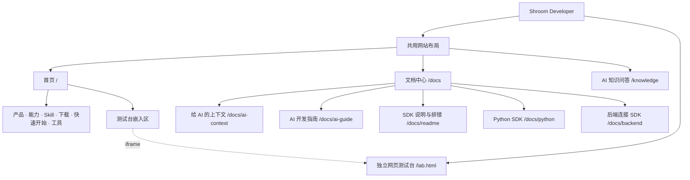

# Shroom Developer 页面结构

## 文档范围

- 当前项目：`C:\sdk`
- 核对日期：2026-10-10
- 代码基线：`d92d1b7`
- 内容依据：当前页面源码
	- 描述已有布局与入口
	- 不代表线上运行验证
	- 不包含页面改版
- 关联笔记：[[Shroom-SDK-功能架构]]

## 页面结构图

## 页面层级

- 首页 `/`
	- 长页面滚动布局
	- `/#...` 是首页分区
	- 分区不是独立页面
- 文档中心 `/docs`
	- 五份接入文档
	- 详情路由 `/docs/[slug]`
	- 未知文档返回 404
- AI 知识问答 `/knowledge`
	- 独立完整问答页
- 网页测试台 `/lab.html`
	- 独立静态页面
	- 也可嵌入首页
- 当前有效页面
	- 八个共用布局页面
	- 一个独立测试台

## 共用布局

- 适用范围
	- 首页
	- 文档中心
	- 五个文档详情页
	- AI 知识问答页
- 顶部栏
	- 固定高度：72 px
	- 品牌：Shroom Developer
	- 品牌入口 → 首页顶部
	- 当前栏目或页面标题
	- 查看文档 → `/docs`
	- 获取 SDK → `/#downloads`
	- 窄屏目录开关
- 左侧导航
	- 桌面端固定显示
	- 宽度：240 px
	- 从顶栏下方延伸到底部
	- 菜单过长时内部滚动
	- 首页高亮跟随正文位置
- 主内容区
	- 顶部避让固定栏
	- 桌面端避让侧栏
	- 二级页面复用同一外框
	- 文档详情增加本页目录
- 响应式布局
	- ≥ 1024 px：固定侧栏
	- < 1024 px：折叠目录
	- 目录展开后可关闭
	- 正文切换为全宽布局
- 公共页脚
	- 产品能力 → `/#capabilities`
	- SDK 与上位机 → `/#downloads`
	- 文档中心 → `/docs`
	- AI 知识问答 → `/knowledge`
	- 网页测试台 → `/lab.html`
	- 排错与支持 → `/docs/readme`

## 左侧导航结构

- 了解 SDK
	- 开发概览 → `/#top`
	- 选择产品 → `/#products`
	- 产品能力 → `/#capabilities`
- 接入与下载
	- SDK Skill → `/#skill`
	- SDK 下载 → `/#downloads`
	- 上位机下载 → `/#desktop-downloads`
	- 快速开始 → `/#quick-start`
- 工具与文档
	- 开发工具 → `/#tools`
	- 文档与示例
		- 首页点击 → `/#docs`
		- 二级页点击 → `/docs`
	- Python SDK → `/docs/python`
	- AI 知识问答 → `/knowledge`
- 底部独立入口
	- 网页测试台 → `/lab.html`
	- 新标签页打开
- 当前导航边界
	- 后端连接指南未单列侧栏
	- 从文档中心进入 `/docs/backend`
	- 二级页的首页锚点会返回首页

## 首页分区

- 01 开发概览 `#top`
	- 品牌介绍与 SDK 定位
	- 快速接入代码展示
	- 示例代码复制
	- 用 Skill 快速接入 → `#quick-start`
	- 获取上位机 → `#desktop-downloads`
- 02 平台说明条
	- 通用 SDK 标识
	- Windows / macOS / Linux 标识
	- 无独立锚点
- 03 选择产品 `#products`
	- 产品检索与切换
	- 矩阵压力传感器
	- 智能手套
	- 通用采集模块
	- 对应能力与资源入口
- 04 产品能力 `#capabilities`
	- 统一设备接入
	- 稳定数据解析
	- Mock 模拟开发
	- 压力热图渲染
	- SDK 能力边界说明
- 05 SDK Skill `#skill`
	- AI 辅助接入说明
	- 实体内容：`AI-CONTEXT.md`
	- 获取 Skill → `/docs/ai-context`
	- 三步接入说明
		- 复制 SDK 上下文
		- 描述设备与目标
		- 生成并验证接入
	- 对话卡片是静态示例
	- 不在此处执行 AI 对话
- 06 下载区 `#downloads`
	- Python SDK 卡片
		- 独立 ZIP 下载
		- 指南 → `/docs/python`
	- Node.js SDK 卡片
		- 独立 ZIP 下载
		- 包含浏览器入口
		- 指南 → `/docs/readme`
	- 两种语言直接展示
		- 宽屏双列
		- 窄屏纵向排列
	- 上位机区域 `#desktop-downloads`
		- 位于下载区内部
		- Windows：提供下载入口
		- macOS / Linux：尚未发布
		- 版本与更新说明
		- 驱动与权限提示
		- 排错指南入口
- 07 快速开始 `#quick-start`
	- 下载并解压 SDK
	- 先用模拟数据跑通
	- 连接设备
	- 订阅数据并渲染
	- 接入代码示例
- 08 在线体验 `#web-lab`
	- iframe 嵌入 `/lab.html`
	- 允许串口访问
	- 可新标签页打开
	- 未单列首页侧栏锚点
- 09 开发工具 `#tools`
	- 网页测试台 → `/lab.html`
	- 触觉手套体验站 → 外部站点
	- Shroom SDK Skill → `/docs/ai-context`
	- 点位映射生成器：规划中
	- 工程验证工具：规划中
- 10 文档与示例 `#docs`
	- 给 AI 的上下文
	- 怎么用 AI 来开发
	- SDK 说明与排错
	- 完整文档中心 → `/docs`
- 已停用内容
	- 试用密钥申请 `#trial`
	- 源码保留在注释中
	- 当前页面不会渲染

## 文档页面

- 文档中心 `/docs`
	- 返回首页
	- 文档说明
	- AI 知识助手入口
	- 五个文档卡片
	- 按开发方式推荐阅读
- 文档清单
	- 给 AI 的上下文
		- 路由：`/docs/ai-context`
		- 来源：`sdk/AI-CONTEXT.md`
	- 怎么用 AI 来开发
		- 路由：`/docs/ai-guide`
		- 来源：`sdk/怎么用AI开发.md`
	- SDK 说明与排错
		- 路由：`/docs/readme`
		- 来源：`sdk/README.md`
	- Python SDK
		- 路由：`/docs/python`
		- 来源：`sdk/python/README.md`
	- 后端连接 SDK
		- 路由：`/docs/backend`
		- 来源：`sdk/BACKEND.md`
- 详情页共用结构
	- 返回文档中心 / 首页
	- 标题、摘要、源文件信息
	- 复制全文按钮
	- Markdown 渲染正文
	- 本页章节目录
		- 宽屏：右侧固定跟随
		- 窄屏：折叠目录
		- 章节锚点：`#s1`、`#s2` 等
	- 底部其他文档入口
- 内容生成方式
	- 从 SDK Markdown 构建生成
	- 不是后台在线文章编辑器

## AI 问答页面与浮窗

- 完整问答 `/knowledge`
	- 标题与检索说明
	- 推荐问题
	- Python 文档快捷入口
	- 对话消息区
	- 文档引用与跳转
	- 问题输入框
	- 发送 / 停止生成
	- 清空当前会话
- 公共问答浮窗
	- 首页和文档页可见
	- 右下角问文档入口
	- 弹出对话面板
	- 可前往完整问答页
	- 会话缓存于当前浏览器会话
	- `/knowledge` 不重复显示浮窗
- 服务边界
	- 调用 `POST /api/knowledge`
	- 该地址是接口，不是页面
	- 回答依赖智谱及知识库配置
	- 网站文档构建不等于知识库上传

## 下载弹窗与独立资源

- 下载登记弹窗
	- Python / Node.js / Windows 共用
	- 当前所选资源决定下载目标
	- 姓名、手机、邮箱、机构
	- 提交后触发下载
	- 已登记浏览器可直接下载
	- 登记网络失败也放行
	- 不是独立页面
	- 不是付费授权系统
- 独立网页测试台
	- 路径：`/lab.html`
	- 不套用网站顶栏和侧栏
	- 页面由测试台模板构建
	- 首页以 iframe 嵌入
- 外部手套站
	- 地址：`https://glove.jq-industries.io/`
	- 不属于本站路由
- 下载文件
	- `/shroom-sdk-python.zip`
	- `/shroom-sdk-node.zip`
	- 上位机文件由下载服务提供
	- 文件地址不是页面
- 后端连接 SDK
	- `/docs/backend` 仅为使用指南
	- 客户端连接已有 HTTP / WebSocket 服务
	- 不等于本站新增后台管理页

## 源码索引

- 共用外框：[SiteShell.tsx](../../app/SiteShell.tsx)
- 顶栏与侧栏：[SiteNavigation.tsx](../../app/SiteNavigation.tsx)
- 首页分区：[page.tsx](../../app/page.tsx)
- 下载配置：[downloads.ts](../../app/downloads.ts)
- 下载弹窗：[DownloadProvider.tsx](../../app/DownloadProvider.tsx)
- 文档中心：[docs/page.tsx](../../app/docs/page.tsx)
- 文档详情：[docs/[slug]/page.tsx](../../app/docs/%5Bslug%5D/page.tsx)
- 文档生成：[build-docs.mjs](../../scripts/build-docs.mjs)
- 完整问答：[knowledge/page.tsx](../../app/knowledge/page.tsx)
- 问答浮窗：[knowledge-widget.tsx](../../app/components/knowledge-widget.tsx)
- 问答接口：[api/knowledge/route.ts](../../app/api/knowledge/route.ts)
- 测试台模板：[index.template.html](../../sdk/web/index.template.html)
