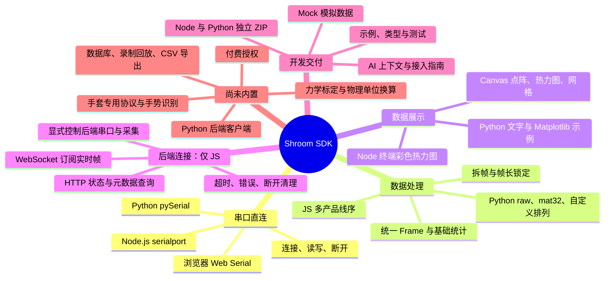

# Shroom SDK 功能架构

## 笔记范围

- 基准日期

	- 2026-10-10
- 代码版本

	- `d92d1b7`
	- Node 与浏览器后端连接已集成
- 当前项目

	- `C:\sdk`
	- SDK 源码：`sdk/`
- 对照项目

	- `E:\ShroomSDK`
	- 仅迁入后端连接客户端
	- 未迁入完整采集与展示工具包

## 功能思维导图

## 串口直连

- 浏览器入口

	- `sdk/web/index.js`
	- Web Serial
	- `Shroom.connect()`
	- 用户点击后连接
	- HTTPS 或 localhost
- Node.js 入口

	- `sdk/node/index.js`
	- Node.js / Electron
	- 可选依赖 `serialport`
	- `Shroom.listPorts()`
	- `Shroom.connect({ path })`
- Python 入口

	- `sdk/python`
	- Python 3.10+
	- 不依赖 Node.js
	- 串口依赖 pySerial
	- `Shroom.list_ports()`
	- `Shroom.connect("COM3")`
- 数据读取

	- JavaScript

		- `device.onFrame()`
		- 逐帧回调
	- Python

		- 同步迭代
		- `device.read_frame(timeout)`
		- 无完整帧返回 `None`
		- 不支持 `on_frame()`
- 生命周期

	- 串口读写
	- 显式关闭连接
	- Python 支持 `with`
	- 接收字节与帧计数

## 数据与线序

- 字节拆帧

	- 分隔符识别
	- 分片数据拼接
	- 帧长锁定
	- 异常长度丢弃
- 统一 Frame

	- 适用范围

		- 直连串口
		- Mock 模拟数据
	- 原始数据

		- `raw`
		- 原始字节
	- 相对数值

		- `values`
		- float32 数组
		- 默认按 255 归一化
	- 矩阵尺寸

		- `rows` / `cols`
	- 基础统计

		- `min` / `max` / `avg`
		- `area`：超过阈值的点数
		- `center`：压力重心
		- `timestamp`：时间戳
- 点位线序

	- JavaScript

		- 多产品内置排列
		- 垫子、坐垫、足底等
		- 产品名映射到线序
	- Python

		- `raw`
		- `mat32`
		- 自定义排列
		- 未同步全部 JS 产品线序
- 数值边界

	- 线序只调整位置
	- 默认相对值不是 N / kPa
	- 受力点数不是物理面积
	- 不进行逐台力学标定

## 数据展示

- 浏览器 Canvas

	- `Shroom.createHeatmap()`
	- 点阵模式
	- 热力图模式
	- 网格模式
	- 配色与显示增益
	- 显示平滑与起伏调节
- Node.js 终端

	- `Shroom.renderAscii()`
	- 彩色字符热力图
- Python 展示

	- `Shroom.render_ascii()`
	- 文字热力图
	- 可选 Matplotlib 示例
- 展示边界

	- 显示效果不等于标定
	- 不内置完整 React UI 库
	- 不内置手套 3D 展示组件

## 后端连接

- 支持范围

	- Node.js
	- Electron
	- 浏览器
	- Python 暂不支持
- 核心客户端

	- `BackendSdkClient`
	- HTTP 控制接口
	- WebSocket 实时通道
	- 依赖已运行的主项目后端
- 导入入口

	- Node：`sdk/node/index.js`
	- 浏览器：`sdk/web/index.js`
	- 包入口：`shroom-sdk/backend`
	- 经典脚本：`Shroom.BackendSdkClient`
- 默认地址

	- HTTP：`http://127.0.0.1:19245`
	- WS：`ws://127.0.0.1:19999`
	- 两个地址分别配置
- HTTP 查询

	- 接口契约

		- `getContract()`
		- 契约缓存与刷新
	- 通道状态

		- `getChannels()`
		- `getWsStatus()`
	- 展示系统

		- `listDisplaySystems()`
		- `getDisplaySystem(id)`
	- 串口状态

		- `listSerialPorts()`
		- `getSerialStatus()`
	- 当前传感器

		- `getCurrentSensor()`
- 显式控制后端

	- 切换传感器

		- `setSensorType(type)`
	- 开关串口

		- `openSerial()`
		- `closeSerial()`
	- 启停采集

		- `startCollection()`
		- `stopCollection()`
	- 控制动作需主动调用
	- 不自动重试写操作
- 实时订阅

	- `connectRealtime()`
	- `subscribe()`
	- `unsubscribe()`
	- `frame`：单帧通知
	- `message`：JSON 消息
	- `raw`：非 JSON 文本
	- 批量帧逐条通知
- 连接管理

	- 默认 10 秒超时
	- 错误事件
	- 断开清理
	- 过时连接事件隔离
	- 不自动重连
	- `disconnectRealtime()`
- 后端帧边界

	- 保留后端原始 JSON
	- 不等于串口 Frame
	- 不自动归一化
	- 不重复套用线序
	- 不直接调用 `decodeFrame()`
	- 基础热力图需显式适配
- 部署边界

	- 不启动后端服务
	- 不内置采集引擎
	- Shroom Monitor 不是此后端
	- 浏览器遵循 CORS / Origin
	- HTTPS 页面使用 HTTPS / WSS
	- 权限与认证由后端负责

## 开发与交付

- 模拟设备

	- `Shroom.mock()`
	- 无硬件开发
	- 模拟帧与直连帧语义一致
- 开发资料

	- README
	- AI-CONTEXT
	- 后端连接指南
	- Python 专用指南
	- JavaScript 类型定义
- SDK 下载

	- Node.js ZIP

		- Node.js 源码
		- 浏览器入口
		- 后端连接客户端
		- 示例与文档
	- Python ZIP

		- Python 独立源码
		- pip 本地安装
		- 本次功能未改动
	- 兼容完整 ZIP

		- 保留旧下载入口
- 后端只读示例

	- `node node/backend-demo.js`
	- 查询契约与串口状态
	- 订阅实时帧
	- 不自动开串口
	- 不自动启动采集
- 验证状态

	- 后端 SDK：15 项测试通过
	- 知识问答：14 项测试通过
	- 类型检查通过
	- 生产构建通过
	- 下载包解压验证通过
	- 本次未做真机联调

## 网站配套

- 文档中心

	- `/docs`
	- `/docs/backend`
	- `/docs/python`
- AI 知识问答

	- 智谱知识库检索
	- 流式回答
	- 来源与章节定位
	- 新文档需另行上传知识库
- 下载登记

	- 收集下载线索
	- 不等于付费鉴权
- 上位机下载

	- Shroom Monitor
	- 独立串口监视器
- 配套边界

	- 网站服务不打入 SDK
	- AI 上下文不等于 AI 服务
	- AI 上下文不等于完整 Skill 包

## 能力边界

- 当前未内置

	- 本地数据库
	- 本地录制与回放
	- CSV 导出
	- 手套专用拆包协议
	- 手势识别
	- 力学标定
	- N / kPa 换算
	- 付费许可证强制鉴权
	- Python 后端客户端
- 手套注意事项

	- 手部检测不等于触觉手套
	- 直连 SDK 不含完整手套协议
	- 后端模式取决于后端支持
	- E 盘完整手套能力未搬入
- 能力归属

	- SDK 提供连接客户端
	- 后端负责自身设备与采集
	- 调用采集接口不等于自带存储
	- 测试通过不等于全部硬件验证

## 源码索引

- 总体说明

	- [SDK README](../../sdk/README.md)
	- [项目架构](../../ARCHITECTURE.md)
- JavaScript 入口

	- [浏览器入口](../../sdk/web/index.js)
	- [Node.js 入口](../../sdk/node/index.js)
- 后端连接

	- [接入指南](../../sdk/BACKEND.md)
	- [共享客户端](../../sdk/backend/client.js)
	- [Node 适配器](../../sdk/node/backend.js)
	- [只读示例](../../sdk/node/backend-demo.js)
	- [回归测试](../../sdk/tests/backend-client.test.mjs)
- Python

	- [Python 指南](../../sdk/python/README.md)
- AI 上下文

	- [AI-CONTEXT](../../sdk/AI-CONTEXT.md)
