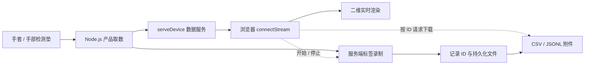

# Shroom 当前系统结构 1.1

## 文档范围

- 项目：`C:\sdk`
- 日期：2026-10-19
- 文档版本：1.1

	- 原结构与产品补充合并版
	- 1.1 不代表 SDK 发版
- SDK 版本：0.1.0
- 范围：当前工作区

	- 包含未提交变更
	- 不代表线上部署状态
- 内容状态
	- 当前实现
		- 沿用原结构快照
		- 不代表新增代码已交付
	- 待核实
		- 原结构未说明的行为
		- 需核对实现与测试证据
	- 建议与规划
		- 1.1 补充的产品约定
		- 不作为现有 API 承诺
- 组织原则

	- 现有产品走快速接入
	- 新设备走基础自定义
	- 采集包含开始与停止
	- 下载独立按记录 ID
	- 任务入口优先
		- 先选用户目标
		- 再选设备与技术栈
		- 按任务定义完成标准

## 产品定位与用户任务

- 定位草案
	- 已支持触觉硬件的数据接入
	- 结构化数据与二维展示
	- 本地采集与文件交付
- 用户假设
	- 应用集成开发者
		- 将设备接入自有应用
		- 消费结构化产品数据
	- 实验采集人员
		- 获得可解释的记录
		- 使用 Python 等工具分析
	- 设备适配开发者
		- 接入新协议与点位映射
	- 主用户待验证
		- 以现有客户真实任务判断
		- 不以设备新旧替代用户分类
- 核心用户任务
	- 读取第一帧
		- 连接已支持的真实产品
		- 收到结构化数据
		- 理解字段与单位
	- 集成自己的应用
		- 选择合适的接入方式
		- 订阅并处理产品数据
		- 正确处理断连与释放
	- 生成采集文件
		- 开始并停止录制
		- 确认状态与质量
		- 按记录 ID 下载
		- 独立解释导出结果
	- 适配新设备
		- 配置串口与协议
		- 验证拆帧与点位
		- 明确适配完成标准
- 交付标准草案
	- 用户能够独立完成所选任务
	- 纯取数不强制录制与下载
	- 每条路径说明环境与限制
	- 每项结果都有检查方法

## 系统组成

- 开发者网站
	- SDK 与上位机下载
	- 快速与基础文档
	- SDK Skill 与知识问答
	- 不代替本地采集服务
- SDK 源码
	- Node.js 产品接入
	- 浏览器通讯与渲染
	- Python 基础串口
	- 共享解析与数据结构
- Node.js 数据服务
	- 本机串口取数
	- WS 广播数据
	- 服务端标签录制
	- 按记录 ID 导出
- 示例网页
	- 连接数据服务
	- 展示实时数据
	- 控制采集起停
	- 查询记录与下载
- 组件职责补充
	- 串口持有方
		- 区分 Node.js 与浏览器直连
		- 多程序争用行为待核实
	- 录制状态
		- 由快速服务管理
		- 浏览器负责控制与展示
	- 上位机
		- 已有平台下载入口
		- 与 SDK 的能力关系待核实
		- 无代码采集能力待核实
	- 既有主项目后端
		- 与独立快速服务分开说明
		- 不推定两者协议互通

## 接入路径选择

- 只需第一帧
	- 已支持产品的 Node.js 接口
	- `device.onData()` 接收数据
	- 浏览器直连测试台用于另一条诊断路径
	- 两条路径的环境范围待补
- 集成应用
	- Node.js 直接消费产品数据
	- 需要浏览器分发时启动快速服务
	- 需要界面时再接入渲染
- 展示与采集
	- Node.js 快速服务
	- 浏览器示例网页
	- 使用完整七步示例
- 接入既有后端
	- 使用 `BackendSdkClient`
	- 前提是主项目后端已运行
	- 不连接独立快速服务协议
- 适配新设备
	- 基础串口与协议路线
	- 自定义拆帧与映射
- 路径说明规划
	- 每条路径给出环境前提
	- 每条路径给出最小示例
	- 每条路径给出完成结果
	- 每条路径给出排错入口

## 快速接入主链路

- 适用范围
	- 完整展示与采集示例
	- 纯取数可在获得产品数据后结束
	- 应用集成按需要选用后续模块
- 完整顺序
	- 连接产品 → Node.js 取数 → 指定端口启动 WS → 前端连接 → 实时渲染 → 数据采集（开始 / 停止）→ 按 ID 下载
- 后端准备
	- 01 连接产品
		- 手套：`Shroom.connectGlove()`
		- 手垫：`Shroom.connectHandPad()`
		- 手套明确选择左右手
		- 串口按实际端口选择
	- 02 Node.js 取数
		- 内置产品协议与映射
		- `device.onData()` 订阅
		- 直接输出产品数据
	- 03 启动 WS
		- `Shroom.serveDevice()`
		- 默认数据端口：19999
		- 同端口提供 HTTP 下载
- 前端展示
	- 04 连接前端
		- `Shroom.connectStream()`
		- 本机填写 WS 端口
	- 05 实时渲染
		- `Shroom.createProductView()`
		- 自动订阅产品数据
		- 手套二维分区图
		- 手垫矩阵热力图
- 数据采集
	- 06 同一分类管理起停
		- 输入本次标签
		- `stream.startRecording()`
		- `stream.stopRecording()`
		- 停止等待文件写完
		- 检查状态与帧数
		- 一次会话一个标签
- 数据下载
	- 07 独立下载操作
		- `stream.listRecordings()`
		- 选择对应采集记录
		- `stream.downloadRecording(recordingId)`
		- ID 来自会话或历史记录
		- 不默认下载最近一条
		- 不使用标签或端口代替 ID
		- CSV 或 JSONL
- 任务验收规划
	- 首次取数
		- 能解释来源与基本字段
	- 应用集成
		- 能订阅并正常释放资源
		- 能处理约定的连接异常
	- 文件采集
		- 能确认最终状态
		- 能核对文件与记录 ID
		- 能解释数据与已知异常

## 运行数据关系

- 展示与录制并行
	- 降低绘图帧率不减少录制帧
	- 关闭网页不等于停止录制
	- 重连可查询服务端状态
- 资源分别释放
	- `view.destroy()` 释放画面
	- `stream.close()` 断开前端
	- `server.close()` 关闭服务
	- `device.close()` 关闭设备
- 端口各有用途
	- 5178：默认示例网页端口
	- 19999：默认数据与下载端口
	- 端口占用时按实际配置
	- 默认只允许本机访问
	- 跨机另配地址与允许来源

## 采集状态与异常约定

- 章节状态
	- 当前行为以已说明节点为准
	- 其余规则为规划或待核实
	- 实现核对后再形成 API 承诺

- 当前已说明
	- 服务端管理录制
	- 网页关闭后继续录制
	- 重连可查询状态
	- 停止等待文件完成写入
	- 重启恢复记录列表
	- 异常中断保留状态
- 产品风险
	- 状态存在不代表行为约定完整
	- 保存帧数不等于源端完整率
	- 中断记录不能被误认为正常完成
- 状态规划
	- 开始中
	- 录制中
	- 停止中
	- 完成
	- 中断
	- 失败
	- 名称与转换需对照现有实现
- 开始与重试规划
	- 返回唯一记录 ID
	- 同一开始请求有去重规则
	- 无数据时给出明确提示
	- 请求超时后的查询与重试行为待核实
- 停止与落盘补充
	- 明确最后一帧的接收边界
	- 文件完成写入后报告完成
	- 重复停止返回一致结果
	- 写入失败不报告正常完成
- 网页断开
	- 保持现有服务端录制行为
	- 重连后主动显示活动会话为规划
	- 恢复停止入口为规划
- 设备断开待核实与规划
	- 当前处理行为待核实
	- 显示中断原因
	- 若允许续录则保留中断区间
	- 不续录则结束为中断状态
- 服务退出待核实与规划
	- 正常退出
		- 明确活动记录结束方式
		- 明确文件与串口关闭顺序
	- 异常退出
		- 重启区分完整与中断记录
		- 说明完整帧恢复范围
		- 说明尾部损失范围
- 其他待核实行为
	- 磁盘写满与写入失败
	- 多网页同时控制
	- 并发录制数量
	- 空记录下载
	- 未完成记录下载
	- 用户主动取消
- 验收规划
	- 重试不创建重复会话
	- 故障后状态可解释
	- 中断与失败可区分
	- 结果可关联原记录 ID

## 文档页面结构

- 文档中心 `/docs`
	- 快速接入文档
		- `/docs/quick-start`
		- 顶部突出完整 7 步
		- 流程目录全部展开
		- 1 先跑通完整示例
		- 2 一键连接真实产品
		- 3 前端接入与渲染
		- 4 数据采集
			- 输入标签并开始
			- 停止并检查结果
		- 5 按记录 ID 下载
		- 6 地址安全与排错
		- 下方跳转基础文档
	- 基础文档
		- `/docs/custom`
		- 新设备与自定义路线
		- 后端 `/docs/backend`
			- 下拉切换 Node.js / Python
			- 串口查询与配置
			- 拆帧解析与诊断
			- 通讯接口
			- 存储基础
		- 前端
			- 通讯 `/docs/frontend-communication`
			- 渲染 `/docs/rendering`
		- 辅助指南
			- SDK Skill `/docs/ai-context`
			- AI 开发 `/docs/ai-guide`
			- 完整说明 `/docs/readme`
	- 兼容参考入口
		- `/docs/node`
		- `/docs/python`
		- `/docs/serial`
		- `/docs/storage`
		- `/docs/backend-api`
		- 入口保留但不全部平铺
- 文档改进规划
	- 任务导航
		- 读取第一帧
		- 集成自有应用
		- 生成采集文件
		- 适配新设备
	- 下载前说明
		- 语言能力差异
		- 产品与环境支持
		- 示例所需服务
	- 排错导航
		- 找不到设备
		- 连接后没有数据
		- 数值或映射异常
		- 网页关闭后的录制
		- 重启后的文件位置
	- 参考资料
		- API 入口与错误码
		- 数据字典与样例文件
		- 版本兼容与升级说明
	- AI 回答
		- 适用 SDK 版本
		- 对应文档出处
		- 文档更新后的回归检查

## SDK 功能分层

- 使用入口
	- Node.js 使用专用入口
		- `shroom-sdk/node`
		- [Node.js 源码](C:/sdk/sdk/node/index.js)
	- 浏览器使用 Web 入口
		- 包根入口默认指向浏览器
		- [浏览器源码](C:/sdk/sdk/web/index.js)
	- Python 使用 `shroom_sdk`
	- 当前以本地 ZIP 交付
		- 未发布公共 npm / PyPI 包
- 产品层
	- Node.js 与浏览器
		- 整包手套 `handGloveFullPacket`
		- 手部检测垫 `hand`
		- `connectProduct()` 统一入口
	- 高层封装
		- 产品波特率
		- 拆帧与协议
		- 点位映射
		- 命名分区数据
- 基础串口层
	- Node.js：`serialport`
	- 浏览器：Web Serial
	- Python：pySerial
	- 查询、配置、连接、读取、关闭
	- 结构化错误与诊断
- 数据处理层
	- 拆帧与帧长管理
	- 标准 `Frame`
	- 线序与矩阵映射
	- 归一化与基础统计
	- `shroom.frame.v1` 网络编码
- 通讯层
	- 独立快速服务
		- `serveDevice()` 启动服务
		- `connectStream()` 接收数据
		- 录制控制与文件下载
		- WS：`recording.*` 控制
		- HTTP：`/health` 状态
		- HTTP：`/recordings/{uuid}.csv`
		- HTTP：`/recordings/{uuid}.jsonl`
	- 既有后端客户端
		- `BackendSdkClient`
		- HTTP 查询与设备控制
		- WS 订阅原始 JSON
		- 连接已运行的主项目后端
		- 不启动后端服务
		- 与快速服务不是同一协议
		- 使用命名导出而非 `Shroom.BackendSdkClient`
- 渲染层
	- 产品视图 `createProductView()`
	- 通用矩阵 `createHeatmap()`
	- Node.js 终端热力图
	- Python 文字与绘图示例
- 采集与导出层
	- Node.js 本地持久化
	- 会话 ID、标签与时间
	- JSONL 原始记录
	- CSV 流式导出
	- 重启恢复记录列表
	- 异常中断保留状态

## 语言能力与环境范围

- Node.js 当前能力
	- 已核实产品协议与命名分区
	- 基础串口
	- 独立快速服务端
	- 本地录制与导出
	- 终端热力图
- 浏览器当前能力
	- 产品数据处理与渲染
	- Web Serial 基础串口
	- `connectStream()` 快速服务客户端
	- 通过服务端控制录制与下载
	- 不据此推定独立持久化能力
- Python 当前能力
	- 基础串口与矩阵
	- 文字与绘图示例
	- 无产品级快速服务接口
	- 产品封装覆盖待核实
	- 同等录制与下载能力未在原结构定义
- 支持状态规划
	- 明确支持
	- 部分支持
	- 未支持
	- 未验证
- 环境清单待补
	- 操作系统与版本
	- Node.js 与 Python 版本
	- 浏览器与连接方式
	- 产品型号与固件组合
	- 示例与发行包版本
- 平台承诺边界
	- 上位机下载不代表 SDK 同等验证
	- 各语言入口不代表任务能力对等
	- 以测试通过的组合提供支持说明

## 产品数据结构

- 整包触觉手套
	- 明确 `side` 左右手
	- 原始压力：256 通道
	- 五指 `fingers`
		- `thumb` 大拇指
		- `index` 食指
		- `middle` 中指
		- `ring` 无名指
		- `little` 小拇指
		- 每指主体 4×3
		- 每指独立 `pulp` 指腹
	- 手掌 `palm`
		- 共 72 点
		- 行长度保留 12、15、15、15、15
	- 分区值
		- `raw` 原始 ADC
		- `matrix` 分区矩阵
		- `values` 归一化值
	- 兼容字段
		- 旧 195 点展示矩阵
		- 顶层统计仍按旧矩阵
		- 不能等同新分区整体统计
	- IMU 保留原始字节
- 手部检测垫
	- 原始压力：1024 通道
	- 映射矩阵：32×32
	- 归一化与基础统计
- 录制记录
	- `id` 采集记录标识
	- `label` 人工标签
	- `status` 会话状态
	- `frameCount` 已保存帧数
	- `source` 真实或模拟来源
	- `error` 异常信息

## 数据含义与质量约定

- 当前解释边界
	- ADC 与相对归一化值
	- 未直接提供物理压力值
	- 旧矩阵统计不等于全手统计
	- IMU 字节不等于姿态结果
- 通道映射规划
	- 原始通道与解码索引
	- 部位与左右手
	- 矩阵行列坐标
	- 有效与保留通道
	- 未使用与重复映射
	- `pulp` 点数与索引覆盖待核实
	- 不假设全部 256 通道参与展示
- 统计口径规划
	- 每项统计标明范围
	- 明确参与点数与掩码
	- 明确聚合方法
	- 新分区与兼容统计可区分
	- API、界面与导出含义一致
- 归一化规划
	- 公式与输入输出范围
	- 固定或自适应方式
	- 参数与版本
	- 裁剪与越界行为
	- 基线与无效点处理
	- 校准适用范围
	- 未标定时保留相对响应含义
- 时间约定规划
	- 主机接收时间
	- 时间单位与时钟含义
	- 会话内帧序号
	- 设备时间与源序号
		- 仅协议提供时记录
		- 不虚构不存在的设备字段
- 质量观测规划
	- 已接收帧数
	- 解析成功帧数
	- 已保存帧数
	- 解析错误与写入错误
	- 数据中断区间
	- 可观测的队列积压或溢出
	- 源端丢帧判断边界
		- 需源序号或等价信息
		- 保存帧数不能单独证明完整
		- 无法判断的损失明确标注
- 验收规划
	- 单通道非零样本验证映射
	- 相同原始帧与参数结果一致
	- 损坏帧与暂停数据可定位
	- 慢写入与失败可识别
	- 无标定时不显示 kPa 或牛顿

## 记录元数据与文件交付

- 当前记录基础
	- ID、标签、时间与状态
	- 帧数、来源与异常
	- CSV 与 JSONL 下载
- 元数据补充规划
	- 记录信息
		- 起止时间与最终状态
		- 真实或模拟来源
		- 异常原因与质量摘要
	- 设备信息
		- 产品型号与左右手
		- 通道数
		- 可获得的设备与固件标识
		- 无法获得时记为未知
	- 解释版本
		- SDK 版本
		- 传输协议版本
		- 产品数据格式版本
		- 映射版本
		- 录制格式版本
	- 处理参数
		- 归一化方法与参数
		- 基线与校准信息
		- 未使用校准时明确记录
	- 文件信息
		- 文件与记录 ID 关联
		- 文件校验信息
		- 导出字段字典
- 人工标签边界
	- 当前一次会话一个标签
	- 描述整段会话
	- 不自动等于逐帧动作真值
	- 准备与有效动作可能混在一段
- 按需扩展规划
	- 标签词表
	- 实验条件
	- 匿名受试者标识
	- 事件标记与时间段标注
	- 先验证真实任务是否需要
- CSV 说明待补
	- 列顺序与含义
	- 单位与缺失值
	- 编码与标签转义
	- 一行表示帧还是采样点
- JSONL 说明待补
	- 原始记录的精确定义
	- 区分解码 ADC 与串口字节
	- 不推定能重跑全部协议解析
- 文件验收规划
	- CSV 与 JSONL 帧可对应
	- 原始值与帧数可核对
	- 中断与模拟来源可识别
	- 文件离开网页仍可解释
	- 原始数据与参数可重建分区结果
	- 空记录与未完成记录规则明确

## 页面与工具

- 首页 `/`
	- 产品与能力
	- SDK Skill
	- Python / Node.js 下载
	- Windows / macOS / Linux 上位机
	- 快速开始与开发工具
- 共享网站外框
	- 顶栏、左侧导航、正文、页脚
	- 文档导航统一左置
	- 窄屏折叠菜单
- 独立静态工具
	- `/quick-start.html`
		- WS 快速接入示例
		- 数据采集与独立下载
	- `/lab.html`
		- 浏览器直连串口测试
		- 不要求 Node.js 数据服务
	- 下载包中的示例
		- `http://localhost:5178/web/quick-start.html`
- AI 问答 `/knowledge`
	- 智谱知识检索与流式回答
	- 需要服务端密钥配置
	- 不属于传感器数据链路
	- 本地文档不会自动上传知识库

## 版本交付与支持规划

- 发行包
	- 明确 SDK 版本
	- 附带内容清单
	- 依赖安装方式
	- 对应文档与可运行示例
	- 离线安装支持范围待核实
- 兼容关系
	- 浏览器包与快速服务
	- SDK 与产品固件
	- 协议与数据字段
	- 映射与历史文件
	- 能解码不代表语义兼容
- 兼容检查规划
	- 支持组合可查询
	- 不兼容时给出操作提示
	- 保留历史样本验证
	- 旧 195 点字段说明范围
	- 提供替代字段与迁移示例
	- 废弃周期按支持能力确定
- 支持入口
	- 已知问题
	- 错误码与排错
	- 日志与诊断导出
	- 反馈渠道
	- 响应时间按团队能力确定
- 部署模式
	- 本机默认
		- 沿用当前访问边界
	- 跨机协作
		- 是否正式支持待验证
		- 纳入认证与授权约定
		- 纳入传输保护要求
		- 不直接沿用本机试用承诺

## 源码目录结构

- `C:\sdk\app`
	- `page.tsx` 开发首页
	- `SiteShell.tsx` 共享布局
	- `docs` 文档页面与目录
	- `knowledge` 知识问答页面
- `C:\sdk\sdk`
	- `core` 解析、映射、产品帧
	- `node` 串口、WS 服务、录制
	- `web` 串口、WS 客户端、绘图
	- `backend` 既有后端客户端
	- `python` Python 基础包
	- `docs` SDK 文档事实源
	- `tests` JavaScript 回归
- `C:\sdk\scripts`
	- `build-sdk-bundle.mjs` 浏览器单文件
	- `pack-sdk.mjs` ZIP 打包
	- `build-docs.mjs` 文档预渲染
- `C:\sdk\public`
	- 浏览器示例与测试台
	- Node.js SDK ZIP
	- Python SDK ZIP
	- 兼容完整 SDK ZIP
- `C:\sdk\server`
	- 智谱检索代理
	- 文档与问答回归
- `C:\sdk\docs\obsidian`
	- 系统结构分层笔记
	- 本文档 1.1 合并版
- `C:\sdk\ARCHITECTURE.md`
	- 详细架构与历史变更

## 当前能力边界

- 完整快速链路
	- 当前支持 Node.js 与浏览器
	- Python 仅基础串口与矩阵能力
	- Python 无产品级快速服务接口
- 产品支持
	- 仅已核实的手套与手垫协议
	- 不自动识别设备型号
	- 不自动判断左右手
- 采集与下载
	- 人工标签不是动作识别
	- 文件存储不是通用数据库
	- 未内置录制回放
	- 未内置多设备同步
- 数据含义
	- ADC 与相对归一化值
	- 不直接提供 kPa 或牛顿
	- 不提供手势与姿态解算
- 渲染范围
	- 当前是二维热力图
	- 未提供三维手模渲染
- 商业与安全
	- 未实现付费许可校验
	- 下载登记不等于授权
	- 公网部署另配认证与 TLS

## 产品优先级与发布验收

- 版本范围
	- 文档 1.1 记录补充方案
	- SDK 后续发版范围待确定
	- 不将本文规划等同已完成
- P0 交付门槛
	- 含义
		- 扩大对外采集使用前核实
		- 已实现则补文档与证据
		- 不等于已确认代码缺陷
	- 数据口径
		- 通道、统计与归一化明确
		- 新旧映射可区分
		- 负责人建议为 SDK 与协议工程
		- 下一次对外采集试用前核实
	- 采集故障
		- 断连、退出与写入失败可解释
		- 中断不被标为正常完成
		- 负责人建议为数据服务与测试
		- 下一次对外采集试用前核实
	- 数据质量
		- 时间与数量含义明确
		- 可观测异常与判断边界明确
		- 负责人建议为 SDK 与数据使用方
		- 下一次对外采集试用前核实
- P1 试用改进
	- 接入选择
		- 任务入口与语言能力清晰
		- 负责人建议为产品与文档
		- 下一轮首次接入测试前补充
	- 历史数据解释
		- 元数据与兼容规则明确
		- 负责人建议为 SDK 与发布工程
		- 数据语义变化的版本发布前核实
- P2 持续观察
	- AI 问答版本与出处
	- 负责人建议为文档与问答维护者
	- 文档或 SDK 更新时检查
- 负责人落实
	- 以上为建议职能
	- 具体人员由团队确定
- 当前不自动阻塞
	- 三维手模
		- 先验证空间展示需求
	- 公共 npm 与 PyPI
		- 先保证 ZIP 可复现安装
	- 多设备同步
		- 双手或跨设备任务出现后评估
	- 付费许可
		- 先确定收费与交付模式

## 待验证假设与后续规划

- 用户定位
	- 应用集成或实验采集谁优先
	- 观察客户最近一次真实任务
	- 根据任务调整主入口
- 商业定位
	- 硬件配套或独立收费
	- 核实销售与支持责任
	- 再决定许可与服务承诺
- Python 完整链路
	- 核实实际语言使用
	- 核实当前绕行成本
	- 再决定产品级能力投入
- 回放与标注
	- 观察 CSV 下载后的下一步
	- 核实整段标签是否够用
	- 排序离线重建、事件标记与回放
- 跨机与多人
	- 核实部署位置与操作者
	- 核实访问与控制权限
	- 再正式定义跨机模式
- 推进顺序建议
	- 先核实目标任务与范围
	- 落实数据与采集约定
	- 同步改进接入与用户观察
	- 按证据选择扩展能力

## 产品成功指标

- 指标阶段
	- 先建立实际基线
	- 再确定时限与成功率目标
	- 不将小样本外推为整体成功率
- 首次成功取数时间
	- 支持硬件已经就绪
	- 从按文档安装开始
	- 到首帧真实数据可解释
	- 记录未完成情况与原因
- 任务独立完成率
	- 无人工代操作
	- 按任务验收结果
	- 完成人数除以尝试人数
	- 首帧、集成与采集分开统计
- 录制完成率
	- 分子
		- 正常完成且文件可校验
	- 分母
		- 正常完成、失败与中断会话
	- 分项记录
		- 真实与模拟分开
		- 主动取消与进行中另列
		- 空记录按用户意图解释
	- 不等于源端完整率
- 数据解释完整性
	- 来源与单位
	- 左右手与统计范围
	- 版本与处理参数
	- 按适用字段抽查
- 支持负担
	- 人工介入次数
	- 人工支持耗时
	- 首要失败原因
- 首轮验证方式
	- 邀请代表性真实用户
	- 观察完整任务
	- 记录选择与操作卡点
	- 用结果调整文档与优先级
