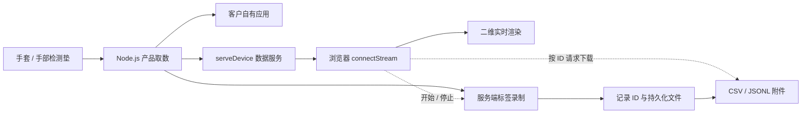

# Shroom 当前系统结构 1.2

## 文档范围

- 项目：`C:\sdk`
- 日期：2026-10-19
- 文档版本：1.2

	- 已购设备客户快速集成版
	- 基于 1.1 调整产品约定
	- 1.2 不代表 SDK 发版
- SDK 版本：0.1.0
- 范围：当前工作区

	- 包含未提交变更
	- 不代表线上部署状态
- 内容状态
	- 当前实现
		- 沿用 1.1 结构快照
		- 未新增源码核验结论
	- 已确认定位
		- 主用户为已购设备客户
		- 核心目标为快速集成
	- 1.2 产品约定
		- 规定入口与验收方向
		- 对应实现需核对与同步
	- 本轮产品评审补充
		- 明确支持承诺与集成终点
		- 补充消费、恢复与变更约定
		- 增加本轮验收记录与指标口径
		- 不新增源码或实测通过结论
	- 待核实与规划
		- 保留未验证能力的边界
		- 不作为已交付 API 承诺
- 组织原则
	- 已购设备优先快速集成
	- 按型号与技术栈选择路线
	- SDK 封装产品协议与映射
	- 客户消费结构化产品数据
	- 首帧作为中间检查点
	- 自有应用接入作为核心终点
	- 展示与采集按需扩展
	- 新设备适配进入高级路线
	- 采集包含开始与停止
	- 下载独立按记录 ID

## 产品定位与用户任务

- 产品定位
	- 面向已购设备的客户
	- 帮助快速接入自有应用
	- 降低协议与映射接入成本
	- 提供数据与连接生命周期约定
- 主用户
	- 已购买 Shroom 设备的客户
	- 需要将设备接入自身系统
	- 实际接入人员按技术栈选路线
	- 环境与语言需求按客户项目确认
- 核心用户任务
	- 确认交付组合
		- 已购型号与左右手
		- 客户技术栈与环境
		- 可获得的固件信息
		- 对应 SDK 与示例
	- 跑通最小例程
		- 安装必要依赖
		- 选择真实设备端口
		- 接收可解释的真实数据
	- 集成自己的应用
		- 复用连接与订阅代码
		- 处理产品字段与单位
		- 将数据用于自身业务
	- 验证连接生命周期
		- 识别断连与无新数据
		- 按约定恢复连接
		- 正确取消订阅与释放资源
- 配套用户任务
	- 展示实时数据
		- 按需连接浏览器
		- 按需接入二维视图
	- 生成采集文件
		- 开始并停止录制
		- 确认状态与质量
		- 按记录 ID 下载
		- 独立解释导出结果
	- 适配新设备
		- 配置串口与协议
		- 验证拆帧与点位
		- 明确适配完成标准
- 集成交付约定
	- 已支持设备优先使用产品接口
	- 基础接入不要求重写协议与映射
	- 纯取数不强制网页与快速服务
	- 纯取数不强制录制与下载
	- 第一帧不作为集成最终验收
	- 客户程序须通过约定的运行检查
	- 每条路线说明环境与限制
	- 每项结果都有检查方法
- 核心业务结果约定待落实
	- 每个客户项目选一个实际使用任务
	- 定义数据输入后的预期业务结果
	- 数据进入客户实际业务处理路径
	- 控制台打印仅作中间检查
	- 不强制客户增加展示或录制
	- 约定结果可由客户与交付方共同确认
	- 将首次集成与后续稳定使用分别观察
- 客户交付模式待确认
	- 自助接入
	- 约定辅导接入
	- 约定集成服务
	- 所有模式均验收客户业务结果
	- 自助成功率仅评价自助路线
	- 约定服务与临时救援分开记录
	- 服务包含范围与完成条件按项目明确

## 系统组成

- 开发者网站
	- 设备对应的接入指引
	- SDK 与上位机下载
	- 快速与基础文档
	- SDK Skill 与知识问答
	- 不代替本地采集服务
- SDK 源码
	- Node.js 产品接入
	- 浏览器通讯与渲染
	- Python 基础串口
	- 共享解析与数据结构
- Node.js 数据服务
	- 本机串口取数
	- WS 广播数据
	- 服务端标签录制
	- 按记录 ID 导出
- 示例网页
	- 连接数据服务
	- 展示实时数据
	- 控制采集起停
	- 查询记录与下载
- 组件职责
	- 客户应用
		- 消费 SDK 结构化数据
		- 实现客户业务逻辑
	- 串口持有方
		- 区分 Node.js 与浏览器直连
		- 多程序争用行为待核实
	- 录制状态
		- 由快速服务管理
		- 浏览器负责控制与展示
	- 上位机
		- 已有平台下载入口
		- 与 SDK 的能力关系待核实
		- 无代码采集能力待核实
	- 既有主项目后端
		- 与独立快速服务分开说明
		- 不推定两者协议互通

## 接入路径选择

- 主入口：集成已购设备
	- 先选已购产品型号
	- 再选客户技术栈与环境
	- 查看对应支持状态
	- 获取匹配的 SDK 与最小例程
	- 先取数再接入客户程序
- 当前 Node.js 产品路线
	- 使用产品级连接接口
	- `device.onData()` 接收数据
	- 直接消费结构化产品数据
	- 需要浏览器分发时启动快速服务
	- 需要界面时再接入渲染
- 浏览器诊断路线
	- 直连串口测试台
	- 用于设备与数据诊断
	- 环境范围待补齐
	- 不替代客户应用的集成验收
- Python 路线
	- 当前能力见语言范围
	- 不默认与 Node.js 能力对等
	- 直接接入需核实产品封装覆盖
	- 不把跨语言绕行默认设为标准路线
- 展示与采集路线
	- Node.js 快速服务
	- 浏览器示例网页
	- 使用完整七步示例
	- 按客户需要选用
- 接入既有后端
	- 使用 `BackendSdkClient`
	- 前提是主项目后端已运行
	- 不连接独立快速服务协议
- 适配新设备
	- 基础串口与协议路线
	- 自定义拆帧与映射
	- 与已支持产品的首次接入分开
- 每条路线的交付内容
	- 适用产品与环境前提
	- 安装与启动方法
	- 最小可运行示例
	- 接入自有应用的方法
	- 字段与异常处理说明
	- 完成结果与排错入口

## 快速集成主链路

- 主链路
	- 确认型号与技术栈 → 检查环境 → 获取 SDK → 运行最小例程 → 接入客户程序 → 验证数据与连接生命周期
- 当前示例基线
	- 使用已说明的 Node.js 产品接口
	- 其他语言按能力范围选择
	- 未验证组合不标为已支持
- 01 确认型号与环境
	- 选择手套或手部检测垫
	- 手套明确左右手
	- 确认系统与运行时版本
	- 检查设备端口与必要依赖
	- 查询型号与固件兼容说明
- 02 获取对应 SDK
	- 选择匹配语言的发行包
	- 使用同版文档与示例
	- 说明安装与启动入口
	- 说明首次运行的预期结果
- 03 跑通最小例程
	- 手套：`Shroom.connectGlove()`
	- 手垫：`Shroom.connectHandPad()`
	- 串口按实际端口选择
	- SDK 使用内置协议与映射
	- `device.onData()` 订阅数据
	- 检查真实来源与左右手
	- 解释字段与单位
- 04 接入客户程序
	- 说明模块导入方式
	- 复用连接与订阅代码
	- 消费产品分区或矩阵数据
	- 保留客户自身业务处理
	- 说明取消订阅与退出方法
	- 完整示例之外提供最小集成示例
- 05 验证连接生命周期
	- 区分设备连接与数据更新
	- 识别设备断开及端口占用
	- 明确自动或手动恢复方式
	- 按约定恢复后继续消费数据
	- 关闭时正确释放设备
	- 现有异常行为需核对实现
- 06 客户集成验收
	- 在客户实际程序中运行
	- 接收并正确解释真实数据
	- 通过约定时长与负载检查
	- 完成断连与恢复检查
	- 完成退出与再次连接检查
	- 基础集成无需运行录制流程
- 业务验收样例要求
	- 样例属于规划而非现有 API
	- 已知输入样本
		- 给定原始帧与处理工件
		- 检查预期分区与字段值
	- 真实设备任务
		- 设备产生约定的触觉变化
		- 客户业务收到对应数据
		- 产生双方约定的业务结果
	- 异常任务
		- 无新数据时不继续使用旧值作为新值
		- 恢复后继续完成同一业务任务
	- 验收结论
		- 保存结果与失败原因
		- 未通过项说明修复或范围处理

## 展示与采集扩展链路

- 适用范围
	- 客户需要网页展示或文件采集
	- 作为快速集成后的可选分支
	- 完整七步不作为统一前置要求
- 完整顺序
	- 连接产品 → Node.js 取数 → 指定端口启动 WS → 前端连接 → 实时渲染 → 数据采集（开始 / 停止）→ 按 ID 下载
- 后端准备
	- 01 连接产品
		- 手套：`Shroom.connectGlove()`
		- 手垫：`Shroom.connectHandPad()`
		- 手套明确选择左右手
		- 串口按实际端口选择
	- 02 Node.js 取数
		- 内置产品协议与映射
		- `device.onData()` 订阅
		- 直接输出产品数据
	- 03 启动 WS
		- `Shroom.serveDevice()`
		- 默认数据端口：19999
		- 同端口提供 HTTP 下载
- 前端展示
	- 04 连接前端
		- `Shroom.connectStream()`
		- 本机填写 WS 端口
	- 05 实时渲染
		- `Shroom.createProductView()`
		- 自动订阅产品数据
		- 手套二维分区图
		- 手垫矩阵热力图
- 数据采集
	- 06 同一分类管理起停
		- 输入本次标签
		- `stream.startRecording()`
		- `stream.stopRecording()`
		- 停止等待文件写完
		- 检查状态与帧数
		- 一次会话一个标签
- 数据下载
	- 07 独立下载操作
		- `stream.listRecordings()`
		- 选择对应采集记录
		- `stream.downloadRecording(recordingId)`
		- ID 来自会话或历史记录
		- 不默认下载最近一条
		- 不使用标签或端口代替 ID
		- CSV 或 JSONL
- 扩展任务验收
	- 展示
		- 可辨连接与数据更新状态
		- 颜色与数值范围可解释
	- 文件采集
		- 能确认最终状态
		- 能核对文件与记录 ID
		- 能解释数据与已知异常
		- 文件完成与任务有效性分别检查

## 运行数据关系

- 主数据路径
	- 客户应用可直接消费产品数据
	- 快速服务用于按需分发与采集
- 展示与录制分工
	- 展示降频不应主动减少录制帧
	- 持续能力须按工作负载验证
	- 关闭网页不等于停止录制
	- 重连可查询服务端状态
- 资源分别释放
	- `view.destroy()` 释放画面
	- `stream.close()` 断开前端
	- `server.close()` 关闭服务
	- `device.close()` 关闭设备
- 端口各有用途
	- 5178：默认示例网页端口
	- 19999：默认数据与下载端口
	- 端口占用时按实际配置
	- 默认只允许本机访问
	- 跨机另配地址与允许来源
- 工作负载约定待落实
	- 设备数量与输入速率
	- 目标运行与采集时长
	- CPU、内存与磁盘条件
	- 数据新鲜度与保存结果分别验收
	- 积压、溢出与写入失败可观测
	- 无源序号时不宣称源端无丢帧
- 数据消费策略待决策
	- 实时展示
		- 优先数据新鲜度
		- 可按明示策略舍弃过期帧
		- 不能把积压旧帧伪装成实时数据
	- 逐帧业务与采集
		- 按任务明确完整性要求
		- 不静默切换为只保留最新帧
		- 超出能力时明确拒绝、降载或中断
	- 发布前落实
		- 默认模式与可选模式
		- 缓冲上限与溢出动作
		- 过期阈值及判断依据
		- 慢回调与慢客户端影响范围
		- 丢弃、积压与失败的观测方式
	- 验收
		- 用慢消费者验证实际策略
		- 验证内存与队列符合约定上限
		- 验证显示与采集分别符合其策略
		- 阈值与容量以本轮实测填写

## 采集状态与异常约定

- 适用范围
	- 选择服务端采集的客户
	- 不扩大基础集成的必需步骤
- 章节状态
	- 当前行为以已说明节点为准
	- 1.2 目标规则需对照实现
	- 未核实规则不作 API 承诺
- 当前已说明
	- 服务端管理录制
	- 网页关闭后继续录制
	- 重连可查询状态
	- 停止等待文件完成写入
	- 重启恢复记录列表
	- 异常中断保留状态
- 用户可见状态约定
	- 设备或服务连接状态
	- 最近数据更新状态
	- 录制与落盘状态
	- 不用已连接代替数据正常
	- 数据过期阈值按设备频率确定
- 活动任务目标规则
	- 每个快速服务实例一个活动录制
	- 现有并发行为待核实
	- 页面进入先查询活动记录
	- 展示记录 ID、标签与开始时间
	- 提供恢复查看与停止入口
	- 网页关闭后的行为在开始前说明
	- 多页面控制规则需确定并验证
- 状态规划
	- 开始中
	- 录制中
	- 停止中
	- 完成
	- 中断
	- 失败
	- 名称与转换需对照现有实现
- 开始与重试规划
	- 返回唯一记录 ID
	- 同一开始请求有去重规则
	- 已有活动录制时明确返回或拒绝
	- 无数据时给出明确提示
	- 超时后可查询实际任务结果
	- 不因盲目重试创建重复会话
- 停止与落盘补充
	- 明确接收或队列中的停止边界
	- 文件完成写入后报告完成
	- 重复停止返回一致结果
	- 写入失败不报告正常完成
	- 无设备时间时不承诺精确采样截断
- 设备断开待核实与规划
	- 当前处理行为待核实
	- 显示中断原因
	- 若允许续录则保留中断区间
	- 不续录则结束为中断状态
- 服务退出待核实与规划
	- 正常退出
		- 明确活动记录结束方式
		- 明确文件与串口关闭顺序
	- 异常退出
		- 重启区分完整与中断记录
		- 说明完整帧恢复范围
		- 说明尾部损失范围
- 数据质量约定
	- 文件完成与质量摘要分开
	- 正常落盘可同时存在数据中断
	- 保存帧数不等于源端完整率
	- 中断和失败不能误报正常成功
- 其他待核实行为
	- 磁盘写满与写入失败
	- 空记录下载
	- 未完成记录下载
	- 用户主动取消
- 验收规划
	- 关闭网页后重开可发现任务
	- 重复开始不创建额外会话
	- 停止后重复停止结果一致
	- 故障后状态可解释
	- 中断与失败可区分
	- 结果可关联原记录 ID

## 文档页面结构

- 结构状态
	- 路由沿用当前结构快照
	- 1.2 导航为调整目标
	- 网站与示例实现需同步核实
- 文档中心 `/docs`
	- 主入口：快速集成已购设备
		- `/docs/quick-start`
		- 1 选择设备型号与左右手
		- 2 选择技术栈并检查环境
		- 3 获取 SDK 与最小例程
		- 4 跑通真实数据
		- 5 接入客户自己的应用
		- 6 验证异常恢复与资源释放
		- 首屏给出最小路线与预期结果
		- 完整七步放入扩展示例
	- 按需扩展
		- 网页通讯与渲染
		- 数据采集起停
		- 按记录 ID 下载
		- 展示与采集完整七步
	- 基础与高级文档
		- `/docs/custom`
		- 新设备与自定义路线
		- 后端 `/docs/backend`
			- 下拉切换 Node.js / Python
			- 标注语言能力与前提
			- 串口查询与配置
			- 拆帧解析与诊断
			- 通讯接口
			- 存储基础
		- 前端
			- 通讯 `/docs/frontend-communication`
			- 渲染 `/docs/rendering`
		- 辅助指南
			- SDK Skill `/docs/ai-context`
			- AI 开发 `/docs/ai-guide`
			- 完整说明 `/docs/readme`
	- 兼容参考入口
		- `/docs/node`
		- `/docs/python`
		- `/docs/serial`
		- `/docs/storage`
		- `/docs/backend-api`
		- 入口保留但不全部平铺
- 下载前说明
	- 产品与环境支持
	- 语言能力差异
	- 对应文档与示例版本
	- 示例所需服务
- 排错导航
	- 安装或依赖失败
	- 找不到设备与端口占用
	- 连接后没有新数据
	- 数值或映射异常
	- 断连后的恢复方法
	- 关闭程序后无法再次连接
	- 网页关闭后的录制
	- 重启后的文件位置
- 参考资料
	- API 入口与错误码
	- 数据字典与样例文件
	- 版本兼容与升级说明
- AI 回答
	- 适用 SDK 版本
	- 对应文档出处
	- 文档更新后的回归检查

## SDK 功能分层

- 使用入口
	- Node.js 使用专用入口
		- `shroom-sdk/node`
		- [Node.js 源码](C:/sdk/sdk/node/index.js)
	- 浏览器使用 Web 入口
		- 包根入口默认指向浏览器
		- [浏览器源码](C:/sdk/sdk/web/index.js)
	- Python 使用 `shroom_sdk`
	- 当前以本地 ZIP 交付
		- 未发布公共 npm / PyPI 包
- 产品层
	- Node.js 与浏览器
		- 整包手套 `handGloveFullPacket`
		- 手部检测垫 `hand`
		- `connectProduct()` 统一入口
	- 高层封装
		- 产品波特率
		- 拆帧与协议
		- 点位映射
		- 命名分区数据
- 基础串口层
	- Node.js：`serialport`
	- 浏览器：Web Serial
	- Python：pySerial
	- 查询、配置、连接、读取、关闭
	- 结构化错误与诊断
- 数据处理层
	- 拆帧与帧长管理
	- 标准 `Frame`
	- 线序与矩阵映射
	- 归一化与基础统计
	- `shroom.frame.v1` 网络编码
- 通讯层
	- 独立快速服务
		- `serveDevice()` 启动服务
		- `connectStream()` 接收数据
		- 录制控制与文件下载
		- WS：`recording.*` 控制
		- HTTP：`/health` 状态
		- HTTP：`/recordings/{uuid}.csv`
		- HTTP：`/recordings/{uuid}.jsonl`
	- 既有后端客户端
		- `BackendSdkClient`
		- HTTP 查询与设备控制
		- WS 订阅原始 JSON
		- 连接已运行的主项目后端
		- 不启动后端服务
		- 与快速服务不是同一协议
		- 使用命名导出而非 `Shroom.BackendSdkClient`
- 渲染层
	- 产品视图 `createProductView()`
	- 通用矩阵 `createHeatmap()`
	- Node.js 终端热力图
	- Python 文字与绘图示例
- 采集与导出层
	- Node.js 本地持久化
	- 会话 ID、标签与时间
	- JSONL 原始记录
	- CSV 流式导出
	- 重启恢复记录列表
	- 异常中断保留状态

## 订阅与恢复契约待落实

- 章节状态
	- 属于 1.2 产品补充
	- 接口形式与当前行为待核实
	- 不新增已交付字段或方法承诺
- 订阅契约
	- 回调顺序与调用方式
	- 取消订阅的方法与返回约定
	- 重复取消与关闭后的行为
	- 回调抛错的传播与影响范围
	- 多订阅者之间的影响范围
	- 慢消费者按数据消费策略处理
- 帧对象使用期
	- 明确交付的是快照还是借用缓冲
	- 是否允许修改与共享需说明
	- 若借用缓冲则给出有效期
	- 异步保存或计算的正确方法
	- 示例避免误保留被覆写的数据
- 连接恢复
	- 区分同一设备恢复与设备替换
	- 端口名不能单独证明设备身份
	- 复核型号、左右手与映射配置
	- 硬件标识仅在可获得时使用
	- 无标识时说明确认能力限制
	- 必要时由用户重新选择设备
	- 自动或手动恢复策略发布前确定
	- 重试时限与主动取消行为明确
- 恢复后的数据边界
	- 新连接与旧连接能够区分
	- 帧计数重置有解释
	- 旧队列不得混入新连接数据
	- 不把恢复后的首帧当成无间断延续
	- 录制若续录则关联中断与配置变化
	- 设备或映射变化时重新确认续录规则
- 验收
	- 回调抛错与取消行为符合约定
	- 保留一帧后读取不产生误解
	- 断开重连后不重复订阅
	- 端口变化与设备替换不静默接错
	- 恢复后旧数据不被当作新数据

## 语言能力与环境范围

- Node.js 当前能力
	- 已说明产品协议与命名分区
	- 基础串口
	- 独立快速服务端
	- 本地录制与导出
	- 终端热力图
- 浏览器当前能力
	- 产品数据处理与渲染
	- Web Serial 基础串口
	- `connectStream()` 快速服务客户端
	- 通过服务端控制录制与下载
	- 不据此推定独立持久化能力
- Python 当前能力
	- 基础串口与矩阵
	- 文字与绘图示例
	- 无产品级快速服务接口
	- 产品封装覆盖待核实
	- 同等录制与下载能力未在原结构定义
- 客户技术栈约定
	- 按已购客户实际项目确定支持范围
	- 不因现有 Node.js 完整就要求客户换栈
	- 承诺直接接入的语言
		- 须覆盖产品协议与映射
		- 须输出结构化产品数据
		- 须说明连接异常与资源释放
		- 须提供对应集成示例与证据
	- Python 客户直接接入时
		- 产品级能力进入该路线交付门槛
		- 基础串口不能代替产品级接入
	- 离线分析客户
		- 可优先提供文件读取示例
	- 网页、录制与服务能力
		- 按实际任务决定
		- 不要求各语言全功能对等
- 支持承诺分级待落实
	- 标准支持组合
		- 已完成对应任务验收
		- 有维护责任与已知限制
	- 客户专项组合
		- 项目范围与补齐项明确
		- 有责任人与交付节点
		- 验收前不标为标准支持
	- 评估中或范围外组合
		- 明确告知当前状态
		- 不以试用可运行代替支持承诺
	- 客户保留原技术栈是交付目标
		- 不等于默认支持任意语言与环境
		- 新增组合按专项范围评估
	- 承诺规则
		- 能力支持状态与承诺等级分开记录
		- 已有承诺先完成或明确协商调整
		- 不因测试失败事后改标范围外
- 支持状态
	- 明确支持
	- 部分支持
	- 未支持
	- 未验证
	- 状态按具体任务与组合标注
- 环境清单待补
	- 操作系统与版本
	- Node.js 与 Python 版本
	- 浏览器与连接方式
	- 产品型号与固件组合
	- 示例与发行包版本
- 平台承诺边界
	- 上位机下载不代表 SDK 同等验证
	- 语言入口不代表任务能力对等
	- 以测试通过的组合提供支持说明
	- 承诺范围须与客户交付约定一致

## 产品数据结构

- 整包触觉手套
	- 明确 `side` 左右手
	- 原始压力：256 通道
	- 五指 `fingers`
		- `thumb` 大拇指
		- `index` 食指
		- `middle` 中指
		- `ring` 无名指
		- `little` 小拇指
		- 每指主体 4×3
		- 每指独立 `pulp` 指腹
	- 手掌 `palm`
		- 共 72 点
		- 行长度保留 12、15、15、15、15
	- 分区值
		- `raw` 原始 ADC
		- `matrix` 分区矩阵
		- `values` 归一化值
	- 兼容字段
		- 旧 195 点展示矩阵
		- 当前顶层统计仍按旧矩阵
		- 不能等同新分区整体统计
	- IMU 保留原始字节
- 手部检测垫
	- 原始压力：1024 通道
	- 映射矩阵：32×32
	- 归一化与基础统计
- 客户默认使用约定
	- 新示例优先说明产品分区或矩阵
	- 同时解释原始值与归一化值
	- 旧顶层统计标明兼容用途
	- 全手聚合须先确定参与点口径
	- 替代字段或计算示例需核实后给出
	- 不在文档修订中静默改变现有 API
- 录制记录
	- `id` 采集记录标识
	- `label` 人工标签
	- `status` 会话状态
	- `frameCount` 已保存帧数
	- `source` 真实或模拟来源
	- `error` 异常信息

## 数据含义与质量约定

- 当前解释边界
	- ADC 与相对归一化值
	- 未直接提供物理压力值
	- 旧矩阵统计不等于全手统计
	- IMU 字节不等于姿态结果
- 通道映射约定待落实
	- 原始通道与解码索引
	- 部位与左右手
	- 矩阵行列坐标
	- 有效与保留通道
	- 未使用与重复映射
	- `pulp` 点数与索引覆盖待核实
	- 256 个通道的用途可核对
	- 区分原始通道与展示位置数量
	- 不假设全部通道参与展示
- 统计口径约定待落实
	- 每项统计标明范围
	- 明确参与点数与掩码
	- 明确聚合方法
	- 新分区与兼容统计可区分
	- API、界面与导出含义一致
- 归一化约定待落实
	- 公式与输入输出范围
	- 固定或自适应方式
	- 参数与版本
	- 裁剪与越界行为
	- 基线与无效点处理
	- 校准适用范围
	- 未标定时保留相对响应含义
	- 不默认跨设备与会话可比
- 显示解释约定
	- 颜色对应的数值范围
	- 自适应色阶需明确标识
	- 同色不自动代表相同原始值
- 时间与帧身份约定待落实
	- 时间单位与时钟含义
	- 主机接收、解析或保存时刻
	- 墙钟时间用于日期展示
	- 单调时间用于间隔与时长
	- 同帧在实时流与导出中可对应
	- 设备时间与源序号
		- 仅协议提供时记录
		- 不虚构不存在的设备字段
	- 无设备时间时
		- 仅说明主机观测时间
		- 不据此承诺真实采样时刻
		- 不据此承诺跨设备同步
- 质量观测规划
	- 已接收帧数
	- 解析成功帧数
	- 已保存帧数
	- 解析错误与写入错误
	- 数据中断区间
	- 可观测的队列积压或溢出
	- 源端丢帧判断边界
		- 需源序号或等价信息
		- 保存帧数不能单独证明完整
		- 无法判断的损失明确标注
- 有效帧判定待落实
	- 分开记录接收、解析与产品结构有效
	- 按实际协议能力检查校验与长度
	- 通道数、格式与适用映射一致
	- 无效帧拒收或带质量说明的规则明确
	- 无效点不静默替换为有效零值
	- 全零或恒定值本身不等于损坏
	- 数据正常状态基于最近有效帧
	- 坏帧不刷新为有效数据更新
- 工件适用关系待落实
	- 型号、左右手与协议对应映射
	- 校验值一致不等于适用于当前设备
	- 缺失、维度错误与版本冲突可定位
	- 无法自动核对的配置由用户确认
- 验收规划
	- 单通道非零样本验证映射
	- 多点样本验证聚合口径
	- 相同原始帧与参数结果一致
	- 损坏帧与暂停数据可定位
	- 慢写入与失败可识别
	- 无标定时不显示 kPa 或牛顿

## 记录元数据与文件交付

- 当前记录基础
	- ID、标签、时间与状态
	- 帧数、来源与异常
	- CSV 与 JSONL 下载
- 元数据补充规划
	- 记录信息
		- 起止时间与最终状态
		- 真实或模拟来源
		- 异常原因与质量摘要
	- 设备信息
		- 产品型号与左右手
		- 通道数
		- 可获得的设备与固件标识
		- 无法获得时记为未知
	- 解释版本
		- SDK 版本
		- 传输协议版本
		- 产品数据格式版本
		- 映射版本
		- 录制格式版本
	- 处理参数
		- 归一化方法与参数
		- 基线与校准信息
		- 未使用校准时明确记录
	- 重建所需工件
		- 对应映射与有效点掩码
		- 处理顺序与参数
		- 随记录或发行包离线提供
		- 用不可变标识或校验值关联
		- 仅版本号不足以验证可复现性
	- 文件信息
		- 文件与记录 ID 关联
		- 文件校验信息
		- 导出字段字典
- 人工标签边界
	- 当前一次会话一个标签
	- 描述整段会话
	- 不自动等于逐帧动作真值
	- 准备与有效动作可能混在一段
- 数据可用性检查
	- 设备与左右手选择正确
	- 有效采集区间可说明
	- 数据中断等异常可识别
	- 人工确认规则按任务提供
	- 不强制先建设完整标注平台
- 按需扩展规划
	- 标签词表
	- 实验条件
	- 匿名受试者标识
	- 事件标记与时间段标注
	- 按真实任务排序
- CSV 说明待补
	- 列顺序与含义
	- 单位与缺失值
	- 编码与标签转义
	- 一行表示帧还是采样点
- JSONL 说明待补
	- 原始记录的精确定义
	- 区分解码 ADC 与串口字节
	- 不推定能重跑全部协议解析
- 文件验收规划
	- CSV 与 JSONL 帧可对应
	- 原始值与帧数可核对
	- 中断与模拟来源可识别
	- 文件离开网页仍可解释
	- 原始数据与处理工件可重建结果
	- 空记录与未完成记录规则明确

## 页面与工具

- 页面状态
	- 当前路由与工具沿用结构快照
	- 客户入口按 1.2 目标同步
- 首页 `/`
	- 优先入口：集成已购设备
	- 选择产品型号与技术栈
	- 对应 SDK、文档与最小例程
	- 产品与能力说明
	- SDK Skill
	- Python / Node.js 下载
	- Windows / macOS / Linux 上位机
	- 按需进入展示与采集工具
- 共享网站外框
	- 顶栏、左侧导航、正文、页脚
	- 文档导航统一左置
	- 窄屏折叠菜单
- 独立静态工具
	- `/quick-start.html`
		- WS 展示与采集示例
		- 数据采集与独立下载
		- 不作为纯取数集成的必经步骤
	- `/lab.html`
		- 浏览器直连串口测试
		- 不要求 Node.js 数据服务
	- 下载包中的示例
		- `http://localhost:5178/web/quick-start.html`
- AI 问答 `/knowledge`
	- 智谱知识检索与流式回答
	- 需要服务端密钥配置
	- 不属于传感器数据链路
	- 本地文档不会自动上传知识库

## 版本交付与客户支持

- 客户交付指引
	- 已购型号与左右手说明
	- 可获得的固件信息
	- 匹配语言与环境的 SDK
	- 最小例程与自有应用示例
	- 数据字典与已知限制
	- 常见故障与反馈入口
- 发行包
	- 明确 SDK 版本
	- 附带内容清单
	- 依赖安装方式
	- 对应文档与可运行示例
	- 构建标识或包校验值
	- 离线安装支持范围待核实
- 客户安装面验收待落实
	- 仅使用发行包与对应文档
	- 不依赖仓库源码或隐含全局环境
	- 承诺的模块导入方式可用
	- CPU 架构与串口原生依赖明确
	- 联网、编译工具等前提可预判
	- 在干净客户环境完成最小集成
- 支持组合记录
	- 产品型号与可得固件信息
	- 操作系统与运行时版本
	- 浏览器或其他连接方式
	- 发行包与文档版本
	- 已通过的任务与测试条件
	- 结果、证据与验证时间
	- 具体责任人
	- 未提供证据的组合不代填通过
- 交付配置单规划
	- 引用本次固定的支持组合
	- 关联设备与可得硬件修订信息
	- 固定发行包、示例与同版文档
	- 固件未知时给出人工核对路径
	- 未知固件不默认标为兼容
	- 初期可用静态配置单交付
- 支持证据与维护边界待落实
	- 原证据只覆盖记录中的组合
	- 包、固件、映射或依赖变化时评估影响
	- 涉及数据或生命周期变化时补做相关验证
	- 未评估变化不复制已通过结论
	- 记录允许继承证据的变化范围
	- 维护期限、缺陷处理与迁移安排待填
	- 新增承诺明确责任人与维护影响
- 兼容关系
	- 浏览器包与快速服务
	- SDK 与产品固件
	- 协议与数据字段
	- 映射与历史文件
	- 能解码不代表语义兼容
- 兼容检查规划
	- 支持组合可查询
	- 不兼容时给出操作提示
	- 保留历史样本验证
	- 旧 195 点字段说明范围
	- 提供替代字段与迁移示例
	- 废弃周期按支持能力确定
- 可复现交付
	- 发行包与测试记录对应
	- 未提交工作区保存可识别快照
	- 提交号不单独代表未提交内容
	- 另一位使用者能重现验收
- 升级与回退约定待落实
	- 客户项目固定可识别的发行包
	- 提供升级变更与受影响范围
	- 固件、映射和参数变更分别说明
	- 升级前运行同一组参考样本
	- 验证旧集成与历史文件影响
	- 回退所需旧包与配置可获得
	- 不能回退的变化事先说明
	- 不因文档更新静默改变数据含义
- 支持入口
	- 已知问题
	- 错误码与排错
	- 日志与诊断导出
	- 反馈时附型号、环境与版本
	- 反馈渠道
	- 响应时间按团队能力确定
- 最小诊断交付待落实
	- 包与文档的可识别版本
	- 产品、配置与支持组合
	- 复现步骤与预期结果
	- 连接及最近数据状态
	- SDK 能观测的错误与质量摘要
	- 使用最小例程区分故障来源
	- 区分设备、SDK、环境与客户业务
	- 明确谁接收问题与反馈处理结论
	- 不要求客户先交出完整业务项目
- 部署模式
	- 本机默认
		- 沿用当前访问边界
	- 跨机协作
		- 是否正式支持待验证
		- 纳入认证与授权约定
		- 纳入传输保护要求
		- 不直接沿用本机试用承诺

## 源码目录结构

- `C:\sdk\app`
	- `page.tsx` 开发首页
	- `SiteShell.tsx` 共享布局
	- `docs` 文档页面与目录
	- `knowledge` 知识问答页面
- `C:\sdk\sdk`
	- `core` 解析、映射、产品帧
	- `node` 串口、WS 服务、录制
	- `web` 串口、WS 客户端、绘图
	- `backend` 既有后端客户端
	- `python` Python 基础包
	- `docs` SDK 文档事实源
	- `tests` JavaScript 回归
- `C:\sdk\scripts`
	- `build-sdk-bundle.mjs` 浏览器单文件
	- `pack-sdk.mjs` ZIP 打包
	- `build-docs.mjs` 文档预渲染
- `C:\sdk\public`
	- 浏览器示例与测试台
	- Node.js SDK ZIP
	- Python SDK ZIP
	- 兼容完整 SDK ZIP
- `C:\sdk\server`
	- 智谱检索代理
	- 文档与问答回归
- `C:\sdk\docs\obsidian`
	- 系统结构分层笔记
	- 本文档 1.2 客户集成版
	- [1.1 历史版本](C:/sdk/docs/obsidian/Shroom-当前系统结构-1.1.md)
- `C:\sdk\ARCHITECTURE.md`
	- 详细架构与历史变更

## 当前能力边界

- 已说明的产品路线
	- Node.js 与浏览器产品能力
	- 完整展示采集链路基于两者组合
	- Python 仅基础串口与矩阵能力
	- Python 无产品级快速服务接口
- 产品支持
	- 仅已说明的手套与手垫协议
	- 不自动识别设备型号
	- 不自动判断左右手
- 采集与下载
	- 人工标签不是动作识别
	- 文件存储不是通用数据库
	- 未内置录制回放
	- 未内置多设备同步
- 数据含义
	- ADC 与相对归一化值
	- 不直接提供 kPa 或牛顿
	- 不提供手势与姿态解算
- 渲染范围
	- 当前是二维热力图
	- 未提供三维手模渲染
- 商业与安全
	- 未实现付费许可校验
	- 下载登记不等于授权
	- 公网部署另配认证与 TLS
- 本次修订边界
	- 仅更新系统结构文档
	- 不据此认定网站已经改版
	- 不据此认定规划能力已经实现

## 产品优先级与发布验收

- 版本范围
	- 文档 1.2 采用客户快速集成目标
	- SDK 后续发版范围待确定
	- 不将本文约定等同已完成实现
- P0 基础集成交付门槛
	- 适用范围
		- 对客户承诺支持的设备与技术栈
		- 与具体客户交付约定一致
		- 已实现能力补齐文档与证据
	- 购后接入路径
		- 客户能找到对应 SDK 与示例
		- 支持范围与环境前提清楚
		- 安装与最小例程可复现
	- 产品数据口径
		- 协议与映射由产品接口封装
		- 字段、单位与左右手明确
		- 新分区与旧统计可区分
		- 默认示例不误用兼容统计
	- 客户自有应用
		- 有最小集成示例
		- 客户程序能消费真实数据
		- 不只验收官方示例与第一帧
	- 连接生命周期
		- 断连与无新数据可识别
		- 恢复方式明确并验证
		- 退出后串口资源可释放
		- 再次连接行为符合约定
	- 运行与支持证据
		- 工作负载与目标时长明确
		- 在承诺组合内完成检查
		- 结果关联发行包与文档
		- 失败可定位并有处理结论
- 采集能力交付门槛
	- 向客户提供该能力时适用
	- 开始、停止与重复请求可解释
	- 网页重开能发现并控制活动任务
	- 断连、退出与写入失败可解释
	- 中断不被标为正常完成
	- 文件、记录 ID 与说明一致
	- 数据质量与任务有效性分别核对
	- 不作为纯取数客户的必经流程
- 门槛问题处理
	- 待核实先进入验证任务
	- 失败后修复或调整交付范围
	- 已承诺客户范围变更需明确沟通
	- 错误数据含义阻断相关能力交付
	- 错误成功状态阻断相关能力交付
- P1 集成体验改进
	- 完善高频故障诊断
	- 减少客户重复配置
	- 丰富客户技术栈集成示例
	- 完善历史数据解释与迁移
	- 已承诺技术栈的必要能力仍属 P0
- P2 持续观察
	- AI 问答版本与出处
	- 非核心展示效果
	- 文档或 SDK 更新时检查
- 负责人落实
	- 产品负责路线与验收范围
	- SDK 与协议工程负责数据及连接
	- 测试负责组合与异常证据
	- 文档与发布负责包和说明一致
	- 每项门槛落实一名具体责任人
	- 具体人员与交付节点待团队填入
- 当前不自动阻塞
	- 三维手模
		- 按客户空间展示任务评估
	- 公共 npm 与 PyPI
		- 先保证 ZIP 可复现安装
	- 多设备同步
		- 按双手或跨设备任务评估
	- 完整回放与标注平台
		- 按客户数据使用任务评估
	- 付费许可
		- 按收费与支持模式确定

## 本轮交付与验收记录待填写

- 记录状态
	- 用于将本轮约定转为执行记录
	- 当前未填入实测结果
	- 空白或待核实不标为通过
- 本轮最小承诺集合
	- 客户项目：待填
	- 交付模式：待填
	- 主业务任务与预期结果：待填
	- 支持组合记录与交付配置单：待填
	- 发行包与同版文档标识：待填
	- 工作负载与目标时长：待填
	- 数据新鲜度与消费策略：待填
	- 负责人、客户确认人与节点：待填
- 选用能力逐项登记
	- 本次承诺并验收
	- 可试用但未纳入本次验收
	- 当前不提供
	- 采集与展示不因随包附示例自动进入承诺
	- 交付前明确说明各项状态
- 验收覆盖阶段
	- 最小集成验证
	- 客户环境试运行
	- 正式使用交付
	- 本轮选择具体阶段
	- 结论仅覆盖记录中的条件
	- 尚未覆盖的实际使用条件列为限制
- 验收记录
	- 干净环境安装与导入
	- 真实数据到客户业务结果
	- 订阅、慢消费与帧有效性
	- 断连恢复与设备配置确认
	- 退出释放与再次连接
	- 选用能力的对应验收
	- 每项填写结果、证据与处理结论
- 范围变更
	- 新增需求登记影响与责任人
	- 更新交付与验收节点
	- 保留原承诺及变更记录
	- 已承诺范围调整须与客户明确确认
- 观察后决策
	- 输出本轮继续、修复或调整范围的结论
	- 明确下一轮目标与复查节点
	- 测试失败不能只停留在待核实列表

## 待验证事项与后续规划

- 客户集成条件
	- 已购型号与固件组合
	- 实际技术栈与部署环境
	- 客户程序的数据消费方式
	- 持续运行时长与速率要求
	- 当前人工支持与绕行成本
- 技术栈覆盖
	- 根据实际交付排序
	- 承诺直接接入时补齐产品能力
	- 实时订阅与离线分析分开验证
	- 不以全语言功能对等为默认目标
- 支持与商业约定
	- 设备交付包含的 SDK 支持范围
	- 版本维护与升级责任
	- 响应与服务周期
	- 收费与许可需求另行确定
- 回放与标注
	- 观察客户取得文件后的任务
	- 核实整段标签是否够用
	- 排序离线重建、事件标记与回放
- 跨机与多人
	- 核实部署位置与操作者
	- 核实访问与控制权限
	- 再正式定义跨机模式
- 推进顺序
	- 明确本轮客户支持组合
	- 跑通最小例程与自有应用集成
	- 验证数据口径与连接生命周期
	- 按需验证采集和展示
	- 按实际卡点选择后续投入

## 产品成功指标

- 指标阶段
	- 核心评价客户自有应用集成
	- 先建立实际基线
	- 再确定时限与成功率目标
	- 不将小样本外推为整体成功率
- 观测单位与范围
	- 主记录对应一个客户项目的接入任务
	- 绑定设备任务、技术栈与发行包
	- 同一客户多个项目分开登记
	- 重试更新原任务而不新增计数
	- 同时汇总覆盖客户数与项目数
	- 观察前固定支持范围与交付模式
	- 初次集成与升级复验分开统计
- 整体集成完成率
	- 评价全部约定交付模式
	- 按事先确定的结算时间统计
	- 已通过验收任务占应结算任务
	- 失败、超时和退出保留原因
	- 尚未到结算时间的任务另列
	- 结合交付模式与支持成本解释
- 自助任务独立集成成功率
	- 仅纳入事先约定的自助路线
	- 事先约定的辅导与集成服务不进入该分母
	- 使用与整体完成率相同的结算时间
	- 原自助任务接受临时帮助后仍保留在原分母
	- 辅助后通过可计整体完成但不计独立成功
	- 分母
		- 承诺组合内已开始且到结算时间的原自助任务
		- 安装与连接失败也计入
		- 未到结算时间的任务另列
	- 分子
		- 无额外人工提示完成集成的任务
		- 通过本任务约定的业务结果与运行验收
		- 自有应用正确消费真实数据
		- 字段与单位可解释
		- 通过约定的连接生命周期验收
	- 支持范围外需求
		- 单独记录原因与数量
		- 用于支持范围决策
- 达到可用集成的时间
	- 从客户开始 SDK 接入计时
	- 到自有应用通过集成验收
	- 总耗时与实际操作时间分开
	- 等待支持时间单列
	- 未完成者记录退出节点与原因
- 首次成功取数时间
	- 作为阶段指标
	- 支持硬件已经就绪
	- 从按文档安装开始
	- 到首帧真实数据可解释
	- 单列硬件准备与环境阻塞
	- 记录未完成情况与原因
- 完成结果分类
	- 无额外人工提示完成
	- 提示后完成
	- 人工代操作完成
	- 未完成
	- 仅第一类计入独立完成
	- 首帧、集成与采集分别记录
- 尝试与会话计数
	- 任务起点预先定义
	- 观察表可先于会话 ID 登记
	- 无记录 ID 的启动失败不漏记
	- 同一任务重试不新增任务计数
	- 超时后核对实际结果
	- 未决任务另列并约定结算时间
- 录制完成率
	- 仅评价选择采集的任务
	- 分子
		- 正常完成且文件可校验
	- 分母
		- 正常完成、失败与中断会话
	- 分项记录
		- 真实与模拟分开
		- 主动取消与进行中另列
		- 空记录按用户意图解释
	- 不替代客户集成成功率
	- 不等于源端完整率
- 数据解释完整性
	- 来源与单位
	- 左右手与统计范围
	- 版本与处理参数
	- 按适用字段抽查
- 支持负担
	- 每客户人工提示与代操作次数
	- 每客户人工支持耗时
	- 首要失败原因
	- 高频重复问题
	- 约定服务与非计划救援分别统计
- 实际使用复查
	- 按项目约定复查节点
	- 确认客户实际使用任务是否仍可完成
	- 区分暂无使用需求与技术故障
	- 记录部署变化与新增支持成本
	- 不将一次集成通过等同持续采用
- 首轮验证方式
	- 邀请已购设备的目标客户
	- 使用其实际型号与技术栈
	- 观察从安装到自有应用接入
	- 记录断连恢复与退出结果
	- 用结果调整路径与支持范围
	- 初期可观察 3—5 位客户发现问题
	- 小样本不替代正式发布验收
- 指标对应的调整
	- 路线选错：调整型号与技术栈入口
	- 安装失败：改善依赖与环境说明
	- 数据难懂：完善字典与默认口径
	- 示例可用但集成失败：改善最小集成示例
	- 异常恢复失败：完善连接生命周期
	- 跨语言绕行多：调整技术栈投入
	- 采集控制失败：修复对应采集路线

## 文档维护约定

- 系统结构文档
	- 组件职责、数据流与当前边界
	- 客户定位、主链路与验收方向
- SDK 文档事实源
	- `C:\sdk\sdk\docs`
	- 接口、错误码与数据字典
	- 文件格式与可运行示例
	- 其他章节通过链接引用
- 支持与验收记录
	- 跟随实际发行包维护
	- 具体组合与证据保持对应
	- 未验证状态不改写为已支持
- 规划同步
	- 产品约定实现后补齐证据
	- 同步网站与示例说明
	- 已完成事项移出待验证列表
	- 候选需求与本轮承诺分开
