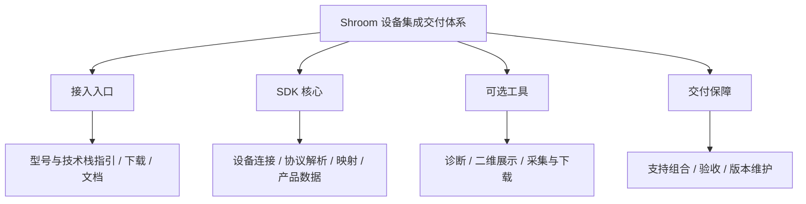
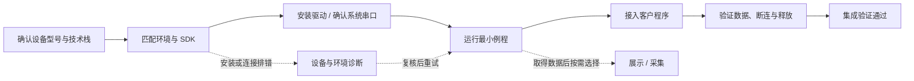
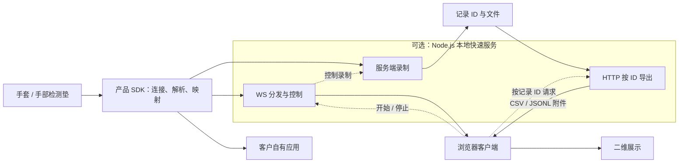

# Shroom 当前系统结构 1.4

- 文档日期：2026-10-19
- 文档版本：1.4
	- 基于 1.3 重组与优化
	- 文档版本不代表 SDK 发版
- SDK 版本：0.1.0
- 事实范围
	- 实现描述沿用 1.3 所述快照
	- 已补驱动与授权源码，真机核验仍待完成
	- 页面调整和技术契约仍需落实
- 阅读方式
	- 本文看目标、路径与结构
	- [技术契约与能力边界](C:/sdk/docs/obsidian/Shroom-技术契约与能力边界-1.4.md)看接口和数据规则
	- [交付验收与待办](C:/sdk/docs/obsidian/Shroom-交付验收与待办-1.4.md)看支持承诺、验证和执行
	- [商业收费方案草案](C:/sdk/docs/obsidian/Shroom-商业收费方案-1.4.md)看随附权益、选配服务与报价边界
	- [1.3 历史版本](C:/sdk/docs/obsidian/Shroom-当前系统结构-1.3.md)保留完整调整前记录

## 一 产品目标与范围

- 主用户
	- 已购买 Shroom 设备的客户
	- 需要将设备快速接入自有应用
- 核心价值
	- SDK 封装产品协议与点位映射
	- 客户消费可解释的结构化数据
	- 减少接入配置和排错工作
- 核心交付
	- 设备对应的 SDK 与最小例程
	- 产品数据与字段说明
	- 连接、订阅、异常与资源释放约定
- 按需扩展
	- 网页分发与二维展示
	- 服务端录制与文件下载
	- 设备诊断与新协议适配
- 责任边界
	- SDK 负责
		- 承诺组合内的数据与连接契约
		- 对应示例、说明与缺陷处理
	- 客户应用负责
		- 自身业务算法、阈值与下游系统
	- 双方共同验证
		- SDK 数据进入客户实际处理路径
		- 连接异常后按约定处理
	- 专项服务另定范围
		- 扩大的业务集成责任明确登记
		- SDK 通过与业务就绪分别结论
- 产品组成图
	- 下图表示组成关系
	- 不表示数据经过每个模块

## 二 客户接入流程

- 默认任务
	- 将已购设备接入客户程序
	- 官方示例与第一帧是检查点
	- 自有应用通过集成验证是终点
- 主流程图
	- 下图表示客户操作顺序
	- 与程序运行结构分开阅读

- 01 确认交付组合
	- 设备型号与手套左右手
	- 技术栈、系统与运行时
	- 可获得的固件信息
	- 标准支持或客户专项状态
- 02 获取与安装
	- 对应发行包与同版文档
	- 先安装对应系统的串口驱动
	- 重插设备并确认系统识别串口
	- 必要依赖与端口配置
	- 干净环境下可复现安装
- 03 跑通最小例程
	- 连接真实设备
	- 确认来源、左右手和字段含义
	- 已支持产品无需重写拆帧与映射
- 04 接入客户程序
	- 复用最小连接与订阅示例
	- 按数据字典消费产品数据
	- 客户保留自身业务处理
- 05 验证与退出
	- 区分连接状态与数据更新
	- 断连后按约定恢复或重新开始
	- 取消订阅并释放设备
	- 再次连接行为符合约定
- 可选任务
	- 诊断可在安装、连接或无数据时进入
	- 展示与采集在获取产品数据后选用
	- 不要求先写完自有应用
	- 完整七步用于展示与采集
	- 纯取数不强制网页、录制或下载
- 网站组织目标
	- `/docs/quick-start` 承载默认任务
	- 首屏按型号与技术栈进入例程
	- 通讯、渲染、采集放后续分支
	- `/docs/custom` 承载高级适配
	- AI 问答提供文档辅助
	- 目标页面是否实现另行核验

## 三 系统运行架构

- 核心模块
	- 设备接入
		- 持有串口并接收原始数据
	- 产品数据处理
		- 拆帧、解析与点位映射
		- 输出分区或矩阵产品数据
	- 数据消费
		- 客户应用直接订阅
		- 按需分发到浏览器
- 运行结构图
	- 下图以 Node.js 路线为基线
	- 实线表示数据或文件流
	- 虚线表示控制请求
	- 采集状态与文件由本地服务管理

- 三个关键边界
	- 网站入口与数据运行分开
		- 下载、教程与 AI 问答不在传感器数据链路
	- 客户程序与快速服务分开
		- 直接订阅产品数据不要求启动 WS
	- 展示与采集分开
		- 降低绘图频率不应主动减少录制帧
		- 网页关闭后服务端录制仍可继续
		- 实际持续能力按工作负载验证
- 其他接入模式
	- 浏览器直连
		- Web Serial 路线单独说明环境
		- 不能与 Node.js 同时假定持有同一串口
	- 既有主项目后端
		- 已运行后端 → `BackendSdkClient`
		- 与独立快速服务不是同一协议
- 模块释放
	- `device.close()` 释放设备
	- `stream.close()` 断开浏览器通讯
	- `view.destroy()` 释放视图
	- `server.close()` 关闭快速服务
	- 各自行为与关闭顺序须核验

## 四 当前能力与使用边界

- 状态说明
	- 以下为继承的已述能力
	- 已述能力不替代组合验收证据
	- 新规则在技术专题中标为约定或待核验
- Node.js
	- 已述产品级手套与手垫接入
	- `device.onData()` 订阅产品数据
	- 快速服务、本地录制与导出
- 浏览器
	- 产品数据处理与二维渲染
	- Web Serial 基础串口
	- `connectStream()` 连接快速服务
	- 通过服务控制采集与下载
- Python
	- 基础串口、矩阵与示例
	- 产品封装覆盖待核实
	- 无已述产品级快速服务接口
	- 不默认具备 Node.js 完整能力
- 技术栈支持原则
	- 按实际客户项目确定交付范围
	- 承诺直接接入时须覆盖产品协议与映射
	- 未验证语言或环境不直接标为支持
	- 新组合按专项评估与维护预算确认
- 数据解释边界
	- 输出 ADC 与相对归一化值
	- 未标定时不解释为 kPa 或牛顿
	- 手套 256 通道与旧 195 点统计区分
	- 手垫为 32×32 映射矩阵
	- IMU 原始字节不等于姿态结果
- 状态表达边界
	- 连接成功不代表数据更新
	- 最近有效帧仅说明结构与更新时间
	- 物理响应和业务可用性另行验证
	- 无设备时间或源序号时保留判断限制
- 当前未内置
	- 三维手模、录制回放与多设备同步
	- 自动设备型号识别与左右手判断
	- 手势识别与姿态解算
	- 付费许可校验

## 五 交付验收与下一步

- 标准 SDK 发布
	- 按共享接口与参考应用验收
	- 证据绑定发行包和支持组合
	- 不以单一客户业务进度作为发布结论
- 客户项目交付
	- 验证数据进入客户实际程序
	- 检查约定的数据与连接生命周期
	- SDK 交付和业务就绪分别结论
	- 下游算法仅在专项承诺范围内验收
- 专项需求归属
	- 通用设备能力评估进入 SDK 核心
	- 特定环境或系统对接优先独立适配
	- 客户业务规则保留在客户程序
	- 承诺前明确开发和维护投入
- 本轮先完成的记录
	- 固定一个发行包或可识别快照
	- 选择一个已承诺支持组合
	- 指定一个最小客户接入任务
	- 完成安装、数据和连接检查
	- 填写结果、证据、负责人和处理结论
	- 当前不代填实测通过结果
- 优先级
	- P0：本轮承诺路线可用且数据可解释
	- P0：异常可识别，资源可释放
	- 选配门槛：交付采集时验证起停与文件
	- P1：高频排错与集成效率改进
	- 后续：按真实需求评估扩展功能
- 核心指标
	- 整体集成完成率
	- 自助路线独立集成成功率
	- 达到可用集成的时间
	- 每项目支持与维护投入
	- 首帧和录制指标作为分项观察
- 维护方法
	- 新内容先判断所属问题
	- 用户步骤只进入客户流程
	- 模块关系只进入运行架构
	- 接口规则只进入技术专题
	- 缺口与任务只进入验收待办
	- 收费与权益只进入商业专题
	- 同一规则只保留一个维护位置

## 六 商业收费方案草案

- 方案状态
	- 商业建议，金额和条款待确认
	- 授权模型已确认，实现待对接
	- 不代表已上线价目表或付费许可
- 已确认授权模式
	- 共用同一后台与通用校验逻辑
	- 上位机与 SDK 分别签发产品密钥
	- 两类密钥默认互不通用
	- 授权是否额外收费按订单权益确定
	- 具体范围与兼容规则由商业专题维护
- 推荐模型
	- 标准 SDK 权益随设备交付
	- 接入辅导与专项集成按项目收费
	- 持续支持按约定范围计年
	- 高级软件与 OEM 验证后单独报价
	- 各项可组合，不强制逐级升级
- 核心边界
	- 原订单已包含能力不追溯收费
	- 已承诺能力与缺陷处理按原范围履行
	- 额外服务结束不使基础本地取数停机
	- 历史数据不以续费作为读取条件
	- 未内置功能不作为现货套餐
- 产品接入
	- 购后入口展示随附与选配内容
	- 服务报价绑定项目与验收范围
	- 商业管理不进入基础实时数据路径
- 专题入口
	- [商业收费方案 1.4](C:/sdk/docs/obsidian/Shroom-商业收费方案-1.4.md)

## 驱动与SDK许可补充

- 串口驱动是实机接入前置
	- [Windows EXE](https://shroom.jq-industries.com/drive/CH341SER.EXE)
	- [macOS ZIP](https://shroom.jq-industries.com/drive/CH34xVCPDriver.zip)
	- CH34x设备没有可用驱动就读不到串口
	- 安装后重插并重启采集应用，再查端口
- SDK许可不限制传感器型号
	- 同一SDK许可使用产品与通用串口
	- 保留产品密钥、期限与电脑名额
	- 协议适配能力仍以当前API为准
- [驱动安装指南](C:/sdk/sdk/docs/DRIVERS.md)
