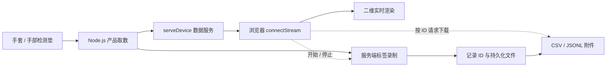

# Shroom 当前系统结构

## 文档范围

- 项目：`C:\sdk`
- 日期：2026-10-19
- SDK 版本：0.1.0
- 范围：当前工作区

	- 包含未提交变更
	- 不代表线上部署状态
- 组织原则

	- 现有产品走快速接入
	- 新设备走基础自定义
	- 采集包含开始与停止
	- 下载独立按记录 ID

## 系统组成

- 开发者网站
	- SDK 与上位机下载
	- 快速与基础文档
	- SDK Skill 与知识问答
	- 不代替本地采集服务
- SDK 源码
	- Node.js 产品接入
	- 浏览器通讯与渲染
	- Python 基础串口
	- 共享解析与数据结构
- Node.js 数据服务
	- 本机串口取数
	- WS 广播数据
	- 服务端标签录制
	- 按记录 ID 导出
- 示例网页
	- 连接数据服务
	- 展示实时数据
	- 控制采集起停
	- 查询记录与下载

## 快速接入主链路

- 完整顺序
	- 连接产品 → Node.js 取数 → 指定端口启动 WS → 前端连接 → 实时渲染 → 数据采集（开始 / 停止）→ 按 ID 下载
- 后端准备
	- 01 连接产品
		- 手套：`Shroom.connectGlove()`
		- 手垫：`Shroom.connectHandPad()`
		- 手套明确选择左右手
		- 串口按实际端口选择
	- 02 Node.js 取数
		- 内置产品协议与映射
		- `device.onData()` 订阅
		- 直接输出产品数据
	- 03 启动 WS
		- `Shroom.serveDevice()`
		- 默认数据端口：19999
		- 同端口提供 HTTP 下载
- 前端展示
	- 04 连接前端
		- `Shroom.connectStream()`
		- 本机填写 WS 端口
	- 05 实时渲染
		- `Shroom.createProductView()`
		- 自动订阅产品数据
		- 手套二维分区图
		- 手垫矩阵热力图
- 数据采集
	- 06 同一分类管理起停
		- 输入本次标签
		- `stream.startRecording()`
		- `stream.stopRecording()`
		- 停止等待文件写完
		- 检查状态与帧数
		- 一次会话一个标签
- 数据下载
	- 07 独立下载操作
		- `stream.listRecordings()`
		- 选择对应采集记录
		- `stream.downloadRecording(recordingId)`
		- ID 来自会话或历史记录
		- 不默认下载最近一条
		- 不使用标签或端口代替 ID
		- CSV 或 JSONL

## 运行数据关系

- 展示与录制并行
	- 降低绘图帧率不减少录制帧
	- 关闭网页不等于停止录制
	- 重连可查询服务端状态
- 资源分别释放
	- `view.destroy()` 释放画面
	- `stream.close()` 断开前端
	- `server.close()` 关闭服务
	- `device.close()` 关闭设备
- 端口各有用途
	- 5178：默认示例网页端口
	- 19999：默认数据与下载端口
	- 端口占用时按实际配置
	- 默认只允许本机访问
	- 跨机另配地址与允许来源

## 文档页面结构

- 文档中心 `/docs`
	- 快速接入文档
		- `/docs/quick-start`
		- 顶部突出完整 7 步
		- 流程目录全部展开
		- 1 先跑通完整示例
		- 2 一键连接真实产品
		- 3 前端接入与渲染
		- 4 数据采集
			- 输入标签并开始
			- 停止并检查结果
		- 5 按记录 ID 下载
		- 6 地址安全与排错
		- 下方跳转基础文档
	- 基础文档
		- `/docs/custom`
		- 新设备与自定义路线
		- 后端 `/docs/backend`
			- 下拉切换 Node.js / Python
			- 串口查询与配置
			- 拆帧解析与诊断
			- 通讯接口
			- 存储基础
		- 前端
			- 通讯 `/docs/frontend-communication`
			- 渲染 `/docs/rendering`
		- 辅助指南
			- SDK Skill `/docs/ai-context`
			- AI 开发 `/docs/ai-guide`
			- 完整说明 `/docs/readme`
	- 兼容参考入口
		- `/docs/node`
		- `/docs/python`
		- `/docs/serial`
		- `/docs/storage`
		- `/docs/backend-api`
		- 入口保留但不全部平铺

## SDK 功能分层

- 使用入口
	- Node.js 使用专用入口
		- `shroom-sdk/node`
		- [Node.js 源码](C:/sdk/sdk/node/index.js)
	- 浏览器使用 Web 入口
		- 包根入口默认指向浏览器
		- [浏览器源码](C:/sdk/sdk/web/index.js)
	- Python 使用 `shroom_sdk`
	- 当前以本地 ZIP 交付
		- 未发布公共 npm / PyPI 包
- 产品层
	- Node.js 与浏览器
		- 整包手套 `handGloveFullPacket`
		- 手部检测垫 `hand`
		- `connectProduct()` 统一入口
	- 高层封装
		- 产品波特率
		- 拆帧与协议
		- 点位映射
		- 命名分区数据
- 基础串口层
	- Node.js：`serialport`
	- 浏览器：Web Serial
	- Python：pySerial
	- 查询、配置、连接、读取、关闭
	- 结构化错误与诊断
- 数据处理层
	- 拆帧与帧长管理
	- 标准 `Frame`
	- 线序与矩阵映射
	- 归一化与基础统计
	- `shroom.frame.v1` 网络编码
- 通讯层
	- 独立快速服务
		- `serveDevice()` 启动服务
		- `connectStream()` 接收数据
		- 录制控制与文件下载
		- WS：`recording.*` 控制
		- HTTP：`/health` 状态
		- HTTP：`/recordings/{uuid}.csv`
		- HTTP：`/recordings/{uuid}.jsonl`
	- 既有后端客户端
		- `BackendSdkClient`
		- HTTP 查询与设备控制
		- WS 订阅原始 JSON
		- 连接已运行的主项目后端
		- 不启动后端服务
		- 与快速服务不是同一协议
		- 使用命名导出而非 `Shroom.BackendSdkClient`
- 渲染层
	- 产品视图 `createProductView()`
	- 通用矩阵 `createHeatmap()`
	- Node.js 终端热力图
	- Python 文字与绘图示例
- 采集与导出层
	- Node.js 本地持久化
	- 会话 ID、标签与时间
	- JSONL 原始记录
	- CSV 流式导出
	- 重启恢复记录列表
	- 异常中断保留状态

## 产品数据结构

- 整包触觉手套
	- 明确 `side` 左右手
	- 原始压力：256 通道
	- 五指 `fingers`
		- `thumb` 大拇指
		- `index` 食指
		- `middle` 中指
		- `ring` 无名指
		- `little` 小拇指
		- 每指主体 4×3
		- 每指独立 `pulp` 指腹
	- 手掌 `palm`
		- 共 72 点
		- 行长度保留 12、15、15、15、15
	- 分区值
		- `raw` 原始 ADC
		- `matrix` 分区矩阵
		- `values` 归一化值
	- 兼容字段
		- 旧 195 点展示矩阵
		- 顶层统计仍按旧矩阵
		- 不能等同新分区整体统计
	- IMU 保留原始字节
- 手部检测垫
	- 原始压力：1024 通道
	- 映射矩阵：32×32
	- 归一化与基础统计
- 录制记录
	- `id` 采集记录标识
	- `label` 人工标签
	- `status` 会话状态
	- `frameCount` 已保存帧数
	- `source` 真实或模拟来源
	- `error` 异常信息

## 页面与工具

- 首页 `/`
	- 产品与能力
	- SDK Skill
	- Python / Node.js 下载
	- Windows / macOS / Linux 上位机
	- 快速开始与开发工具
- 共享网站外框
	- 顶栏、左侧导航、正文、页脚
	- 文档导航统一左置
	- 窄屏折叠菜单
- 独立静态工具
	- `/quick-start.html`
		- WS 快速接入示例
		- 数据采集与独立下载
	- `/lab.html`
		- 浏览器直连串口测试
		- 不要求 Node.js 数据服务
	- 下载包中的示例
		- `http://localhost:5178/web/quick-start.html`
- AI 问答 `/knowledge`
	- 智谱知识检索与流式回答
	- 需要服务端密钥配置
	- 不属于传感器数据链路
	- 本地文档不会自动上传知识库

## 源码目录结构

- `C:\sdk\app`
	- `page.tsx` 开发首页
	- `SiteShell.tsx` 共享布局
	- `docs` 文档页面与目录
	- `knowledge` 知识问答页面
- `C:\sdk\sdk`
	- `core` 解析、映射、产品帧
	- `node` 串口、WS 服务、录制
	- `web` 串口、WS 客户端、绘图
	- `backend` 既有后端客户端
	- `python` Python 基础包
	- `docs` SDK 文档事实源
	- `tests` JavaScript 回归
- `C:\sdk\scripts`
	- `build-sdk-bundle.mjs` 浏览器单文件
	- `pack-sdk.mjs` ZIP 打包
	- `build-docs.mjs` 文档预渲染
- `C:\sdk\public`
	- 浏览器示例与测试台
	- Node.js SDK ZIP
	- Python SDK ZIP
	- 兼容完整 SDK ZIP
- `C:\sdk\server`
	- 智谱检索代理
	- 文档与问答回归
- `C:\sdk\docs\obsidian`
	- 系统结构分层笔记
- `C:\sdk\ARCHITECTURE.md`
	- 详细架构与历史变更

## 当前能力边界

- 完整快速链路
	- 当前支持 Node.js 与浏览器
	- Python 仅基础串口与矩阵能力
	- Python 无产品级快速服务接口
- 产品支持
	- 仅已核实的手套与手垫协议
	- 不自动识别设备型号
	- 不自动判断左右手
- 采集与下载
	- 人工标签不是动作识别
	- 文件存储不是通用数据库
	- 未内置录制回放
	- 未内置多设备同步
- 数据含义
	- ADC 与相对归一化值
	- 不直接提供 kPa 或牛顿
	- 不提供手势与姿态解算
- 渲染范围
	- 当前是二维热力图
	- 未提供三维手模渲染
- 商业与安全
	- 未实现付费许可校验
	- 下载登记不等于授权
	- 公网部署另配认证与 TLS
